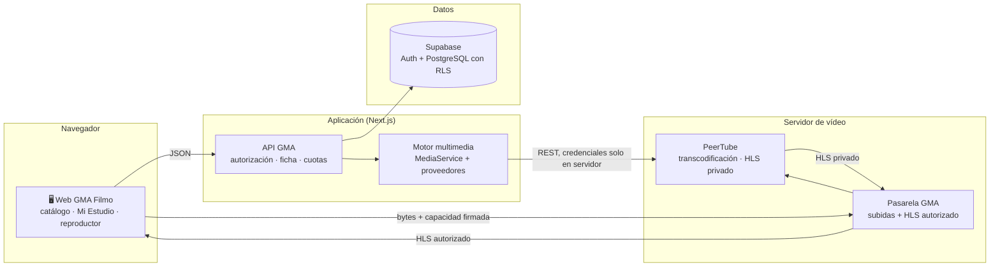
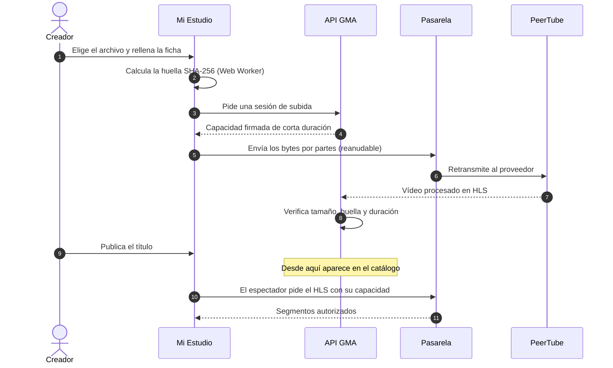
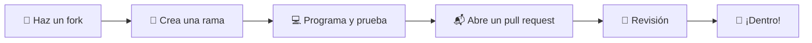

<div align="center">


# GMA Filmo

### *el cine es nuestro*

**Plataforma de streaming libre y de código abierto para el cine independiente:**
**cortometrajes, películas y series de creadores que suben, publican y comparten su obra.**

<br />

[](./LICENSE)
[](./CONTRIBUTING.md)
[](#)

[](https://nextjs.org)
[](https://react.dev)
[](https://www.typescriptlang.org)
[](https://tailwindcss.com)
[](https://supabase.com)
[](https://joinpeertube.org)
[](https://playwright.dev)

[**Qué es**](#-qué-es-gma-filmo) ·
[**Funciones**](#-funciones) ·
[**Arquitectura**](#-arquitectura) ·
[**Empezar**](#-empezar-en-local) ·
[**Contribuir**](#-cómo-contribuir) ·
[**Hoja de ruta**](#-hoja-de-ruta)

</div>

---

## 🎬 Qué es GMA Filmo

GMA Filmo nace de la comunidad **[Generación Maldita](https://generacionmaldita.com)** con una idea sencilla: que el cine hecho fuera de los grandes estudios tenga una casa propia, cuidada y abierta.

Es una plataforma de streaming completa (catálogo, reproductor, perfiles, valoraciones, comunidad) en la que **los propios creadores suben y publican su obra** desde un estudio integrado. Y es **open source**: cualquiera puede leer el código, ejecutarlo, mejorarlo o usarlo como base para su propia plataforma.

<table>
<tr>
<td width="33%" valign="top">

**🍿 Para el público**<br />
Un catálogo navegable como el de cualquier gran plataforma, con perfiles, lista personal, «seguir viendo», valoraciones y comentarios.

</td>
<td width="33%" valign="top">

**🎥 Para quien crea**<br />
Un perfil público de creador, enlaces sociales, opción de recibir apoyo y **Mi Estudio** para subir películas, tráileres, subtítulos y extras.

</td>
<td width="33%" valign="top">

**🛠️ Para quien programa**<br />
Un proyecto real en Next.js + Supabase con un motor multimedia propio, neutral respecto al proveedor de vídeo y cubierto por pruebas.

</td>
</tr>
</table>

---

## ✨ Funciones

<details open>
<summary><b>Ver y descubrir</b></summary>

<br />

| | Función | Qué hace |
|---|---|---|
| 🏠 | **Inicio** | Cabecera ambiental con tráiler, carruseles por colección, Top 10 y recomendaciones por perfil |
| 🎞️ | **Catálogo** | Cortos, películas y series, con colecciones y filtros por género |
| 🔎 | **Buscador** | Búsqueda por título y por autor en todo el catálogo |
| 📄 | **Ficha del título** | Sinopsis, créditos, extras, títulos relacionados, valoraciones y comentarios |
| ▶️ | **Reproductor** | Pantalla completa con HLS (nativo o `hls.js`), subtítulos y progreso guardado por perfil; también reproduce el contenido histórico en MP4 y YouTube |

</details>

<details open>
<summary><b>Comunidad y cuenta</b></summary>

<br />

| | Función | Qué hace |
|---|---|---|
| 👥 | **Perfiles** | Varios perfiles por cuenta, con avatar propio, modo infantil y bloqueo por PIN |
| 📌 | **Mi Espacio** | Lista personal, historial y «seguir viendo» |
| ⭐ | **Valoraciones** | Puntuación por estrellas y nota media pública por título |
| 💬 | **Comentarios** | Respuestas, «me gusta», orden, comentarios en un momento concreto del vídeo y reporte de contenido |
| ✍️ | **Propuestas de sinopsis** | La comunidad puede sugerir mejoras a las fichas |
| 🔐 | **Acceso** | Email y contraseña o Google (Supabase Auth), y navegación como invitado |

</details>

<details open>
<summary><b>Para creadores</b></summary>

<br />

| | Función | Qué hace |
|---|---|---|
| 🧑‍🎨 | **Perfil de creador** | Página pública con filmografía, biografía y redes sociales |
| 💛 | **Apoyar al creador** | Página de apoyo directo a cada creador |
| 🎛️ | **Mi Estudio** | Asistente de subida con ficha completa: película, tráiler, póster, subtítulos y extras |
| ⏯️ | **Subidas reanudables** | Si se corta la conexión, la subida continúa donde se quedó; cada archivo se verifica por tamaño y huella SHA-256 |

</details>

---

## 🧭 Arquitectura

GMA Filmo separa con claridad **quién decide** (la aplicación y la base de datos) de **quién mueve los bytes** (el proveedor de vídeo y una pasarela propia). Así, las películas nunca pasan por el servidor web y el proveedor de vídeo se puede cambiar sin tocar la interfaz.



**Principios del diseño**

- 🧱 **Proveedor neutral.** `lib/media/` define un contrato `MediaProvider` con varias implementaciones: `peertube` (producción), `mock` (desarrollo local, sin dependencias externas), y `r2` / `stream` para compatibilidad con contenido anterior.
- 🔏 **Capacidades firmadas.** El navegador nunca recibe credenciales del proveedor: recibe una autorización corta firmada con Ed25519 que solo vale para una sesión, un archivo y una operación.
- 🔒 **Vídeo privado por defecto.** Los vídeos se guardan como privados en PeerTube y GMA decide quién los ve. El P2P está desactivado.
- 🧯 **Migraciones solo aditivas.** Nada se borra ni se renombra; el contenido histórico sigue reproduciéndose aunque el motor nuevo esté apagado.
- 🚦 **Todo detrás de interruptores.** El motor se enciende y apaga con variables de entorno (`UPLOAD_ENGINE_V2`, `NEXT_PUBLIC_UPLOAD_ENGINE_V2`, `UPLOADS_PAUSED`…).

<details>
<summary><b>Así viaja una película desde Mi Estudio hasta el reproductor</b></summary>

<br />



</details>

---

## 🧰 Tecnologías

| Capa | Tecnología |
|---|---|
| **Framework** | [Next.js 14](https://nextjs.org) (App Router) · React 18 · TypeScript |
| **Interfaz** | Tailwind CSS 4 · shadcn/ui · Radix · Motion · Iconoir |
| **Estado y validación** | Zustand · Zod |
| **Cuentas y datos** | [Supabase](https://supabase.com): Auth + PostgreSQL con Row Level Security |
| **Vídeo** | [PeerTube](https://joinpeertube.org) (privado, HLS) · `hls.js` · pasarela propia en Node |
| **Subidas** | Hash SHA-256 en Web Worker (`hash-wasm`) · transportes uploadx, tus y multipart |
| **Imágenes y auxiliares** | `sharp` · Cloudflare R2 |
| **Pruebas** | Playwright (e2e, responsive, estudio) · `node:test` con `tsx` · PGlite |
| **Despliegue** | Vercel (web) · servidor propio con PeerTube y la pasarela |

---

## 🚀 Empezar en local

### Requisitos

- **Node.js 20** o superior y npm
- Un proyecto de [Supabase](https://supabase.com) (gratuito sirve para desarrollar)
- *Opcional:* Docker y la CLI de Supabase si quieres levantar el entorno multimedia completamente local

### En cuatro pasos

```bash
# 1. Clona el repositorio
git clone https://github.com/gfromtheD/gma-filmo.git
cd gma-filmo

# 2. Instala las dependencias
npm install

# 3. Crea tu archivo de entorno a partir de la plantilla
cp .env.uploads.example .env.local
#    y rellena al menos NEXT_PUBLIC_SUPABASE_URL y NEXT_PUBLIC_SUPABASE_ANON_KEY

# 4. Arranca el servidor de desarrollo
npm run dev
```

Abre **<http://localhost:3000>** y listo. Con el motor apagado (valor por defecto) tendrás el catálogo, el reproductor y toda la parte social funcionando.

<details>
<summary><b>🗄️ Base de datos</b></summary>

<br />

El esquema completo vive en [`supabase/migrations/`](./supabase/migrations). Ejecuta cada archivo en el **editor SQL de Supabase** en orden de fecha (el prefijo del nombre), empezando por `comments_system.sql` y `dm_system.sql`, que no llevan fecha. Las migraciones son aditivas e idempotentes: ninguna borra datos y se pueden repetir sin riesgo.

</details>

<details>
<summary><b>🎛️ Probar Mi Estudio y el motor multimedia sin servidores externos</b></summary>

<br />

El motor incluye un proveedor **Mock** que transfiere bytes reales por HTTP, verifica la huella y entrega un HLS de prueba. No necesitas PeerTube ni cuentas en la nube.

```bash
npm run media:local-keys      # genera las claves Ed25519 locales
npm run media:fixtures        # crea los vídeos de prueba
npm run media:local:prepare   # prepara Supabase local aislado (Docker)
npm run media:local:start     # levanta web, pasarela y base de datos
```

La plantilla [`.env.media.example`](./.env.media.example) contiene la configuración local segura. Más detalle en [`infrastructure/media-local/README.md`](./infrastructure/media-local/README.md).

</details>

<details>
<summary><b>🔧 Variables de entorno principales</b></summary>

<br />

| Variable | Para qué sirve |
|---|---|
| `NEXT_PUBLIC_SUPABASE_URL` · `NEXT_PUBLIC_SUPABASE_ANON_KEY` | Conexión pública a Supabase (protegida por RLS) |
| `SUPABASE_URL` · `SUPABASE_SERVICE_ROLE_KEY` · `SUPABASE_DB_URL` | Acceso de servidor. **Nunca** con prefijo `NEXT_PUBLIC_` |
| `UPLOAD_ENGINE_V2` · `NEXT_PUBLIC_UPLOAD_ENGINE_V2` | Enciende el motor multimedia nuevo |
| `UPLOADS_PAUSED` | Pausa las subidas nuevas sin afectar a la reproducción |
| `MEDIA_VIDEO_PROVIDER` · `MEDIA_AUXILIARY_PROVIDER` | Proveedor de vídeo y de archivos auxiliares (`mock`, `peertube`, `r2`) |
| `MEDIA_GATEWAY_URL` | Dirección de la pasarela de medios |
| `MEDIA_CAPABILITY_*` | Claves Ed25519 para firmar las autorizaciones |
| `PEERTUBE_*` | Conexión a la instancia de PeerTube (solo servidor) |

Las plantillas completas están en [`.env.uploads.example`](./.env.uploads.example), [`.env.media.example`](./.env.media.example) e [`infrastructure/peertube/env.example`](./infrastructure/peertube/env.example). Ninguna contiene secretos reales: no subas nunca los tuyos.

</details>

---

## 🧪 Pruebas

```bash
npm run lint                       # análisis estático
npm run test:e2e                   # recorrido de la web con Playwright
npm run test:responsive            # matriz de móviles, tabletas y escritorio
npm run test:media:unit            # contratos, estados, cuotas e idempotencia del motor
npm run test:media:integration     # ciclo de vida, recuperación y publicación
npm run test:media:studio          # lógica de Mi Estudio
npm run test:uploads               # motor de subidas
```

> [!TIP]
> Los comandos `media:*` y `test:media:*` del [`package.json`](./package.json) cubren el resto: contrato con PeerTube, concurrencia en PostgreSQL, pruebas en vivo del entorno local y operaciones.

---

## 🗂️ Estructura del proyecto

```text
gma-filmo/
├── app/                    Rutas de Next.js (App Router)
│   ├── (platform)/         inicio, cortos, películas, series, buscador, creadores
│   │   └── (protected)/    mi-espacio, mi-estudio, mi-perfil, configuración
│   ├── ver/[id]/           reproductor
│   └── api/                API: títulos, subidas, medios, comentarios, valoraciones…
├── components/
│   ├── features/           componentes por función (studio, player, comments…)
│   └── ui/                 componentes base (shadcn/ui)
├── lib/
│   ├── media/              motor multimedia: servicio, proveedores, pasarela, transportes
│   ├── studio-media/       adaptador entre Mi Estudio y el motor
│   ├── uploads/            motor de subidas y compatibilidad con R2
│   └── supabase/           clientes y consultas
├── supabase/migrations/    esquema de la base de datos
├── infrastructure/         plantillas de PeerTube, entorno local y worker de vídeo
├── scripts/                utilidades operativas del motor y las subidas
├── tests/ · e2e/           pruebas unitarias, de integración y end-to-end
└── docs/                   decisiones de arquitectura, planes y runbooks
```

---

## 🛡️ Seguridad

- **Row Level Security** en todas las tablas: el contenido es de lectura pública y los datos personales solo los ve su dueño.
- **Cabeceras HTTP** estrictas (CSP, HSTS, X-Frame-Options, Referrer-Policy, Permissions-Policy) en [`next.config.mjs`](./next.config.mjs).
- **Validación con Zod** y límite de peticiones en las rutas de la API.
- **Credenciales del proveedor de vídeo solo en el servidor**; el navegador trabaja con autorizaciones firmadas de corta duración.
- **Vídeos privados** en PeerTube y **P2P desactivado**: GMA controla siempre quién reproduce qué.

¿Has encontrado una vulnerabilidad? Por favor, **no abras un issue público**: escribe de forma privada a quien mantiene el proyecto desde [GitHub](https://github.com/gfromtheD).

---

## 🤝 Cómo contribuir

GMA Filmo es de todos los que quieran construirlo. Toda ayuda suma: código, diseño, pruebas, traducciones, documentación o simplemente reportar un fallo.



1. **Busca o abre un issue** para contar qué quieres hacer, sobre todo si es un cambio grande.
2. **Crea una rama** desde `main` con un nombre claro (`feat/subtitulos-srt`, `fix/reproductor-safari`).
3. **Haz commits pequeños** siguiendo [Conventional Commits](https://www.conventionalcommits.org/es/) (`feat:`, `fix:`, `docs:`, `test:`…).
4. **Ejecuta `npm run lint`** y las pruebas de la parte que hayas tocado.
5. **Abre el pull request** explicando qué cambia y cómo probarlo, con capturas si afecta a la interfaz.

Lee la guía completa en **[CONTRIBUTING.md](./CONTRIBUTING.md)**.

---

## 🗺️ Hoja de ruta

- [x] Catálogo, reproductor, perfiles, Mi Espacio y valoraciones
- [x] Comentarios con respuestas, «me gusta» y reportes
- [x] Perfiles de creador y página de apoyo
- [x] Mi Estudio con ficha completa y extras
- [x] Motor multimedia neutral con proveedor PeerTube y pasarela propia
- [ ] Activar las subidas con el motor nuevo para todos los creadores
- [ ] Dominio propio para la web y el servidor de vídeo
- [ ] Panel de moderación y administración de contenido
- [ ] Tipos de Supabase generados automáticamente
- [ ] CSP con *nonces* y límite de peticiones distribuido
- [ ] Traducción de la interfaz a otros idiomas

¿Echas algo en falta? [Propónlo en un issue](https://github.com/gfromtheD/gma-filmo/issues).

---

## 📚 Documentación

| Documento | Contenido |
|---|---|
| [Plan maestro del motor multimedia](./docs/PLAN-MAESTRO-MOTOR-MEDIA-GMA-FILMO.md) | Decisiones, contratos y máquina de estados del motor |
| [Runbook del motor](./docs/media/RUNBOOK.md) | Operación diaria, incidentes y marcha atrás |
| [PeerTube](./infrastructure/peertube/README.md) | Cómo se integra PeerTube y qué queda en el servidor |
| [Entorno local](./infrastructure/media-local/README.md) | Stack multimedia aislado para desarrollar |
| [Decisiones de arquitectura](./docs/adr) | ADR del proyecto |

---

## 📄 Licencia

Publicado bajo la **[licencia MIT](./LICENSE)**. Puedes usar, copiar, modificar y distribuir el código libremente, también con fines comerciales, siempre que conserves el aviso de copyright.

> [!NOTE]
> La licencia cubre el **código**. Las películas, imágenes y textos de los creadores pertenecen a sus autores y no se distribuyen con este repositorio.

<div align="center">

<br />

Hecho con ❤️ por la comunidad de **[Generación Maldita](https://generacionmaldita.com)**

**[⬆ Volver arriba](#gma-filmo)**

</div>
