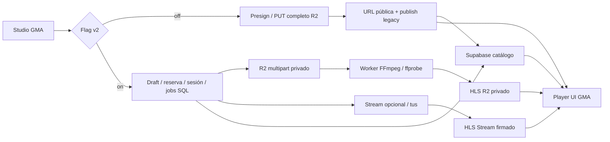
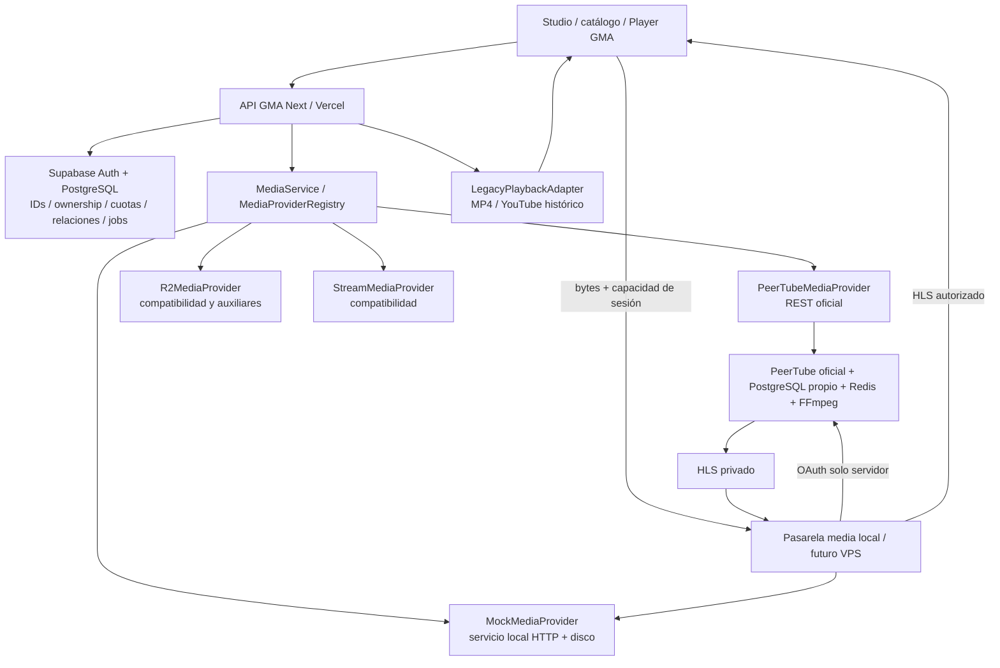
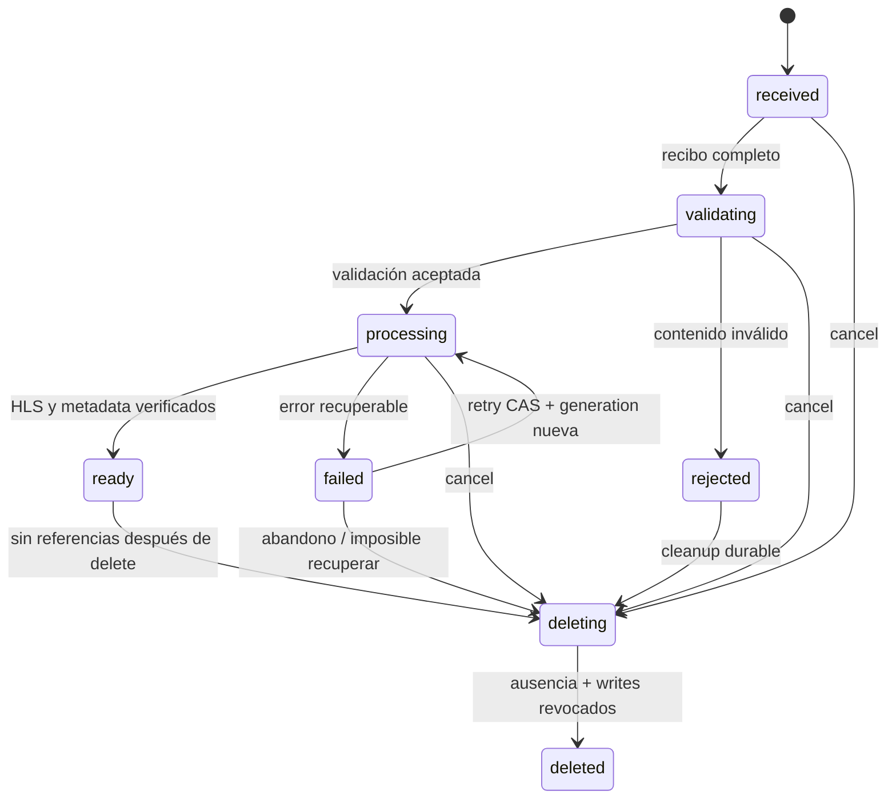
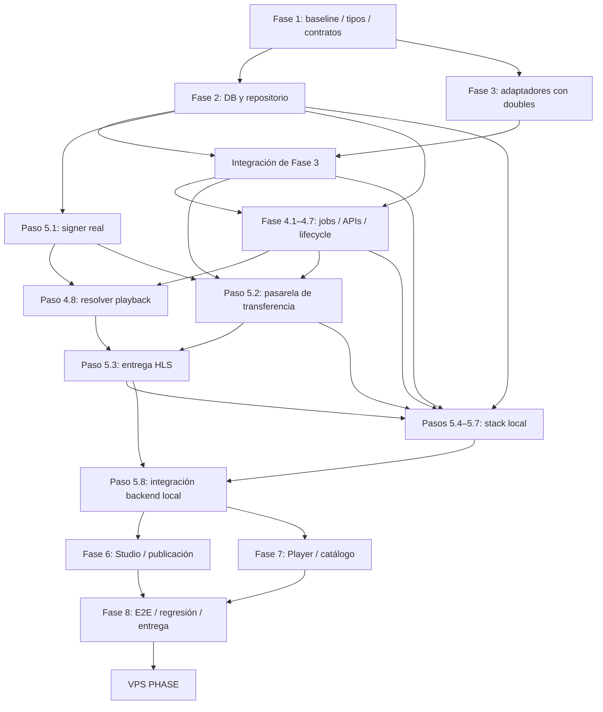

# PLAN MAESTRO DEL MOTOR MEDIA — GMA-FILMO

**Versión 1.0 · 7 de octubre de 2026 · Estado: especificación auditada, implementación pendiente.**

Este documento es la especificación de ejecución de la siguiente iteración. No certifica producción ni modifica el motor. Ante una petición «Ejecuta la fase X», implementar exclusivamente esa fase y sus dependencias pendientes, siguiendo los contratos aquí fijados. No sustituir decisiones por diseños de documentos anteriores. Registrar cualquier diferencia nueva del repositorio antes de actuar.

**80 pasos de implementación: 64 locales, en fases 1–8; 16 posteriores, en VPS PHASE.** La primera prueba local completa termina en el paso 8.8. P2P tiene un bloqueo de seguridad explícito y no forma parte de la aceptación local ni del primer servicio VPS.

## 1. Resumen ejecutivo y decisiones

1. Conservar Next, React, Supabase Auth, PostgreSQL, catálogo, navegación y apariencia de Studio/Player. El motor audiovisual es una frontera interna de GMA.
2. **Reutilizar `gma_media_assets`, no crear otra tabla `media_assets`.** Ya existen identidad UUID, propietario, rol, referencia externa, metadatos, sesiones, relaciones y contabilidad transaccional.
3. Conservar las máquinas separadas de borrador, transferencia, activo y job. Añadir `failed` recuperable al activo; no hacer un único estado que mezcle publicación con subida.
4. Crear `lib/media/` como frontera neutral. `UploadService` coordina negocio y SQL; `MediaProvider` integra cada proveedor; el navegador selecciona un transporte por protocolo, nunca por marca.
5. Proveedores persistidos: `r2`, `stream`, `mock`, `peertube`. Mantener `provider_ref` como referencia externa. Legacy MP4/YouTube se resuelve con un adaptador de lectura del título; no fabricar assets verificados para contenido histórico.
6. Las altas nuevas usarán `mock` en local y, después del piloto, `peertube`. Mantener R2 multipart/FFmpeg/HLS ya implementado como compatibilidad operativa y Stream como lectura/recuperación de activos existentes. R2 puede seguir almacenando auxiliares, detrás del adaptador.
7. Mock debe transferir bytes por HTTP real, persistir progreso, verificar tamaño/SHA y entregar HLS válido de una fixture. La transcodificación se simula; **el vídeo reproducido es la fixture, no una transcodificación del archivo arbitrario seleccionado**. La UI local lo indicará.
8. Player: mantener el mismo `HTMLVideoElement` y controles; HLS nativo si está disponible, `hls.js` en el resto, MP4/YouTube legacy. No usar la interfaz ni el iframe de PeerTube como reproductor principal.
9. PeerTube oficial, inicialmente v8.3.1 como referencia verificada: upload reanudable **uploadx/Content-Range, no tus**. OAuth técnico únicamente en servidor. Una pasarela de medios en el VPS retransmite bytes y autoriza reproducción; no pasan películas por Vercel.
10. PeerTube técnico privado; publicación visible en GMA, sin convertir automáticamente el vídeo en público en PeerTube. HLS autorizado por capacidades GMA. P2P apagado inicialmente: el tracker oficial no aporta por sí solo el control de permisos de GMA.
11. Migraciones aditivas, sin borrar/renombrar `r2_video_url`, `stream_uid`, relaciones históricas ni objetos R2. Rollback de aplicación compatible con esquema nuevo, nunca down migration destructiva.
12. No prometer capacidad: 1.000 usuarios recurrentes y 100 espectadores simultáneos son objetivos. Certificar con carga real escalonada 10/25/50/100/150/200 al disponer de infraestructura.

Estas decisiones afectan contratos duraderos y deben mantenerse entre fases. Ninguna exige ahora una migración irreversible de contenido. La eliminación de originales históricos, apertura de privacidad o activación P2P requieren su propio gate descrito más adelante.

## 2. Estado real, fuentes y alcance de la auditoría

### 2.1 Snapshot reproducible

| Elemento | Resultado observado |
|---|---|
| Clon inspeccionado | `/Users/aseidkonna/Documents/Codex/Proyectos/gma-filmo` |
| Repositorio GitHub | [gfromtheD/gma-filmo](https://github.com/gfromtheD/gma-filmo) |
| Rama local | `feature/upload-engine-v2` |
| HEAD local | `c5b3483b137624c96f389e487bb7c4d33897f41a` |
| Remoto actual, comprobado con GitHub y `ls-remote` | `main`, `41494c6289e3c60af9ef94a65875cadcac6508b8` |
| Relación HEAD/remoto | 23 commits locales por delante; 0 commits remotos exclusivos |
| Diferencia acumulada con remoto | 158 archivos; 14.009 líneas añadidas, 2.520 eliminadas; incluye cambios de producto anteriores ajenos a este plan |
| Working tree inicial | `M lib/uploads/repository.ts`; `?? supabase/migrations/20261007_r2_capacity.sql` |
| Rama v2 remota | No publicada entre las ramas remotas visibles; GitHub muestra `main` |
| Producción efectiva | No certificada en esta misión: GitHub no demuestra qué release sirve Vercel ni qué migraciones tiene Supabase |

No hacer reset, checkout forzado, stash automático ni sobrescribir esos dos cambios. La modificación de `repository.ts` añade batch de assets y autorización de outputs; depende de la migración 20261007 sin confirmar. El plan se basa en **HEAD + ese working tree**, no únicamente en HEAD.

Historia relevante local: `93fbea0` auditoría; `2ce609d` Stream/tus + R2 auxiliares; `979d720` R2 multipart + FFmpeg/HLS; `c5b3483` validación/rollback. El objetivo de este documento sustituye la obligatoriedad de R2-first y de Stream; conserva sus invariantes útiles.

### 2.2 Fuentes revisadas y prioridad

Se inspeccionaron el árbol de archivos, módulos multimedia, APIs, tipos, configuración, migraciones y pruebas; se contrastó GitHub con el clon. Se leyeron `INFORME-MOTOR-SUBIDAS.md`, `IMPLEMENTACION-MOTOR-SUBIDAS.md`, `RESULTADOS-PRUEBAS-MOTOR.md`, el prompt de referencia y, especialmente, `ARQUITECTURA-R2-FIRST.md` y `PRUEBAS-R2-FIRST.md`, todos en `docs/investigacion-subidas/`.

Chats relevantes recuperados mediante la aplicación: «Comparar VPS R2 Stream», «Resumen del proyecto», «Petición de investigación profunda», «stack gma / ambivio», «Recap GMA en GPT» y «Preparar repo gma-filmo para Codex». Sus propuestas son contexto, no prueba de implementación. Las consultas revisadas no presentan páginas adicionales pendientes; no se afirma haber leído conversaciones que no estén expuestas por las herramientas.

Autoridad: código activo en el snapshot → SQL desplegable → tests → documentos recientes → antiguos → chats. Las banderas determinan qué rama de código se ejecuta. No se ha accedido a datos/secretos de producción ni aplicado SQL remoto.

### 2.3 Tecnología y dependencias

Next `^14.2.35`, React `^18.3.1`, TypeScript con `strict` y `noUncheckedIndexedAccess`, Tailwind 4, Zustand, Zod 4, Supabase SSR/JS, AWS S3 SDK, `hls.js ^1.7.3`, `tus-js-client ^4.3.1`, `hash-wasm`, Sharp. Tests con Node/tsx, PGlite, PostgreSQL real y Playwright. FFmpeg/ffprobe son binarios externos; no deben ejecutarse en funciones Vercel.

Versiones instaladas verificadas: Next 14.2.35, React 18.3.1, hls.js 1.7.3, TypeScript 5.9.3, Supabase JS 2.106.1 y Playwright 1.60.0. Inventario local de env por nombres, sin valores: `.env.local` solo contiene `VERCEL_OIDC_TOKEN`; `.env.uploads.example` contiene los nombres del motor, flags false y campos operativos vacíos. No hay credenciales locales Supabase/R2/PeerTube utilizables aportadas por esos archivos. No se deduce configuración efectiva de Vercel del ejemplo.

El shell de esta sesión no tiene `node`/`npm` en PATH; se usó Node incluido en el entorno. Esto es un detalle del entorno, no un fallo del proyecto. En los comandos de ejecución de este plan se supone Node/npm disponibles; no codificar rutas de este Mac en el producto.

### 2.4 Diagnóstico ejecutado en esta misión

| Check | Resultado y límite |
|---|---|
| `test:uploads` | 26/26 pasan; dominio SQL y proveedores simulados |
| `test:uploads:r2` | 23/23 pasan; R2/pipeline simulado |
| TypeScript sin escritura incremental | Pasa: `tsc --noEmit --incremental false` |
| Migración 20261007 sobre fixture PGlite 05+06 | Se aplica sin error; no prueba Supabase remoto |
| Prueba diagnóstica de observación tardía | Confirma que SQL permite actualmente `ready → processing` por `observe`; corregir |
| Inventario Playwright | 4 uploads, 26 responsive, 7 support, 16 secondary; listado, no ejecución completa de navegador en esta misión |
| Render/lógica secundaria | 14/14 pasan en configuración temporal sin webServer; Studio/estadísticas/créditos/apoyo, no login/browser real |
| Auditoría actual de dependencias productivas | 24 avisos: 2 bajos, 4 moderados, 16 altos, 2 críticos (`next`, `proxy-addr`); es señal de versiones afectadas, no demostración de explotación |

Los resultados FFmpeg/Chrome/PostgreSQL del 5 de octubre citados en los documentos son **históricos**, no repetidos aquí. No se ha ejecutado un E2E neutral porque aún no existe. Tampoco se ha probado PeerTube real, Linux aislado, R2 remoto, Safari/iOS real ni capacidad.

## 3. Inventario del código afectado y clasificación

Estructura principal observada: `app/` contiene App Router, páginas y APIs; `components/features/` contiene pantallas de producto, con Studio en `components/features/studio/` y Player en `components/features/player/`; `hooks/` mantiene reproducción, progreso y perfiles; `lib/supabase/` contiene acceso a datos; `lib/uploads/` contiene el motor v2; `lib/r2/` conserva el cliente histórico; `types/`, `workers/`, `store/` y `public/` completan tipos, SHA, estado y recursos; `supabase/migrations/`, `scripts/uploads/`, `tests/uploads/` y `docs/investigacion-subidas/` contienen SQL, ejecución, tests y documentación. Configuración relevante en `package.json`, `package-lock.json`, `tsconfig.json`, `next.config.mjs`, `middleware.ts` y los `playwright.*.config.ts`. No hay que mover esta estructura.

En la tabla siguiente, los módulos `r2-video.ts`/`stream.ts`/`auxiliary.ts`/procesamiento/entrega/repository/browser se encuentran en `lib/uploads/`; las pantallas Studio/Player, en sus carpetas `components/features/`. La checklist utiliza las rutas de destino completas para las modificaciones.

| Pieza real | Estado en snapshot | Clasificación y acción |
|---|---|---|
| `lib/uploads/types.ts` | Rows del motor, provider `r2\|stream` | ADAPTAR: separar rows/DTO/domain; conservar nombres SQL |
| `types/media.ts` | Otro `MediaAsset` de catálogo, antiguo | CONSERVAR: no reutilizarlo para row persistente; tipos nuevos en `types/media-engine.ts` |
| `types/database.ts`, `types/catalog.ts` | Tipado legacy; faltan tablas gma en Database | ADAPTAR: completar schema y añadir referencia neutral sin propagar proveedor por catálogo |
| `lib/uploads/repository.ts` | SQL/RPC + `any`, WIP batch | ADAPTAR: preservar WIP, tipos estrictos, comandos neutrales y DTO filtrados |
| `lib/uploads/service.ts` | Coordinación durable; ramas R2/Stream y constructor exige R2 | ADAPTAR: negocio conserva cuotas/jobs; registry resuelve adaptadores perezosamente |
| `video-provider.ts` | `VideoIngestProvider` orientado a multipart | SUSTITUIR frontera pública: wrapper de compatibilidad hasta terminar todas las fases |
| `r2-video.ts`, `processing-worker.ts`, `video-processing.ts` | Multipart, FFmpeg, fencing, outputs | LEGACY TEMPORAL/CONSERVAR: utilizables para assets R2 ya creados; sin dependencia del flujo nuevo |
| `stream.ts`, `future-managed-video.ts`, webhook | Stream opcional, tus/HMAC/JWT | LEGACY TEMPORAL: encapsular; no borrarlo ni exigir credenciales para Mock |
| `auxiliary.ts` | R2 + Sharp + SRT/VTT normalizado | ADAPTAR: extraer normalizador puro y envolver en R2MediaProvider; Mock comparte validación |
| `hls-delivery.ts` | Reescribe playlists R2; rechaza toda `URI=` | CONSERVAR para R2; no utilizar con PeerTube sin parser distinto |
| `storage-inventory.ts`, smoke/preflight/worker/executor | Herramientas R2 y jobs | ADAPTAR preflight/executor; CONSERVAR auditoría R2 |
| `browser.ts`, `client-models.ts`, SHA Worker | Selección/reselección/reintentos por marca | ADAPTAR: transportes por `TransferDescriptor`; SHA Worker CONSERVAR |
| `app/api/upload-drafts/**` | Drafts durables + avatar | ADAPTAR DTO; mantener rutas y revisiones |
| `app/api/uploads/**` | Reserve/status/actions/jobs | ADAPTAR: neutralizar response, completar retry/transfer; conservar autenticación |
| `app/api/titles/route.ts` | Publicación v2 por draft; legacy por URL | ADAPTAR: mediaId explícito en v2, legacy write gate independiente |
| `app/api/titles/[slug]/**` | Edición, retirada, playback, auxiliares | ADAPTAR: resolución neutral y retirada separada de borrado |
| `app/api/media/[id]/**` | Auxiliares y HLS R2 | ADAPTAR: entrega por registry; R2 indexed authorized output |
| `app/api/upload/presign`, `upload/file` | Histórico activo cuando v2 off; file puede usarse para avatar | LEGACY TEMPORAL: no abrirlo como fallback automático; bloquear nuevas películas tras activación neutral |
| Studio `studio-upload-view.tsx`, `studio-upload-orbital.tsx` | UI reutilizable; mezcla URL/sessionId y callbacks `r2Url` | ADAPTAR identidad y restauración; conservar layout |
| Studio screen/titles/edit/types/data | Estado y operaciones de catálogo | ADAPTAR solo contratos/retirada; resto CONSERVAR |
| `player-screen.tsx`, CSS, donation-panel, youtube-video | Controles propios; HTML video + YouTube | CONSERVAR UI; ADAPTAR engine/source y manejo de errores |
| `hooks/use-stream-playback.ts` | HLS nativo/hls.js + renovación | SUSTITUIR por hook neutral; reexport temporal para callers existentes |
| `hooks/use-progress.ts`, cast/fullscreen/viewport | Producto independiente | CONSERVAR; probar posición/identidad estable |
| `lib/supabase/queries.ts`, páginas ver/detail/catalog | Mapeo `r2VideoUrl`, `playbackKind` | ADAPTAR únicamente mapping/reference; no rediseñar queries de perfiles/créditos |
| `app/api/subtitle-proxy`, `sprites/[slug]` | Frontera legacy externa/MP4 | LEGACY TEMPORAL: allowlist, sin introducirlos en nuevo HLS |
| Migraciones 20261005/06 | Motor local implementado | CONSERVAR inmutables; aplicar solo tras baseline/preflight |
| Migración 20261007 | WIP no confirmado | ADAPTAR integración/tests, conservar el contenido ajeno |
| `tests/uploads/**`, Playwright existentes | Contratos y regresión | CONSERVAR; ampliar, no sustituir dobles por aceptación E2E |
| Auth/perfiles/comentarios/ratings/watchlist/navegación/donaciones | Independientes del proveedor | CONSERVAR |
| Imports muertos de frontera antigua | Solo tras terminar y buscar consumidores | ELIMINAR MÁS ADELANTE, nunca durante coexistencia |

La envolvente multimedia incluye **46 de 204 archivos de producto**, 7.205 de 28.112 líneas (22,5 % de archivos; 25,6 % de líneas contenidas en ellos). Inventario amplio con tests/SQL/scripts/CSS: 257 archivos y 32.084 líneas. Esto no equivale a sustituir todo su contenido. Estimación de líneas existentes realmente editadas: **2.500–4.000, aproximadamente 9–14 %** del producto; margen operativo 10–15 %. Se añaden archivos nuevos y tests aparte. No presentar 85–90 % conservado como una medición ya demostrada: es una previsión razonada; se medirá con el diff final.

## 4. Arquitectura actual y contradicciones



Contradicciones que esta especificación resuelve:

- «Hoy solo hay MP4» es falso para el clon: existe HLS R2 y Stream bajo flags. Que esté implementado no demuestra despliegue.
- «Hay que crear media_assets» duplicaría `gma_media_assets`; se amplía la existente.
- «PeerTube usa tus» es falso para la versión revisada; no reutilizar el cliente tus de Stream para PeerTube.
- «HLS de PeerTube activa WebTorrent» es falso: el player actual PeerTube usa P2P HLS/WebRTC; hls.js simple no lo incorpora.
- El informe Stream es histórico; la documentación R2-first es posterior, y este plan cambia el proveedor objetivo.
- `repository.ts` WIP necesita 20261007, pero `tests/uploads/database.ts` aplica solo 05/06. Esa ruta no está cubierta por el baseline de tests actual.
- El RPC `observe` puede degradar un medio listo con observación tardía. El nuevo comando impide esa transición y el wrapper histórico recibe protección equivalente.
- Studio conserva un `r2Url` que a veces contiene session UUID y a veces delivery URL. Al quitar, comparar sessionId con URL puede dejar el principal seleccionado/publicable.
- `retire` actual también elimina relaciones y cancela activos; se necesita separar retirada reversible y borrado durable.
- Audio/capítulos del Player presentan opciones simuladas; no declarar selección de pista real ya implementada.
- Los avisos actuales de dependencias son 24/2 críticos, distintos de 21/1 en el informe antiguo. Resolver antes de exposición pública; no hacer `npm audit fix --force` como parte de esta misión.

## 5. Arquitectura objetivo de esta iteración



La pasarela es **un proceso pequeño del mismo proyecto**, ejecutado localmente ahora y en el VPS después. Tiene dos responsabilidades: transporte de grandes cuerpos y entrega HLS autorizada. No es otro dominio de negocio, no tiene DB propia ni decide publicación/cuotas. PeerTube mantiene su PostgreSQL/Redis propios; **no compartir sus tablas o credenciales con el PostgreSQL de GMA**.

Control plane en GMA: auth, catálogo, ownership, cuotas, referencias y jobs. Data plane en proveedor/pasarela: bytes, FFmpeg y segmentos. Vercel solo recibe JSON/manifiestos pequeños y emite autorizaciones; nunca la película completa.

## 6. Contratos TypeScript definitivos

### 6.1 Archivos y nombres

- `types/media-engine.ts`: dominio neutral, IDs, estados, DTO; sin SDK ni secretos.
- `types/playback.ts`: fuente y pistas del Player.
- `lib/media/provider.ts`: interfaz server-only.
- `lib/media/registry.ts`: registro perezoso por provider persistido.
- `lib/media/repository.ts`: comandos neutrales, wrapper tipado del repositorio existente.
- `lib/media/service.ts`: coordinación; `lib/uploads/service.ts` delega gradualmente.
- `lib/media/providers/{mock,r2,stream,peertube}.ts`: adaptadores.
- `lib/media/providers/peertube-client.ts`, `peertube-mapping.ts`: HTTP y mapping oficiales.
- `lib/media/legacy-playback.ts`, `playback-service.ts`, `dto.ts`, `errors.ts`, `capabilities.ts`.
- `lib/media/transports/{put,multipart,tus,uploadx}.ts`: navegador, sin registry/SDK servidor.
- `hooks/use-media-playback.ts`, `hooks/use-upload-controller.ts`.
- `scripts/media/gateway.ts`, `scripts/media/local-stack.ts`, `scripts/media/executor.ts`.

`types/media.ts` mantiene su modelo de catálogo. Usar `MediaAssetRow` para snake_case persistido y `MediaAssetDTO` para browser, evitando los dos `MediaAsset` ambiguos actuales. Durante transición `lib/uploads/types.ts` puede exportar alias internos de compatibilidad; no introducir `any` nuevo.

### 6.2 Modelo neutral y reproducción

```ts
type MediaProviderKey = 'r2' | 'stream' | 'mock' | 'peertube';
type MediaAssetStatus = 'received' | 'validating' | 'processing' | 'ready'
  | 'failed' | 'rejected' | 'deleting' | 'deleted';
type TransferState = 'provisioning' | 'uploading' | 'paused' | 'uploaded'
  | 'cancelling' | 'cancelled' | 'expired' | 'failed';
type AssetRole = 'main' | 'trailer' | 'extras' | 'intro' | 'poster'
  | 'poster_h' | 'poster_v' | 'subtitles' | 'avatar';
interface MediaAssetDTO {
  mediaId: string; status: MediaAssetStatus; role: AssetRole;
  durationSeconds: number | null; receivedBytes: number | null;
  revision: number; processingGeneration: number;
  processingProgress: number | null; deliveryUrl: string | null;
  error: { code: string; retryable: boolean } | null;
  metadata: { width?: number; height?: number; syntheticPlayback?: boolean };
  createdAt: string; updatedAt: string;
}
interface UploadSessionDTO {
  sessionId: string; mediaId: string; draftId: string; role: AssetRole;
  slot: string; language: string | null; state: TransferState;
  revision: number; transferGeneration: number;
  expectedBytes: number; sourceSha256: string; expiresAt: string;
  receivedBytes: number; transferProgress: number;
  fileName: string; contentType: string;
}
type SubtitleSource = { id: string; language: string; label: string;
  url: string; default: boolean; format: 'vtt' };
type PlaybackSource = {
  version: 1; mediaId: string | null; titleSlug: string | null;
  titleId: number | null;
  revision: number; expiresAt: number | null; refreshUrl: string;
  subtitles: SubtitleSource[]; posterUrl: string | null;
  thumbnails: { vttUrl: string; imageUrl: string;
    tileWidth: number; tileHeight: number } | null;
} & (
  { kind: 'hls'; url: string; mimeType: 'application/vnd.apple.mpegurl';
    p2p: 'none'; fallback: { kind: 'mp4'; url: string } | null }
  | { kind: 'mp4'; url: string; mimeType: 'video/mp4' }
  | { kind: 'youtube'; videoId: string }
);
```

HTTP versiona con `version:1`, fechas ISO para persistencia, `expiresAt` playback en Unix milisegundos, bytes enteros safe. Nunca persistir URLs temporales como identidad. **Conservar progreso por numericId/pelicula_id + user/profile (`sub_profiles`)**, tal como funciona `use-progress`; titleSlug identifica navegación/resolución de source, no sustituye la clave del historial. `mediaId` UUID identifica recurso. Un reemplazo conserva numericId/slug y cambia mediaId/revisión; primera iteración solo clamp de posición `[0,duration]`, sin reset automático de historial.

DTO progress: `receivedBytes` es último offset/partes confirmado por proveedor, default 0; transferProgress=`min(100,100*receivedBytes/expectedBytes)`. Mock processingProgress deriva clock/generation; PeerTube devuelve null porque su detalle no acredita un porcentaje fiable; ready=100, failed conserva última cifra/null. deliveryUrl es `/api/media/<UUID>` solo para auxiliar READY; vídeo no obtiene URL por asset DTO. Thumbnails legacy se devuelven solo si VTT/image/dimensiones existentes son verificables; HLS nuevo sin storyboard devuelve null.

`MovieMedia` recibe `playbackRef?: { titleSlug: string; mode: 'managed' | 'legacy' }`. Los campos `r2VideoUrl`, `videoUrl`, `playbackKind` siguen opcionales solo para consumidores históricos durante coexistencia. Ningún nuevo contenido depende de `r2VideoUrl`.

### 6.3 Transporte y recibo

```ts
type TransferDescriptor =
  | { protocol: 'put'; url: string; headers: Record<string,string>; expiresAt: string }
  | { protocol: 'multipart'; inspectUrl: string; partUrl: string;
      partSize: number; generation: number; concurrency: 2 }
  | { protocol: 'tus'; url: string; chunkSize: number; expiresAt: string }
  | { protocol: 'uploadx'; url: string; headers: Record<string,string>;
      chunkSize: number; offset: number; totalBytes: number; expiresAt: string };
interface UploadReceipt {
  complete: boolean; receivedBytes: number;
  sourceSha256: string | null; identity: 'sha256' | 'provider-receipt';
  providerMediaId: string | null; proof: Record<string, unknown>;
}
interface ProviderSnapshot {
  status: 'pending' | 'processing' | 'ready' | 'failed' | 'rejected' | 'absent';
  durationSeconds: number | null; receivedBytes: number | null;
  metadata: Record<string, unknown>; playbackVerified: boolean;
  error: { code: string; retryable: boolean } | null;
}
```

`proof` solo servidor, validada por esquema específico del adaptador. No admitirla en un endpoint browser. R2 ETag no es SHA. PeerTube receipt puede acreditar bytes, pero no atribuirle un checksum que su API no exponga; la pasarela calcula SHA completo de los bytes recibidos y valida la fuente antes de READY. Para reselección, mantener SHA Worker de archivo completo.

### 6.4 MediaProvider

```ts
interface MediaProvider {
  readonly key: MediaProviderKey;
  readonly capabilities: {
    roles: readonly AssetRole[];
    processing: 'local' | 'managed';
    retry: 'local-job' | 'observe-only' | 'replacement-required';
  };
  provisionUpload(ctx: ProviderUploadContext): Promise<ProviderBinding>;
  recoverUpload(ctx: ProviderUploadContext): Promise<ProviderBinding | null>;
  getTransfer(ctx: ProviderUploadContext): Promise<TransferDescriptor>;
  inspectUpload(ctx: ProviderUploadContext): Promise<UploadReceipt>;
  completeUpload(ctx: ProviderUploadContext): Promise<UploadReceipt>;
  cancelUpload(ctx: ProviderUploadContext): Promise<DeletionObservation>;
  inspectAsset(ctx: ProviderAssetContext): Promise<ProviderSnapshot>;
  getPlayback(ctx: ProviderPlaybackContext): Promise<PlaybackSource>;
  getAuxiliaryDelivery(ctx: ProviderAssetContext): Promise<{
    url: string; mimeType: string; expiresAt: number | null;
  }>;
  deleteAsset(ctx: ProviderAssetContext): Promise<DeletionObservation>;
  getPartTransfer?(ctx: ProviderUploadContext, number: number): Promise<{
    number: number; size: number; url: string; expiresAt: string;
  }>;
}
```

Los contextos se definen sin campos implícitos: `ProviderUploadContext={session:UploadSessionRow,asset:MediaAssetRow,privateState:JsonObject,correlationId:string,transferGeneration:number,expectedAssetRevision:number,signal:AbortSignal,clock:{now():number}}`; `ProviderAssetContext` añade `processingGeneration:number` y conserva sesión necesaria para limpiar/reconciliar. `ProviderPlaybackContext` extiende asset context con `authorization:'owner-preview'|'published-title',titleSlug:string|null,titleId:number|null,titleRevision:number|null,subtitles:SubtitleSource[],posterUrl:string|null,thumbnails:PlaybackSource['thumbnails'],fallback:{kind:'mp4',url:string}|null`. `JsonObject` es JSON recursivo, no any; private state de cada provider tiene schema Zod.

`ProviderBinding={uploadId:string,providerMediaId:string|null,privateState:JsonObject}`; **no exige videoUUID antes de terminar PeerTube**. `DeletionObservation={absent:boolean;writesRevoked:boolean;safeAfter:string|null}`: null significa revocación inmediata confirmada, timestamp significa esperar hasta ese instante además de comprobar ausencia; no significa «desconocido». Si no se conoce seguridad, writesRevoked=false. Solo liberar cuota si SQL y las tres condiciones permiten confirmación. PeerTube devuelve protocolo unsupported para auxiliares; estos se asignan a r2/mock desde reserva.

Preview sin título: `GET /api/media/:id/playback` requiere owner y junction de draft propio. Source `titleSlug=null,titleId=null`, revision=asset.revision, refreshUrl de ese endpoint; engine funciona pero no escribe historial. Context playback usa titleSlug/titleRevision nullable y titleId nullable. No inventar slug de catálogo para un borrador. Source de título siempre titleId real y titleSlug real.

Proofs Zod server-only: Mock `{kind:'mock-sha256',size,sha256,transferGeneration,chunkManifestHash}`; R2 `{kind:'r2-receipt',size,etag,objectKey,completedPartsHash}` y SHA completo del worker antes READY; PeerTube `{kind:'peertube-gateway',uploadId,videoUUID,totalBytes,upstreamReceivedBytes,gmaSha256,correlationName,finalizingAt}`; Stream `{kind:'stream-receipt',uid,receivedBytes,inspectedAt}`. Tipo `proof` público de interfaz se estrecha con esas uniones, rechazando campos inesperados. No afirmar verificación de digest Stream; preserve esa limitación legacy. Los campos `playbackVerified` y ready metadata se construyen por inspector de proveedor, nunca JSON del browser.

`recoverUpload` responde a una creación incierta, no a una solicitud normal de alta. Prohibido volver a crear a ciegas. No se añaden métodos redundantes `getMetadata`/`verifyAsset`: `inspectAsset` reúne estado, metadatos y prueba de playback. Procesamiento se programa en jobs del dominio; el adaptador no publica ni escribe cuotas. El método opcional multipart es exclusivamente de transporte; llamar a otro proveedor devuelve `UPLOAD_PROTOCOL_UNSUPPORTED`.

`registry.get(asset.provider)` usa el proveedor **persistido**, nunca el default de configuración. Cambiar `MEDIA_VIDEO_PROVIDER` solo afecta reservas nuevas. El registry no construye R2/Stream/PeerTube hasta que se necesitan. Mock debe funcionar sin ninguna credencial Cloudflare.

Firma inyectable, definida con los contratos y materializada en 5.1: `MediaCapabilityIssuer.issue(input:MediaCapabilityInput):{token:string,expiresAt:number}`. `MediaCapabilityInput={sessionId:string,assetId:string,generation:number,scope:'upload'|'playback'|'auxiliary',method:'PUT'|'GET',namespace:string,expectedBytes:number,ttlSeconds:number}`; GET autoriza también HEAD sin cuerpo. El issuer añade iss/aud/iat/nbf/exp/jti/kid según §16, con clock inyectado. Los adaptadores reciben esta interfaz; sus pruebas usan un signer double y no presentan ese double como seguridad integrada. Ejecutar 5.1 después de 1.7+2.7, antes de integrar 4.8; su dependencia no pasa por el resolver que firma.

## 7. Modelo de datos y migraciones Supabase

### 7.1 Conservar el esquema existente

| Tabla | Función y claves existentes |
|---|---|
| `gma_upload_policy` | Fila singleton; user/draft/global bytes, minutos Stream, active sessions, gate inventario |
| `gma_upload_drafts` | UUID + propietario FK auth.users RESTRICT, metadata/revision, purpose, title_id FK |
| `gma_media_assets` | UUID + propietario, rol, provider/ref UNIQUE, estado, bytes/duración/metadata/delivery |
| `gma_upload_sessions` | UUID, draft/asset con FK compuesta owner, UNIQUE asset, owner+idempotency_key, SHA/expiración/revisión |
| `gma_draft_media` | PK draft+slot, asset+owner FK, role/language/position |
| `gma_title_media` | PK title+slot, asset+owner FK, title FK RESTRICT |
| `gma_upload_quota`, `gma_upload_ledger` | Global/owner/draft; ledger PK session+account+event reserve/confirm/release |
| `gma_upload_jobs` | Kind/estado/run_after/lease/attempts/dedupe UNIQUE |
| `gma_upload_inbox`, `gma_upload_publications` | Eventos deduplicados; publicación única por draft/hash |
| `gma_upload_account_deletions` | Cleanup→purged→done antes de borrar auth |
| `gma_processing_attempts` | Fencing R2 por job+attempt, prefijo, métricas |
| `gma_media_outputs` | WIP 20261007: PK asset+relative, outputs R2 verificados |
| `peliculas` | Legacy URLs + stream_uid/playback_kind/media_revision; conservar columnas |

No crear nuevas tablas de usuarios/creadores/subtítulos/trailers: `creator_profiles.user_id` continúa enlazando Auth; roles/language/slot de junctions ya expresan complementos. Pósteres/avatars son assets auxiliares. Un solo `main` por draft/title lo garantiza el slot. Extras usan slot estable y position; subtítulos slot por idioma. No usar URL para relacionar ninguno.

### 7.2 Migraciones nuevas, orden y SQL obligatorio

Aplicar **20261005 → 20261006 → 20261007 existente → 202610080001 → 0002 → 0003 → 0004**. No modificar el contenido de migraciones anteriores ya aplicables. Cada nueva migración usa BEGIN/COMMIT, preflight de tablas/columnas y `NOTIFY pgrst,'reload schema'`; restricciones nombradas, índices `IF NOT EXISTS` y funciones `CREATE OR REPLACE`. En piloto aplicar una vez con historial; volver a ejecutar sobre el mismo schema debe ser seguro para los DDL nuevos. No reejecutar seeds históricos.

**`supabase/migrations/202610080001_media_provider_neutral.sql`**:

- Reemplazar solo CHECK de provider en assets/sessions: `IN ('r2','stream','mock','peertube')`. Mantener valores y UNIQUE existentes.
- Ampliar CHECK de `gma_media_assets.state` con `failed`.
- Añadir assets `revision integer NOT NULL DEFAULT 0 CHECK(revision>=0)`, `processing_generation integer NOT NULL DEFAULT 1 CHECK(processing_generation>=1)`, `error_code text`, `error_retryable boolean NOT NULL DEFAULT false`, `verified_at timestamptz`.
- Añadir sessions `retry_count integer NOT NULL DEFAULT 0 CHECK(retry_count>=0)`, `last_error_code text`. Usar `transfer_generation` existente; no duplicarlo.
- Añadir sessions `transfer_lease_owner text`, `transfer_lease_until timestamptz`, `transfer_fence bigint NOT NULL DEFAULT 0`; claim/renew/release de writer se describen en 0002. Añadir `peliculas.media_delete_state text NOT NULL DEFAULT 'none' CHECK(media_delete_state IN ('none','pending','done'))`; no cambiar status histórico.
- No añadir una columna duplicada `peliculas.main_media_id`: `gma_title_media` con slot `main` ya es la única referencia persistida. `main_media_id` será únicamente un campo de solicitud de publicación que SQL compara con esa relación. Ningún trigger mantiene dos identidades paralelas.
- Índices assets `(owner_id,state,updated_at)`, sesiones `(provider,updated_at)` parcial sobre estados vivos; junction `(title_id,role)` para resolver main, además de PK title+slot. Mantener índices capacidad 20261007.
- `playback_kind` admite el valor `media`; el esquema actual no necesita borrar `legacy`, `r2_hls` o `stream`. Si el preflight encuentra CHECK real, ampliarlo aditivamente, sin imponerlo a filas desconocidas hasta inspección.

**`202610080002_media_commands.sql`**:

- Nueva RPC `gma_media_command(p_owner uuid,p_action text,p_payload jsonb) RETURNS jsonb`, solo service_role. Acciones EXACTAS: `bind_upload`, `queue_verification`, `receipt`, `processing`, `ready`, `failed`, `retry`, `authorize_transfer`, `delete_confirmed`.
- Añadir tabla `gma_media_provider_private(session_id uuid PRIMARY KEY REFERENCES gma_upload_sessions(id) ON DELETE CASCADE, asset_id uuid NOT NULL REFERENCES gma_media_assets(id) ON DELETE CASCADE, provider text NOT NULL, upload_id text, private_state jsonb NOT NULL DEFAULT '{}', updated_at timestamptz NOT NULL DEFAULT now())`. UNIQUE asset_id; consistencia provider/asset/owner mediante trigger; no OAuth estático aquí. RLS enabled; REVOKE ALL PUBLIC/anon/authenticated; GRANT service_role. Guarda Location uploadx, recibos/correlación/estado Mock; OAuth permanece en secretos de servidor.
- Añadir `gma_media_command_results(owner_id uuid NOT NULL REFERENCES auth.users(id) ON DELETE RESTRICT,session_id uuid NULL REFERENCES gma_upload_sessions(id),title_id bigint NULL REFERENCES peliculas(id),action text NOT NULL,idempotency_key uuid NOT NULL,request_hash text NOT NULL CHECK(request_hash ~ '^[a-f0-9]{64}$'),result jsonb NOT NULL,created_at timestamptz NOT NULL DEFAULT now(),PRIMARY KEY(owner_id,action,idempotency_key),CHECK(num_nonnulls(session_id,title_id)=1))`. RLS/grants privados como tabla anterior. Retry y lifecycle título consultan resultado **antes de CAS/estado**: mismo recurso/hash devuelve resultado original, hash/recurso distinto conflicto; guardar resultado en misma transacción. No deduplicar retry solo mediante CAS.
- Añadir `gma_media_upload_chunks(session_id uuid REFERENCES gma_upload_sessions(id) ON DELETE CASCADE,generation integer NOT NULL,start_byte bigint NOT NULL,end_byte bigint NOT NULL,sha256 text NOT NULL,storage_relative text NOT NULL,writer_fence bigint NOT NULL,upstream_confirmed boolean NOT NULL DEFAULT false,PRIMARY KEY(session_id,generation,start_byte),CHECK(start_byte>=0 AND end_byte>=start_byte),CHECK(sha256 ~ '^[a-f0-9]{64}$'))`, privado service_role. El rango debe ser contiguo según offset confirmado y end-start+1≤16MiB; no aceptar storage_relative fuera namespace generado. Esta tabla es recibo de transporte local/pasarela, no segunda identidad del medio.
- RPC `gma_media_transfer_claim(p_owner,p_session_id,p_generation,p_writer)` autoriza, bloquea solo sesión, lease 30 s; mismo writer renueva, otro writer con lease vigente: 409, takeover expired incrementa fence. Heartbeat cada 5 s; `gma_media_transfer_commit` valida fence/lease/generation y registra chunk inmutable por SHA; repetición idéntica no duplica, diferente409. Stale writer solo deja temporal aislado y jamás reemplaza chunk autoritativo. Release CAS libera lease. No usar lock global para cada chunk.
- `bind_upload`: bloquear sesión y asset después de lock global si habrá contabilidad; upsert private row, mismo uploadId idempotente; otro uploadId sin procedimiento de reemplazo es conflicto. Media UUID recibido tarde se conserva aun si cancelando, para limpieza. No reactivar sesión cancelada.
- `queue_verification`: petición backend de Complete con owner/session/transfer_generation; comprueba binding, estado uploading/paused/uploaded y generación, e inserta job `verify:<session>:<processing_generation>` idempotente. No marca uploaded ni acepta proof del cliente. Si ya ready devuelve el estado; si cancelando/terminal no reabre. Un job verify vivo de esa generación se reutiliza.
- `receipt`: solo executor con job verify reclamado, lease y generation vigentes; vuelve a ejecutar `inspectUpload`, comprueba bytes exactos y SHA si proof sha256, y persiste el recibo server-only. Primera confirmación: sesión uploaded, asset validating. Recibo durable idéntico para la misma transfer_generation devuelve el estado actual sin regresar a validating ni encolar process otra vez; otro recibo es conflicto. Mock/R2 programan `process:<session>:<processing_generation>` y terminan verify; un auxiliar puede normalizarse y pasar ready bajo esa misma lease. Managed conserva el mismo verify para inspección/polling de processing/HLS: después de receipt ejecuta solo inspectAsset en siguientes vueltas, y un retry observe-only reutiliza el recibo anterior aunque cambie processing_generation. No encola un duplicado de sí mismo.
- `processing/ready/failed`: validar session→asset, owner, generation, job_id/worker/lease_until, expected_asset_revision. `ready` exige recibo completo durable, duración válida para vídeo, snapshot de proveedor y HLS validado; para auxiliares exige normalización y hash/sizes. READY confirma ledger una sola vez y fija verified_at. Unknown provider status nunca READY.
- `retry`: solo owner, draft editable, failed+retryable, receipt completo aún disponible, ninguna referencia publicada, máximo 3 retries explícitos. Primero command_results, después CAS de session revision y asset_revision; incrementar processing_generation/retry_count y ambas revisiones, borrar error, enqueue nuevo job; no reservar/cobrar por segunda vez. PeerTube modo observe-only; fallo terminal exige nuevo upload, no inventar endpoint retrancode.
- Cada process/verify job nuevo incluye payload `{processing_generation:<N>}`. Retry invalida jobs process/verify anteriores de esa sesión, incluso lease viva, antes de crear generation nueva. Fencing R2 también compara generation de job contra asset; jobs antiguos sin campo solo equivalen a generation1. R2 retry reutiliza original verificado y crea nuevo job/prefijo sin modificar transfer_generation ni llamar Complete otra vez. Clasificar error recuperable como failed, no como rejected+delete automático; contenido corrupto/policy inválida conserva ruta rejected/cleanup. Esta adaptación es de coordinación, no reescritura FFmpeg.
- `authorize_transfer`: lectura autorizada de sesión/generation, estados uploading/paused, no expirada ni borrando; no toma lock global. Usar antes de cada capacidad/chunk.
- `delete_confirmed`: CAS deleting/cancelling, sin referencias title/profile/draft activo ajeno, proveedor ausente y writes revocados; confirmar release una vez. Para R2 mantener expiración y márgenes actuales. Mock puede revocar capacidades inmediatamente por tombstone/generation; PeerTube necesita DELETE confirmado y ninguna creación pendiente. Nunca confiar en `absent` recibido del browser.
- Proteger también `gma_upload_command('observe')` histórico y `gma_video_command_locked('processing')` de WIP07: si asset ready, ignorar pending/processing/rejected tardío; rejected/deleting/deleted nunca vuelven a processing. Mantener todos los caminos previos/ledger y su fencing.
- Extender reserva actual para payload servidor `video_provider` y `auxiliary_provider` (r2/mock en auxiliares), con allowlist. Stream reserva segundos; mock/peertube/r2 reservan bytes comerciales, no minutos Stream. Mantener límite de duración independiente. Browser no elige provider.
- Integrar claim/heartbeat para process mock sin quitar fencing R2. `gma_media_heartbeat(p_job_id uuid,p_worker text)` renueva únicamente job vigente 120 s, sin lock global; mutaciones contables siguen orden global→job→session→draft→asset. Scheduler: jobs agotados quedan dead visibles, activo failed recuperable o cleanup según error; no bloquear reconciliación por cualquier dead anterior.

**`202610080003_media_publish_lifecycle.sql`**:

- Publicación actual preserva transacción, hash idempotente y revision. Para mock/peertube escribir `playback_kind='media'` y junction main con el UUID verificado; no llenar `r2_video_url` con HLS/UUID. Para compatibilidad R2/Stream conservar su mapping hasta completar pruebas.
- Request publish incluye main_media_id y se compara con junction main del draft; no aceptar asset arbitrary. Todos los roles adjuntos deben ready y same owner; duración server verificada determina corte 40 minutos. Poster fallback del proveedor solo si validado.
- Añadir RPC `gma_title_command(p_owner uuid,p_action text,p_payload jsonb)` con `unpublish`, `republish`, `delete`, `import_verified_legacy` reservado a backend de migración. Primera iteración UI usa unpublish/delete; republish solo si activos conservados y ready. Propietario del título: `peliculas.creator_user_id=p_owner`, además de owner en junctions/assets; no inferirlo del nombre de autor ni de su URL. Exigir `media_delete_state='none'` para unpublish/republish/edit/replacement/restore. Pending y done no vuelven a none, tampoco para un título legacy sin junction que conserve su URL.
- Añadir `gma_title_media_versions(title_id bigint NOT NULL REFERENCES peliculas(id) ON DELETE RESTRICT,revision integer NOT NULL,owner_id uuid NOT NULL REFERENCES auth.users(id),snapshot jsonb NOT NULL,retained_until timestamptz NOT NULL,created_at timestamptz NOT NULL DEFAULT now(),PRIMARY KEY(title_id,revision))`, privada server-only. Antes de replacement guardar snapshot de slots/mediaIds/owner/language/position, playback_kind y metadatos relevantes del título; conservar URLs legacy estables, nunca URLs temporales. Deadline 7 días. `gma_media_has_references(asset_id)` considera junctions activas y snapshots no caducadas; cancel/GC usa esta función. Delete explícito expira snapshots del título y limpia sus assets sin otras referencias. Rollback restaura snapshot solo si todos los assets ready, owner coincide y current media_revision CAS; consume/reversiona con auditoría.
- RPC service-only `gma_title_restore_version(p_owner uuid,p_title_id bigint,p_expected_revision integer,p_restore_revision integer,p_idempotency_key uuid) RETURNS jsonb`. En una transacción: command_results acción `restore_version` antes de CAS; owner/título/estado none; snapshot propio no caducado; todos los assets ready y sin conflicto; snapshot de la versión actual; restaurar slots/playback_kind/metadatos seguros e incrementar media_revision, sin retroceder el contador. Guardar resultado/auditoría y retener las referencias conforme a la misma ventana. No crear endpoint público de rollback.
- `unpublish`: status unpublished, media_revision++, mantiene junctions/assets/cuotas y media_delete_state=none bajo el guard anterior; no borrar proveedor. `delete`: status unpublished/media_delete_state=pending, elimina junctions, marca drafts abandonados y cancela assets sin más referencias; respuesta accepted y limpieza async. Al confirmar quota release de todas sus sesiones/drafts, scheduler cambia media_delete_state=done. Histórico sin asset permanece físicamente conservado y solo se retira catálogo. Cambiar API DELETE a `delete`; mantener retire antiguo solo como wrapper compatible con su comportamiento histórico.
- Al sustituir: mantener slug y legacy URLs; cambiar junction main+revision atómicamente; limpiar anterior solo si ninguna referencia viva y tras ventana de reversión de 7 días para reemplazos. Registrar el asset anterior y deadline en un job cleanup diferido; no eliminarlo dentro de la transacción de publicación.
- Extender en esta migración `delete_account`/`purge_account` existentes con el orden §18: retirar títulos/expirar snapshots/quitar junctions antes de cleanup; después de ausencia y release, borrar command_results y title_media_versions antes de sesiones/peliculas/Auth. Nuevas FK no deben bloquear la purga. Añadir prueba de cuenta con publish/retry/replacement/snapshot y borrado final.

**`202610080004_media_delivery_security.sql`**:

- RPC `gma_media_authorize(p_asset_id uuid,p_owner uuid,p_title_slug text)` comprueba asset ready, título published/legacy null según política o preview de propietario, junction correcta; devuelve summary safe. Nuevos managed nunca status null.
- RPC `gma_media_output_authorized` generaliza lookup indexed para mock outputs además de R2. No hacer scan de JSON por cada segmento. PeerTube paths se validan por manifiesto/parser y mapping privado; no enumerar todos los segmentos en DTO/DB si el proveedor ya administra inventario.
- Sustituir `gma_media_outputs_sync` de 07: R2 mantiene prefijo `media/<asset>/hls/...`; Mock usa `mock/<asset>/<processing_generation>/` y outputs verificados `{relative,bytes,mime}`. El trigger reconstruye ambos, nunca borra outputs Mock al pasar READY o actualizar metadata. Agregar outputs `mime_type text`, `size_bytes bigint CHECK(size_bytes>=0)` nullable para backfill R2 y no nullable lógico para Mock; PK existente. Update de estado deleting/deleted vacía inventario. PeerTube no entra en este trigger.
- RLS: owner SELECT en drafts/sessions/assets y junctions existentes; no INSERT/UPDATE/DELETE browser para tablas del motor. Solo RPC server_role mutan. Tablas privadas/jobs/ledger/attempts/outputs no exponen escritura ni secretos. Revisión explícita de grants al final de cada migration.
- Mantener policy restrictiva `gma_title_visibility` en `peliculas`: `status IS NULL OR status='published' OR creator_user_id=auth.uid()`; owner authenticated puede preview, público solo published/status null histórico. Nuevas managed nunca status null y deleted queda unpublished. Verificar que haya policy permisiva compatible: restrictiva sola no concede SELECT.

**`202610080008_title_writes_server_only.sql` (corrección aditiva encontrada durante la aceptación local):**

- Revocar `INSERT`, `UPDATE`, `DELETE` sobre `peliculas` a `PUBLIC`, `anon` y `authenticated`. Un owner no puede cambiar `status`, `r2_video_url`, `playback_kind` ni omitir READY/snapshots/cleanup mediante PostgREST.
- Conservar SELECT público y de owner según la policy vigente. Todas las escrituras de títulos pasan por routes GMA con Auth/ownership y RPC/repositorio service-role; incluye la route histórica server-side que llama a `publish_creator_pelicula` como service-role.
- No sustituir grants con una policy permisiva. La baseline local aplica la misma frontera y el E2E intenta INSERT/PATCH/DELETE directos como A y viewer, esperando denegación.
- Esta migración es aditiva e idempotente; debe incluirse tras `0007` en runners/listas explícitas. La aceptación local no prueba ni modifica un proyecto Supabase remoto.

### 7.3 Backfill y rollback de schema

No backfill de URLs a ready automático. Para **assets v2 existentes** rellenar revision/generation defaults y verificar junction main única; informes de filas ambiguas, no elección arbitraria. R2/Stream siguen playback_kind previo.

Los títulos legacy sin owner conocido continúan sin junction main. Inventariarlos por numericId/slug y URL, no asignar propietario ficticio. `legacy_inventory_verified` se establece solo tras inventario contable; local fixture aislada tiene inventario propio y puede activar el gate en su seed. Producción no hereda ese true.

Rollback conserva schema/rows/ledger. Restaurar aplicación capaz de leer `media`; el release antiguo c5b3483 no es rollback seguro una vez creados títulos media. Exportar backup antes de cada migración externa y probar restore en DB desechable.

## 8. Máquina de estados y invariantes

### 8.1 Borrador y título

Draft `draft → published` al publicar; `draft → abandoned` al descartar. Un reemplazo crea otro draft con title_id/base_title_revision; no reabre el ya publicado. Título `published ↔ unpublished` si conserva medios y media_delete_state=none; delete retira y limpia con none→pending→done, sin transición inversa. No añadir draft privado a `peliculas` antes de publicar.

### 8.2 Transferencia

| Origen | Destino permitido | Precondición |
|---|---|---|
| provisioning | uploading | binding durable recuperado/creado |
| provisioning | failed/cancelling | incertidumbre/error durable o cancelación |
| uploading | paused/uploaded/failed/cancelling | usuario pause, receipt completo, error o cancel |
| paused | uploading/uploaded/cancelling/failed | identidad igual y vigencia; proveedor puede terminar durante pausa |
| uploaded | cancelling | borrado/invalidación; procesar no reabre upload |
| failed | uploading | recuperación mismo recurso, offset real, SHA/bytes iguales y error recuperable |
| failed | cancelling | irrecuperable o abandono |
| cualquier no terminal | cancelling | sin referencia publicada; intención SQL |
| cancelling | cancelled/expired | ausencia/revocación confirmadas; expired si cleanup de expiración |
| cancelled/expired | ninguna | nueva sesión/asset si se vuelve a subir |

La pausa cliente aborta red y conserva recurso; no implica cancelación. No cambiar generation por una mera pausa. Expiración no libera cuota hasta ausencia segura. Sesión uploaded puede seguir mostrando asset processing durante horas.

### 8.3 Activo



Auxiliar `validating → ready` sin FFmpeg, después de normalización. `ready` nunca vuelve a processing/failed/rejected por evento atrasado. `deleted` nunca resurrecta. Nueva generación invalida observaciones/job previos. No marcar READY desde progreso browser 100 %, complete HTTP 2xx o video state publicado aislado.

Jobs `pending → running → done`; running con fallo vuelve pending con backoff; lease expirada se reclama; máximo 12 fallos automáticos → dead. Un polling managed pendiente válido vuelve pending con run_after sin contabilizarse como fallo: no agotar doce intentos por observar una transcodificación normal. Deadline inicial de processing 6 h: alerta/failed recuperable, nunca READY forzado ni liberación de cuota. Retry explícito crea job deduplicado con processing_generation nueva, no borra dead ni su evidencia. No usar timers de request como cola.

## 9. Diseño PeerTubeMediaProvider

Referencias verificadas: [REST oficial](https://docs.joinpeertube.org/api-rest-reference.html), [OpenAPI v8.3.1](https://github.com/Chocobozzz/PeerTube/blob/v8.3.1/support/doc/api/openapi.yaml), [código oficial](https://github.com/Chocobozzz/PeerTube/tree/v8.3.1). Fijar versión/digest para piloto; si cambia, regenerar fixtures de contrato y contrastar fuente antes de usar endpoints nuevos.

### 9.1 Operaciones concretas

| Operación | API oficial y uso |
|---|---|
| Descubrir cliente OAuth | GET `/api/v1/oauth-clients/local`; guardar server-only |
| Obtener/renovar token | POST `/api/v1/users/token`; cuenta técnica mínima, password grant/refresh según configuración; nunca browser |
| Canal técnico | GET `/api/v1/users/me`; leer objeto `videoChannels` y fijar channelId propio validado en config |
| Iniciar reanudable | POST `/api/v1/videos/upload-resumable` JSON metadata, headers `X-Upload-Content-Length`, `X-Upload-Content-Type`; guardar Location/upload_id antes de devolver capacidad |
| Transferir | PUT Location con `Content-Range: bytes START-END/TOTAL`, cuerpo chunk; solo pasarela autorizada |
| Consultar offset | PUT Location vacío, `Content-Range: bytes */TOTAL`, `Content-Length:0`; 308 + Range; no HEAD/GET tus |
| Cancel reanudable | DELETE `/api/v1/videos/upload-resumable?upload_id=...`, longitud 0; 204 |
| Inspección vídeo | GET `/api/v1/videos/{uuid}` con OAuth técnico; detalle/state/files/streamingPlaylists/duration |
| Token de ficheros privados | POST `/api/v1/videos/{uuid}/token`; usar `files.token` y `files.expires` solo upstream; no inferir TTL propio |
| Borrar vídeo final | DELETE `/api/v1/videos/{uuid}`; 204 y posterior inspección 404 confirmada |

Al iniciar usar privacy=3 (private), `waitTranscoding=true`, nombre técnico con correlación GMA y channelId configurado; desactivar federation/registro/importación remota si no necesarios. Correlación estable en nombre técnico/tag/mapping de sesión; título público de GMA permanece en DB GMA. No pasar file URL del usuario al endpoint import para evitar SSRF.

No prometer idempotencia de POST PeerTube. Persistir intención SQL y upload Location en tabla privada mediante pasarela antes de responder. Si POST devolvió timeout y no hay mapping recuperable, estado `UPLOAD_PROVISION_RECOVERY_REQUIRED`; no repetir automáticamente. Buscar correlación exacta con `GET /api/v1/users/me/videos`, canal técnico y nombre `gma-<mediaUUID>-a<processingGeneration>`; cero coincidencias mantiene incertidumbre, varias cuarentena. No elegir el primer vídeo de una lista ambigua.

Para comprobar SHA de una subida reanudada, la pasarela **retiene temporalmente los chunks del original en scratch**: escribir+fsync antes de forward, persistir `local_offset` y `upstream_offset` independientes, un writer por sesión. Antes de enviar el último chunk a PeerTube, recorrer el archivo completo y comparar SHA con source_sha256; hash diferente rechaza y cancela sin READY. No es posible obtener ese SHA concatenando hashes parciales ni reanudar un Hash de Node perdido. Reconstruir desde scratch tras reinicio. Offset browser es el confirmado upstream; un chunk guardado pero aún no confirmado se retransmite desde scratch sin mezclar archivos. Tras finalización, persistir videoUUID/receipt antes de liberar scratch; conservarlo si hay incertidumbre. No se transcodifica ni archiva un segundo maestro permanente en GMA. Dimensionar scratch por máximo de archivos activos y limitar admisión cuando esté bajo; no mover cuerpos a Vercel.

### 9.2 Mapping de estados

Fuente del tag establece estados 1–12; OpenAPI enum revisado omite 10–12. Normalizar por código fuente, conservar valor raw en metadata privada y bloquear publicación ante desconocido.

- 1 PUBLISHED: candidato ready, **solo** si receipt, duración y playlist HLS válida están verificados y waitTranscoding cumplido.
- 2 TO_TRANSCODE, 3 TO_IMPORT, 4 WAITING_FOR_LIVE, 5 LIVE_ENDED, 6 TO_MOVE_TO_EXTERNAL_STORAGE, 7 TRANSCODING_FAILED, 8 TO_MOVE_TO_EXTERNAL_STORAGE_FAILED, 9 TO_EDIT, 10 TO_MOVE_TO_FILE_SYSTEM, 11 TO_MOVE_TO_FILE_SYSTEM_FAILED, 12 TO_IMPORT_FAILED. Mapping fijado: 7/8/11/12 failed; 2/6/9/10 processing; 3 processing con alerta de modo import inesperado; 4/5 rejected `PROVIDER_VOD_STATE_INVALID`. Estado desconocido conserva raw, error `PROVIDER_STATE_UNSUPPORTED`, no READY.
- Estado 7 permanente de codec/FFmpeg: replacement-required en esta iteración. Existe `POST /api/v1/videos/{uuid}/transcoding` administrativo, pero no se delega esa credencial al adapter técnico ni al browser; no es necesario para el primer flujo. Timeout/red durante polling: error retryable/observe-only. Conservar el recurso y cuotas.

El adapter valida HLS devuelto por streamingPlaylists; no concatenar supuestos `/static/streaming-playlists/hls/<id>/master.m3u8` como autoridad. Duración tiene límite GMA; resolución inicial hasta 1080p SDR, audio estéreo; validar calidad con material real. PeerTube decide FFmpeg/colas; no correr el worker R2 para sus assets ni duplicar transcodificación.

### 9.3 Privacidad, HLS, eventos y P2P

Unlisted=2 no aporta control de acceso; internal/password tienen otro modelo de autorización. Elegir private=3 más pasarela. El token oficial de ficheros está ligado a vídeo y en v8.3.1 dura 8 horas en la fuente consultada; respetar `expires` devuelto, no publicar ese token en catálogo. PeerTube puede reinjectar file token en HLS para Safari; la pasarela lo consume y reescribe referencias a capacidades GMA.

No hay webhook genérico de vídeo cuya autenticación se deba inventar. **Polling durable es el mecanismo obligatorio** (verify jobs/reconciler). Plugin oficial de hooks puede acelerar una notificación firmada hacia inbox, pero es opcional y toda notificación provoca GET autoritativo; no sustituye reconciliación.

PeerTube actual retiró WebTorrent del player; P2P HLS usa WebRTC. El tracker privado oficial comprueba existencia del infohash, no permisos OAuth/GMA. Por tanto primera VPS usa `tracker.enabled=false`, `p2pEnabled:false`. Mantener UI GMA y engine hls.js. No insertar iframe PeerTube para obtener P2P.

La política fijada para esta arquitectura es **PRIVATE/INTERNAL/PASSWORD_PROTECTED siempre sin P2P**. Una ampliación futura solo evalúa vídeos declarados expresamente públicos y sin restricciones GMA; se requiere integración versionada de `p2p-media-loader-hlsjs`, swarm UUID/protocolo/rendition y SHA de segmentos, más pruebas de tracker/privacidad/carga. `@peertube/player` existe en fuente pero no se ha certificado API pública estable de engine (manifest 0.0.0; consulta npm no accesible); no importar internals como contrato. Es trabajo adicional real, no «solo conectar credenciales». No usar iframe PeerTube ni copiar su player para terminar esta iteración.

## 10. MockMediaProvider funcional y determinista

`scripts/media/gateway.ts` usa Node `http`, sin Express ni infraestructura adicional. En local escucha exclusivamente `127.0.0.1:4319`; exige `UPLOAD_ENVIRONMENT=local`, `MEDIA_MOCK_ENABLED=true` y Supabase URL loopback. Falla el arranque si mock en production/staging remoto. Directorio `work/media-local/storage` fuera de public/Git; ningún path proviene de nombre de archivo.

`MockMediaProvider` soporta todos los roles para que la prueba no necesite R2. Vídeos usan protocolo uploadx GMA compatible a nivel descriptor/offset; auxiliares PUT. Estado durable en provider_private y disco; no Map en memoria como fuente de verdad.

Endpoints de pasarela local y futura, no endpoints de negocio Vercel:

| Endpoint | Conducta |
|---|---|
| `PUT /transfer/:sessionId` | Capacidad upload + generation; chunks Content-Range; consulta vacío devuelve 308/Range; transferencias serializadas por sesión |
| `PUT /auxiliary/:sessionId` | Capacidad put, límite de bytes fijo y SHA final |
| `GET/HEAD /playback/:assetId/:generation/*path` | Capacidad playback, recurso permitido; HLS/segmentos/Range/CORS |
| `GET/HEAD /fixtures/:fixture` | Solo servidor Mock local: allowlist fija `legacy.mp4`, `legacy.es.vtt`, `legacy.en.vtt`, `legacy.poster.webp`; archivos sintéticos versionados, Range/CORS; ninguna ruta de almacenamiento de usuario |
| `GET /health` | Salud sin secretos ni inventario |

Mock upload id `mock:<session UUID>`; paths generated por UUID/generation. Offset real viene de los rangos contiguos confirmados en `gma_media_upload_chunks`, comprobando ficheros; no del contador browser. Escribir cada chunk a temporal con fence, calcular SHA y promover a fichero inmutable por rango+digest, `O_EXCL`; después registrar receipt SQL fenced. Chunk idéntico idempotente; solapado distinto/out-of-order409. Un writer lease por sesión y límite16MiB/backpressure. Stale writer solo deja temporal que janitor elimina; no edita una `.part` compartida. Complete concatena en orden los chunks autoritativos a un archivo de intento único, SHA completo sin RAM completa y rename de original protegido; persiste receipt. Recargar proceso no pierde offset. Cancel tombstone+generation revoca antes de borrar bytes.

Fixture `tests/media/fixtures/`: MP4 sintético 12 s con audio, master HLS 480p/720p y segmentos reales, VTT de dos idiomas, póster WebP, SHA manifest. Se generan una vez con FFmpeg y se versionan si tamaño total <10 MiB; sin dependencia FFmpeg en runtime Mock. Verificar checksum en arranque. No simular HLS con texto inválido o sustituir `video.play()` en aceptación.

El seed legacy usa `r2_video_url=http://127.0.0.1:4319/fixtures/legacy.mp4`, sin asset/junction nueva, y sus VTT/póster de esa allowlist. El resolver permite esta excepción HTTP únicamente si modo local+Mock+Supabase loopback y host/puerto/path exactos; en cualquier otro entorno exige HTTPS y los hosts legacy permitidos. Esto prueba el fallback histórico sin R2 real y sin convertir archivos de usuarios en fixtures públicas.

Simulación controlada por `scenario` guardado **solo mediante seed/herramienta local**, nunca request de producción:

- `success`: uploaded→validating→processing; a +3 s mock-clock ready. En ejecución manual usa timestamps DB y job durable; tests usan clock inyectable/avance explícito.
- `processing-fails-once`: primera processing_generation falla a +2 s con `MOCK_PROCESSING_TRANSIENT`, retryable true; retry generation 2 entrega HLS a +3 s.
- `reject-invalid`: tamaño/SHA/contenido inválido → rejected y cleanup, no READY.
- `upload-response-lost`: bytes escritos pero respuesta cortada; resume consulta offset, no duplica.
- `delete-pending-once`: primera eliminación devuelve pending; segundo job confirma ausencia; cuota se conserva hasta entonces.
- `cancel-during-processing`: tombstone bloquea job anterior y cualquier ready tardío.

El progreso de upload refleja bytes HTTP reales. El porcentaje de processing es una proyección determinista de tiempo/generation, no inventa autoridad; READY viene de job/proof del proveedor. Duración/render de Mock provienen de la fixture, metadata `synthetic_playback=true` y `verified_by='mock-fixture-v1'`. Validar imágenes con Sharp y VTT con normalizador compartido. No aceptar un archivo corrupto como validación audiovisual real: el modo simulado prueba coordinación y bytes, no codecs del archivo arbitrario.

## 11. Pipeline exacto de subida, publicación y reintento

1. Usuario autenticado entra Studio; controller recupera draft propio por servidor. Caché local solo guarda draftId/sessionId/idempotencyKey ligada a userId; ninguna película completa en IndexedDB.
2. Selecciona File y rol; comprobar tamaño local para UX. SHA-256 completo incremental en Worker existente. Nombre/mtime no son identidad. API vuelve a validar límites.
3. Crear/recuperar draft; guardar metadata con revision. `POST /api/uploads` lleva draft_id, revision, role, bytes, sha256, filename/MIME, language e idempotency_key UUID estable. No manda provider/URL/owner.
4. Servidor verifica Supabase JWT, creator (salvo avatar onboarding), ownership y policy. Reserva en una transacción con lock global→owner/draft. Límite principal 4 GiB, draft 6 GiB, owner 10 GiB, global 100 GiB inicial configurable; tres sesiones activas por owner. No usar cuota gratuita comercial de un proveedor como cuota por usuario.
5. SQL crea asset UUID, session UUID, junction y job provision; actualiza revision. Tras intención durable, provider provisiona/recupera; tabla privada persiste binding. API devuelve DTO y TransferDescriptor temporal.
6. Browser transfiere según protocol: put, multipart, tus o uploadx. Progreso bytes, backoff acotado, pausa aborta red; 401 GMA refresca Supabase una vez; autorización de transferencia caducada se renueva desde API si sesión vigente.
7. Tras reload reselecciona File, vuelve a calcular SHA/tamaño; mismatch bloquea resume. Offset/partes vienen de provider, no del contador browser. Same key+same request recupera session; same key+other input 409.
8. Complete finaliza el transporte mediante `provider.completeUpload`; una recepción incompleta devuelve 409 sin avanzar estado. Persiste el resultado provisional en estado privado y llama `queue_verification`; responde 202 hasta ready. No ejecuta `receipt` desde la route ni inventa una lease. Respuesta perdida se recupera por inspect/reconciler, sin otro objeto.
9. Executor reclama verify durante 120 s con heartbeat, vuelve a ejecutar `inspectUpload` y llama `receipt` con job_id/worker/generation/revision vigentes. SQL deja uploaded/validating. Mock/R2 programan process; Mock ejecuta simulación durable, R2 usa su worker FFmpeg. PeerTube continúa en el mismo verify con inspect/polling. READY exige proof duradero y generation/revision vigente, confirma ledger una sola vez.
10. Studio polling GET muestra processing y permite salir. No «fallo definitivo» al terminar espera UI de 20 min: estado DB sigue processing. Recuperar draft después muestra lo real.
11. Publish: `POST /api/titles` con draft_id, revision y main_media_id del asset ready. Backend no usa ninguna URL de cliente. SQL verifica todas las relaciones, owner, revisión, policy y duración; inserta/actualiza title+junction+publication atómicamente. Revalida `peliculas`.
12. Catálogo mapea `playbackRef`, sin descarga/preload vídeo. GET playback del título resuelve source por main UUID/registry; Player conserva UI. Fixture 12 s aparece como corto; clasificación de película ≥40 min se prueba en SQL, no falsificando duración de la fixture.
13. Fallo recoverable processing: botón Reintentar llama retry con revision+idempotencyKey; nueva generation, mismo asset/cuota. Error terminal/transporte irreversible: cancelar/cleanup y nueva sesión explícita; no mezclar bytes de archivos.
14. Quitar de cola: cancelar session durable, limpiar selección por mediaId/sessionId coherentes y actualizar revision del draft; no dejar principal publicable por callback viejo.
15. Retirar título: unpublish reversible, mantiene medios. Borrar: delete aceptado, oculta catálogo inmediatamente, limpieza durable y quota release solo confirmada. UI distingue «retirado» y «borrado pendiente».

## 12. APIs nuevas/modificadas y contratos HTTP

Mantener rutas existentes; no introducir otra API `/media/uploads` paralela.

| Ruta | Entrada/salida definitiva |
|---|---|
| `GET/POST /api/upload-drafts` | DraftDTO/listado propio; POST purpose/title_slug opcional |
| `GET/PATCH/DELETE /api/upload-drafts/:id` | Detail safe assets/sessions/junctions; PATCH metadata+revision; DELETE abandona/cleanup |
| `POST /api/uploads` | Reserve actual estricto; `{version:1,session,asset,transfer,draftRevision}`; 201 nuevo/200 idempotente |
| `GET /api/uploads/:id` | DTO estado/progreso/error, no privateState ni outputs; no cambia estados por petición GET |
| `POST /api/uploads/:id/transfer` | `{generation}` → descriptor renovado después de autorización |
| `POST /api/uploads/:id/resume` | `{sha256,bytes,revision}` → sesión+transfer; mismatch 400, stale 409 |
| `POST /api/uploads/:id/parts` y `/part` | Compatibilidad multipart; protocol guard; part input number+generation |
| `POST /api/uploads/:id/complete` | `{generation}`; 202 si procesa, 200 si ya ready; nunca proof browser |
| `POST /api/uploads/:id/pause`, `/cancel` | `{revision}`; CAS e idempotencia de estado; cancel 202 mientras cleanup |
| `POST /api/uploads/:id/retry` | `{revision,asset_revision,idempotency_key}`; session/asset CAS, nueva processing generation; 409 irreversible |
| `/language`, `/reorder` | Mantener revision+role; rename UI no cambia rol persistido |
| `POST /api/titles` | `{draft_id,revision,main_media_id}` para neutral; `{title}` estable al reintentar |
| `PATCH /api/titles/:slug` | Metadata+media_revision actual; no accepts arbitrary playback URL |
| `POST /api/titles/:slug/unpublish` | `{revision,idempotency_key}` → unpublished, no delete físico |
| `POST /api/titles/:slug/republish` | `{revision,idempotency_key}` → published si same assets ready |
| `DELETE /api/titles/:slug` | `{revision,idempotency_key}` JSON; 202 cleanup, título retirado inmediatamente |
| `GET /api/titles/:slug/playback` | PlaybackSource v1, Cache-Control private,no-store; público si title published, preview owner |
| `GET /api/titles/:slug/media` | Lista role/mediaId/slot/lang/position + sources autorizadas, no Stream/R2 construido en route |
| `GET /api/media/:id` | Auxiliares autorizados; registro del proveedor; tipos MIME seguros |
| `GET /api/media/:id/playback` | Preview de draft solo owner; source sin titleId/slug y sin escritura historial |
| `GET /api/media/:id/hls/*` | Compat R2/Mock pequeño manifest o redirect firmado; no transferir segmentos grandes por Vercel |
| `POST /api/uploads/jobs` | Mantener secreto executor; bounded work sin process FFmpeg dentro route |

Nuevos endpoints de pasarela están en §10. Comandos internos usan el repositorio directamente en proceso backend; no publicar una API administrativa universal sin necesidad. Todas las respuestas de error `{error:{code,message,retryable},requestId}`; adaptar temporalmente `uploadApi` a error string histórico al convivir.

API routes importan service/DTO, no SDK de R2 ni `StreamProvider`. Validación JSON <24 KB existente, números finitos, role/language allowlists y UUID. GET de playback diferencia legacy YouTube; no devolver kind mp4 con URL null.

Semántica exacta de revision: upload resume/pause/cancel usa sesión; retry usa sesión+asset_revision; language/reorder/update/publish usa draft; lifecycle/edit title usa media_revision del título. Toda mutación sesión responde `{version:1,session,asset,draftRevision,transfer?}`; DTO session/asset contienen sus revisiones actuales. Mutation de title responde `{title:{id,slug,status,mediaRevision,deletionState},...}`. Controller sustituye revisiones recibidas, serializa autosave y acciones; no confunde revision de draft con session ni reintenta conflicto sobrescribiendo.

## 13. Player: separar engine de UI

`PlayerScreen` mantiene controles, CSS, intro GMA, donation-panel, responsive y `HTMLVideoElement` ref. `useMediaPlayback(ref, playbackRef, enabled)` devuelve `{source,error,loading,buffering,audioTracks,setAudioTrack,retry}`; engine cuida carga/limpieza/renovación. Mount después de intro, tal como requiere corrección HLS actual.

### 13.1 Selección y vida del engine

- kind mp4: asignar src; conservar Range y seek; sin hls.js.
- kind hls: `canPlayType('application/vnd.apple.mpegurl')` primero; si no, import dinámico hls.js y `Hls.isSupported`. Config inicial maxBufferLength 30, maxMaxBufferLength 60, backBufferLength 30. Una instancia por vídeo; destruir al cambiar fuente/unmount.
- kind youtube: mantener `youtube-video.tsx`; estado/controles existentes mediante bridge actual. No tratar URL YouTube como MP4.
- No reintentar fallo fatal indefinidamente: 3 network retries (1/2/4 s con jitter), 1 media recovery; después error visible+botón retry. 401/403 renueva source una vez, 404 retirado detiene playback; codec unsupported muestra error, no cambia a MP4 arbitrario.
- Al renovar: capturar posición, paused/playing, volumen, mute, rate y selección captions; sustituir manifest; restaurar después de loadedmetadata/manifest. Capacidad nueva cambia URL, no mediaId. No autoplay inesperado si estaba pausado.
- Refresh a expiresAt−60 s, mínimo delay 30 s; en tab reactivada renovar si caducada. Para largos/pausas, provider grants cortos renovables, no un TTL inventado que pretenda autorizar sin límites.

### 13.2 Funcionalidades y criterios

| Función | Decisión |
|---|---|
| Play/pause/seek/rate/volumen | Controles actuales operan el mismo video; eventos de HTML determinan estado |
| Buffer | waiting/stalled/progress/canplay y rango buffered actual, sin confundir procesado con playback |
| Progreso/reanudación | Mantener use-progress por numericId/pelicula_id+user/profile; clamp `[0,duration]`; sin reset/migración automática; preview draft no escribe historial |
| Subtítulos | Sources VTT de assets por idioma; legacy proxy solo allowlist; `<track>` y selección persistida; nunca renderizar texto cue como HTML no sanitizado |
| Audio | hls.js audioTracks/audioTrack; nativo audioTracks si API disponible; una pista oculta selector. Desactivar lista simulada como acción real; no prometer multicanal en primera versión |
| Fullscreen | requestFullscreen del contenedor; iOS webkitEnterFullscreen fallback del video; conservar controles y orientación actual |
| Miniaturas/chapters | Legacy sprites solo MP4 permitido; HLS sin sprites usa póster/tiempo. No generar thumbnails descargando MP4 desde URL HLS. Capítulos actuales simulados no nuevos requisitos |
| Cast/AirPlay | Conservar controles/detección; probar URLs/capacidades accesibles al receptor, no certificar con fixture localhost |
| MP4 fallback | Legacy siempre independiente; managed HLS fallback solo si mismo título tiene MP4 histórico verificado y política autoriza; no fabricar URL original privada ni usar fallback para evadir unpublish |

Safari/macOS+iOS prueban nativo; Chrome desktop/Android hls.js; WebKit Playwright solo smoke, no reemplaza dispositivo iOS. Firefox smoke hls.js. Autoplay muted y gesture requirements reales se preservan. P2P none en PlaybackSource v1; versión posterior solo tras gate.

## 14. Legacy temporal y migración futura R2

La frontera legacy está en `legacy-playback.ts`: title slug/row → MP4 si r2_video_url válido (precedencia actual), si no YouTube válido, si no error no-source. URLs históricas conservan HTTPS/hosts autorizados. No hacer fetch arbitrario backend desde URL aportada por cliente.

No borrar `r2_video_url`, `r2_poster_url`, `r2_subtitle_url`, `stream_uid`, MP4 públicos, ni cambiar visibilidad del bucket histórico. No desplazar assets HLS R2 existentes a PeerTube en iteración local. Stream SDK/tus permanecen mientras haya recursos/usos legítimos.

Cerrar write bypass de forma controlada: `LEGACY_MEDIA_WRITES_ENABLED` independiente, default mantiene comportamiento actual hasta release de transición; release neutral lo pone false. Presign/file/title legacy rechazan **nuevos vídeos** con código LEGACY_UPLOAD_DISABLED; avatares históricos permitidos solo ruta explícita validada hasta integración completa. Un rollback pausa altas neutrales, no abre automáticamente publicación por URL.

Migración futura usa `scripts/media/legacy-inventory.ts` read-only, `legacy-migrate.ts --dry-run` y `--apply --title <slug>` namespace propio. Entrada es título leído de DB, owner verificado y origen permitido. Conservar mapping en `gma_media_migrations` futura (title_id PK, source identity/version, target asset, estado/attempts/error, timestamps) para reanudar sin duplicar; tabla se crea en VPS PHASE, no como requisito local. Descargar bytes por backend aislado o subida de original autorizada; PeerTube import-by-URL no es ruta por defecto. Verificar SHA, duración/HLS/calidad, publicar junction neutral, conservar URL previa durante mínimo 30 días y backup. Borrar R2 solo tras inventario de referencias/backup/aceptación externa; nunca al completar transferencia.

## 15. Configuración y variables

Mantener `.env.uploads.example`; añadir `.env.media.example` sin valores reales. Preflight separa dominio/persistent DB de config de cada adaptador; no exige Cloudflare para mock/PeerTube puro.

| Variable | Local | Servidor / finalidad |
|---|---|---|
| UPLOAD_ENGINE_V2 / NEXT_PUBLIC_UPLOAD_ENGINE_V2 | true/true | Conservar flags existentes; public se incorpora al build |
| UPLOADS_PAUSED | false | Pausar solo admisión/publicación nueva, conservar recovery/playback |
| MEDIA_VIDEO_PROVIDER | mock | r2/peertube en piloto; fallback temporal desde VIDEO_PROVIDER si nueva variable ausente |
| MEDIA_AUXILIARY_PROVIDER | mock | r2 en futuro; selección servidor |
| MEDIA_MOCK_ENABLED | true solo local | Prohibido en producción; guard fail closed |
| MEDIA_GATEWAY_URL | http://127.0.0.1:4319 | URL fija pasarela, nunca request user |
| MEDIA_GATEWAY_PUBLIC_ORIGIN | localhost local | HTTPS dominio media futuro; CORS exact origin |
| MEDIA_CAPABILITY_PRIVATE_KEY / PUBLIC_KEY / KEY_ID | claves local generadas | Ed25519; privada backend, pública pasarela, rotación kid |
| MEDIA_MOCK_STORAGE_DIR | work/media-local/storage | Ruta absoluta resuelta bajo workspace; no public |
| MEDIA_EXECUTOR_POLL_MS | 1000 local | 5000 VPS inicial, jobs/run_after autoridad |
| UPLOAD_ENVIRONMENT / UPLOAD_ISOLATION_ACK | local / true | Guard de aislamiento; producción exige UPLOAD_PRODUCTION_READY |
| SUPABASE_URL / SUPABASE_SERVICE_ROLE_KEY / SUPABASE_DB_URL | stack local | Secretos servidor, nunca NEXT_PUBLIC |
| NEXT_PUBLIC_SUPABASE_URL / NEXT_PUBLIC_SUPABASE_ANON_KEY | stack local | Clave pública prevista por Supabase, RLS obligatoria |
| LEGACY_MEDIA_WRITES_ENABLED | false en fixture neutral | Gate separado para bypass legacy |
| PEERTUBE_BASE_URL | vacío local | Backend HTTPS exact origin de instancia oficial |
| PEERTUBE_USERNAME / PASSWORD / CHANNEL_ID | vacío local | Cuenta técnica mínima; tokens solo servidor |
| PEERTUBE_CLIENT_ID / CLIENT_SECRET | opcional descubrimiento backend | Cache/config técnica, nunca browser |
| PEERTUBE_VERSION | 8.3.1 fixture | Validar contra instancia; cambios exigen pruebas mapping |
| PEERTUBE_PROVIDER_ENABLED | false local | Activación posterior al piloto |
| MEDIA_P2P_ENABLED | false | Prohibido true en esta iteración |
| VIDEO_PROVIDER/VIDEO_PROCESSING_ENABLED | compat R2 | Mantener para assets/worker R2, no forzar en mock |
| Cloudflare/R2/Stream existentes | solo si adapter requerido | Account ID/bucket/claves API/signing/webhook; todos secretos salvo host público legacy |
| UPLOAD_EXECUTOR_SECRET | local generado | API jobs existente; no capability user |

No añadir PEERTUBE tokens a NEXT_PUBLIC. Las capacidades cortas de browser autorizan solo sesión/asset/path/generation/método y tamaño; no son OAuth. Env keys disponibles en archivos locales se inventariarán por **nombre/presencia**, nunca imprimiendo valores. No asumir que un ejemplo vacío refleja un deploy.

Inventario exacto de configuración histórica que se conserva: `CLOUDFLARE_ACCOUNT_ID`, `CLOUDFLARE_R2_BUCKET`, `UPLOAD_R2_PRIVATE_BUCKET`, `R2_ACCESS_KEY_ID`, `R2_SECRET_ACCESS_KEY`, `NEXT_PUBLIC_R2_PUBLIC_URL`; `STREAM_PROVIDER_ENABLED`, `CLOUDFLARE_STREAM_API_TOKEN`, `CLOUDFLARE_STREAM_CUSTOMER_CODE`, `CLOUDFLARE_STREAM_WEBHOOK_SECRET`, `CLOUDFLARE_STREAM_SIGNING_KEY_ID`, `CLOUDFLARE_STREAM_SIGNING_KEY_PEM`; `VIDEO_WORK_DIR`, `VIDEO_SANDBOX`, `FFMPEG_PATH`, `FFPROBE_PATH`, `MEDIA_PYTHON_PATH`, `UPLOAD_PREFLIGHT_PROVIDERS`. `CLOUDFLARE_R2_BUCKET` tiene fallback histórico en el código aunque no figure en el ejemplo. Las rutas/binarios/sandbox solo se validan al activar el worker R2; el modo Mock no los exige. El preflight distingue claves de dominio, provider y worker.

## 16. Seguridad y ownership

1. GMA JWT Supabase se valida en cada operación por `getUserId`/server cookies para preview; owner no sale de body. Creator se comprueba en DB. UUID desconocido/ajeno devuelve 404 para recursos privados; publicación de ajeno 403/409 sin filtrar contenido.
2. Cada FK compuesta asset+owner/draft+owner mantiene aislamiento incluso con race. Publish read+write en misma transacción; nunca authorize then publish fuera de lock/revision.
3. Backend guarda service_role, OAuth técnico, R2 secrets, signing keys. **Owner SELECT de provider_data/metadata existe hoy**: un DTO filtrado no basta si el token está en esas columnas. Por eso private table con grants cerrados y OAuth solo env/cache server.
4. Capacidad JWT/JWS compacta EdDSA Ed25519: header `{alg:'EdDSA',typ:'JWT',kid}`; claims `iss=gma`, `aud=gma-media-gateway`, iat/nbf/exp en segundos, sessionId/assetId, generation, scope/method, namespace permitido `asset/<UUID>/<generation>/` o `transfer/<session>/<generation>/`, expectedBytes, jti; exp≤15min upload o5min playback, tolerancia≤30s. Upload usa `Authorization: Bearer <capacidad GMA>`; HLS nativo/MP4/track/poster usan query `cap=<JWT>` en URL firmada. Reescribir TODAS referencias HLS/auxiliary sin OAuth upstream. Pasarela verifica firma/claims/namespace y estado DB al autorizar cada chunk/manifest/recurso. Public key no autentica requests de administración; no token universal por host.
5. Chunk caps bounded; rangos/total/offset exactos; limit 16 MiB + backpressure; fileName nunca path. MIME/extension son hints, Sharp/SHA normaliza aux, ffprobe en proveedor real valida vídeo. `ready` proviene solo de trusted adapter job.
6. CORS origin exacto GMA, métodos PUT/POST/DELETE/GET/HEAD/OPTIONS según endpoints, headers Authorization/Content-Type/Content-Range/Range, expose Range/Location/Retry-After/Content-Range/Accept-Ranges; `Vary: Origin`; no `*` con credenciales. CSP incorpora gateway exacto a connect/media/img y localhost solo dev; worker-src blob conserva hls.js/SHA; no wildcard PeerTube entero por comodidad.
7. SSRF: origen PeerTube/gateway de config HTTPS y hosts permitidos; URLs oficiales se resuelven bajo ese origen y namespaces estáticos esperados; rechazar credentials en URL, IP privadas no autorizadas, redirects fuera allowlist, `..`, encoded traversal y protocolo no HTTP(S). DNS/resolución y egress limitados en VPS. Excepción loopback solo modo local; import remoto arbitrario desactivado.
8. HLS parser soporta líneas URI y atributos URI de `EXT-X-MAP/KEY/MEDIA/I-FRAME-STREAM-INF`; reescribe todos los recursos/URLs/tokens y valida namespaces. No aplicar el regex R2 que rechaza todo URI= al HLS de PeerTube. Playlists≤1 MiB, profundidad≤4, referencias≤10.000 por snapshot, redirects≤1 mismo host, timeout 10 s; assets originales no tienen endpoint público.
9. Aislamiento FFmpeg Linux del worker actual se conserva para R2; PeerTube sigue hardening oficial. Local Mock no ejecuta FFmpeg sobre archivos desconocidos.
10. Quotas SQL fail closed. Límite sesiones/drafts además de bytes; rate limit actual en memoria no sirve de límite global Vercel. Usar quotas como barrera fuerte; añadir límites por owner en SQL para provision/retry. Reverse proxy pasarela limita requests/conexiones y body; no introducir Redis nuevo para GMA.
11. Retirada revoca autorizaciones nuevas. Capability playback 5 min puede permitir segmentos ya autorizados hasta expirar; no afirmar revocación instantánea/DRM. Verificar DB en manifest y antes de abrir stream; logs cache≤30 s si se usa cache de autorización; borrado no reaparece por callbacks tardíos.
12. Logs no contienen JWT/URLs firmadas/file tokens/contraseñas/cookies ni privateState completo. `Referrer-Policy: no-referrer` en capacidades/medios, redacción query strings en proxy y analytics. Retención limitada; ownership audit trail sin secretos.

## 17. Errores, idempotencia y reconciliación

| Código estable | HTTP | Acción UI/servidor |
|---|---:|---|
| UPLOAD_INVALID_INPUT / SOURCE_MISMATCH | 400 | Corregir selección; no retry automático |
| UPLOAD_UNAUTHORIZED | 401 | Refresh Supabase una vez; después login |
| UPLOAD_NOT_FOUND / MEDIA_NOT_FOUND | 404 | Recurso ajeno/retirado; detener |
| UPLOAD_REVISION_CONFLICT / IDEMPOTENCY_CONFLICT | 409 | Recargar estado; nunca nueva sesión automática |
| UPLOAD_NOT_COMPLETE | 409 | Volver a consultar offset/partes y terminar la transferencia; no avanzar estado |
| UPLOAD_QUOTA_EXCEEDED | 413 | Mostrar límite; no firmar bytes |
| UPLOAD_PROCESSING_PENDING | 202 estado | Mantener processing; salida segura Studio |
| MEDIA_PROVIDER_UNAVAILABLE | 503 | Job backoff y reconsulta |
| UPLOAD_PROVISION_RECOVERY_REQUIRED | 503 | Incertidumbre, conservar reserva; no duplicar POST |
| MEDIA_PROCESSING_FAILED | 409 estado | Retry si retryable true; replacement si terminal |
| UPLOAD_CLEANUP_UNCONFIRMED | 202 estado | Borrado pendiente y cuota retenida |
| MEDIA_PLAYBACK_UNSUPPORTED | 422 | Error player; fallback solo explícito/verificado |

Hash canónico: ordenar claves JSON, normalizar campos y excluir revision de reserve; incluir role/draft/SHA/bytes/filename/MIME/lang, provider servidor fijado al crear. **No recomputar con provider default cambiado al recuperar misma key**: buscar existente y validar identidad original antes de seleccionar nuevo default. Publicación hash draft+metadata+lista ordenada de slots/mediaIds+main ID; mismos datos devuelven mismo title. Publish idempotente no exige la revision nueva después de respuesta perdida.

R2/PeerTube y SQL no tienen transacción distribuida. Intención→operación externa→recibo durable→commit SQL. Respuesta perdida complete/ready se recupera por inspect, no creando otro objeto ni liberando quota. Observaciones obsoletas quedan registradas sin mutar READY/DELETED.

Reconciler procesa provision incierto, uploaded no confirmado, processing atascado, cancelled/deleting, sesiones expiradas, intents privados sin binding, dead y ledger divergente. Poll verify cada 5 s inicialmente, backoff hasta 60 s; jobs durables con run_after y lease. Public assets ready revalidación sanitaria periódica, sin degradar a failed por un único 5xx. Ausencia persistente real bloquea nuevas fuentes y alerta; no destruir metadata sin procedimiento.

## 18. Borrados y limpieza

SQL primero elimina visibilidad/referencias bajo revision y declara deleting; el proveedor cancela recurso y borra; SQL confirma ausencia/write revocation y libera una vez. Dead delete conserva cuota/error visible; operador vuelve a programar tras resolver causa. El browser no hace DELETE directo al proveedor.

Conservar tombstone Mock y generation durante mínimo 48 h, más que TTL de capacidades; janitor solo namespaces UUID conocidos sin referencias/lease. R2 conserva márgenes de presigned PUT/worker tardío. PeerTube cancel uploadx y delete video son operaciones diferentes: si completion retorna videoUUID tarde después de cancelar, persistir UUID y programar delete del vídeo también.

Assets compartidos no se borran mientras haya junction vivo; no diseñar sharing de ownership nuevo. Unpublish mantiene referencias. Delete account usa proceso durable existente, no borrar Auth antes de cleanup, y debe incluir mock/peertube/private state. Histórico sin inventario ownership no se borra automáticamente con cuenta.

Orden de cuenta: `delete_account` retira todos sus títulos, expira snapshots retenidos propios y elimina junctions; cancela todas las sesiones y espera cuota liberada. `purge_account` borra primero command_results y title_media_versions del owner; upload_chunks/private_state se borran al eliminar sus sesiones (o explícitamente antes), después jobs/ledger/draft_media/sessions/publications/drafts/assets en el orden FK existente. Solo al terminar purga elimina Auth. No dejar nuevas FK owner/history bloqueando el procedimiento antiguo ni ignorar sus fallos.

## 19. Entorno completamente local, sin VPS ni credenciales remotas

Elegir **Supabase local real con Auth/PostgREST/PostgreSQL**, más pasarela Mock y Next. No sustituir endpoints GMA/Supabase con Playwright route interception en la prueba de aceptación. PGlite sigue siendo herramienta de unit/integration rápida, no reemplaza ese E2E.

La CLI oficial requiere runtime compatible Docker; la misión actual no lo instala ni dispone de Docker en PATH. Es un requisito local resoluble, no un bloqueo de VPS. No usar comandos Supabase linked/reset remoto. [Desarrollo local oficial Supabase](https://supabase.com/docs/guides/local-development).

El historial del repo **no es un bootstrap seguro**: hay migrations de datos/TRUNCATE y falta un baseline completo inequívoco. Crear fixture local aislada en `infrastructure/media-local/` y workspace generado `work/media-local/supabase/`. Config project_id `gma-filmo-media-local`, API 54341, DB 54342, Studio 54343, mail 54344, todo loopback; Next 4318, gateway 4319. No copiar configuración/IDs de producción.

`scripts/media/local-stack.ts` genera local workdir, copia baseline de pruebas y migrations del motor bajo timestamps ordenados de 14 dígitos, arranca CLI con `--workdir work/media-local`, espera health y obtiene variables locales sin imprimir service-role. Seed vía Auth admin crea creator A/B/viewer email password locales y perfiles/colecciones/título MP4 legacy. `legacy_inventory_verified=true` se limita a esta DB fixture y sus contadores, no a una migración productiva.

Baseline `infrastructure/media-local/baseline.sql` deriva de `types/database.ts` y fixture existente: peliculas con todos los campos del mapping (`youtube_url`, thumbnail/source_page/created_at/status), creator_profiles/creator_public_profiles/profiles/**sub_profiles**, artistas/peliculas_artistas, colecciones/junctions y tablas/view de ratings/watchlist/view_history/film_scores usadas por las pantallas probadas. Seed perfil activo y relación user/profile para `use-active-profile-id`/`use-progress`. Auth schema/roles pertenecen a Supabase local: **no recrearlos como en PGlite**. Definir grants/RLS equivalentes para usuarios de prueba, perfiles por owner y catálogo published; aplicar migraciones auxiliares de negocio solo por lista explícita previamente comprobada, no glob de todo el historial. Validar consultas reales antes de declarar baseline completo.

Scripts de producto no contienen bypass de auth local. El E2E inicia sesión contra Supabase Auth real; seed registra usuarios por API local, no token forjado. `.env.media.local` ignorado genera claves/grants y URLs loopback. `media:local:reset` exige project_id y URLs loopback, borra **solo** workspace/volúmenes de esa fixture; nunca env de production.

## 20. Matriz exacta de pruebas y comandos

### 20.1 Tests a crear

| ID | Suite/archivo | Caso y aserción obligatoria |
|---|---|---|
| U01 | `tests/media/provider-contract.test.ts` | Mock/R2/Stream/PeerTube doubles implementan receipt/inspection/delete; protocol correcto y registry lazy |
| U02 | `states.test.ts` | Todas transiciones §8; ready/deleted rechazan regresión; generation vieja no escribe |
| U03 | `ownership.test.ts` | A no lee/publica/borra B; private provider data denied via authenticated Supabase |
| U04 | `quota.test.ts` | Exact boundary main/draft/user/global, active sessions, fail SQL no permiso; Stream seconds solo Stream |
| U05 | `idempotency.test.ts` | misma key mismo contenido un resultado; otra identidad 409; cambio default no duplicación |
| U06 | `mapping.test.ts` | Snake row→DTO sin secrets/outputs; legacy/managed; enum PeerTube unknown no ready |
| U07 | `uploadx.test.ts` | 308 Range/end inclusive, chunk lost, zero offset, final 200/response lost; no tus HEAD |
| U08 | `capabilities.test.ts` | Exp/kid/aud/scope/generation/tamaño/replay, revoked state y traversal/SSRF |
| I01 | `lifecycle.test.ts` | reserve→receipt→processing→ready→publish todos reales SQL + adapter mock HTTP |
| I02 | `recovery.test.ts` | response lost provision/complete/ready; crash gateway/job lease; una reserva/un recurso |
| I03 | `lifecycle.test.ts` | cancel processing, late ready no resurrección; quota retained pending delete y release única; cuenta con retry/publicación/replacement/snapshot se purga sin FK bloqueante después de cleanup |
| I04 | `retry.test.ts` | processing-fails-once→retry→ready; count≤3; lease viejo y duplicate retry |
| I05 | `publication.test.ts` | mainMediaId ajeno/incorrecto, no ready complement, idempotent publish, replacement mantiene slug; restore_version CAS/dedupe; pending/done nunca se republican, incluso legacy |
| I06 | `database-concurrency.test.ts` | ≥20 conexiones PG: reserves límite, same key, CAS retry, delete vs publish, job único, lock order |
| P01 | `tests/media/browser/player.spec.ts` | HLS real: currentTime avanza, pause/seek/buffer; no mock play |
| P02 | mismo | MP4 Range real y YouTube legacy adapter; no regressión intro |
| P03 | mismo | Dos VTT, track seleccionado y cue al seek; fullscreen smoke; audio pista real o selector deshabilitado |
| P04 | mismo | 401 grant refresh conserva position/paused; 404 unpublish detiene; network retry bounded |
| E01 | `tests/media/e2e/full-flow.spec.ts` | login A→Studio→file→HTTP upload→processing visible→ready→publish→catálogo→HLS→unpublish→republish→delete |
| E02 | `failure-flow.spec.ts` | falla una vez→retry→ready; cancel de otro archivo→cleanup; reboot gateway durante upload→resume |
| E03 | `ownership-flow.spec.ts` | login B no usa medios A; private table denied por navegador; legacy todavía reproduce |
| R01 | suites existentes | Catálogo MP4/YouTube, login/perfiles/Studio/editor, mobile/tablet/orientación y support |

Los IDs no son sustituto de asserts; cada fase cita qué conducta ejecutar. Tests clocks/polling sin sleeps largos; espera por estado con timeout y diagnostics. E2E evidencia log de estados, SQL de IDs/ledger y captura/video Playwright. Nunca contar skipped como passed.

### 20.2 Scripts a añadir en package.json

```json
{
  "test:media:unit": "tsx --test --test-concurrency=1 tests/media/provider-contract.test.ts tests/media/states.test.ts tests/media/ownership.test.ts tests/media/quota.test.ts tests/media/idempotency.test.ts tests/media/mapping.test.ts tests/media/uploadx.test.ts tests/media/capabilities.test.ts",
  "test:media:integration": "tsx --test --test-concurrency=1 tests/media/lifecycle.test.ts tests/media/recovery.test.ts tests/media/retry.test.ts tests/media/publication.test.ts",
  "test:media:concurrency": "tsx scripts/media/test-postgres.ts",
  "test:media:player": "playwright test --config playwright.media.config.ts --project chromium tests/media/browser",
  "test:media:e2e": "playwright test --config playwright.media.config.ts --project chromium tests/media/e2e",
  "test:media:peertube-contract": "tsx --test tests/media/peertube-contract.test.ts",
  "media:local:prepare": "tsx scripts/media/local-stack.ts prepare",
  "media:local:start": "tsx scripts/media/local-stack.ts start",
  "media:local:stop": "tsx scripts/media/local-stack.ts stop",
  "media:local:reset": "tsx scripts/media/local-stack.ts reset",
  "media:gateway": "tsx scripts/media/gateway.ts",
  "media:executor": "tsx scripts/media/executor.ts",
  "media:preflight": "tsx scripts/media/preflight.ts"
}
```

Runner prepare crea baseline/fixtures/env; start supervisa Supabase+gateway+executor+Next con env local y health; stop apaga solo hijos propios y stack local. `playwright.media.config.ts` consume baseURL 4318, workers=1 inicialmente, no sustituye API de GMA. `test-postgres.ts` reutiliza runner PG existente y aplica fixtures/05/06/07+cuatro nuevas; comprueba URL loopback+isolation flag.

Comandos tras implementar scripts, desde repo:

```sh
npm run test:uploads
npm run test:uploads:r2
npm run test:media:unit
npm run test:media:integration
npm run test:media:concurrency
npm run test:media:peertube-contract
npm run media:local:prepare
npm run media:local:start
npm run test:media:player
npm run test:media:e2e
npm run test:responsive
npm run test:support
npm run test:secondary
npx tsc --noEmit --incremental false
npm run lint
npm run build
npm run media:local:stop
```

No ejecutar build/dev/fixtures responsive al mismo tiempo: comparten `.next`; detener stack web antes de suites antiguas y reiniciarlo si hace falta. Concurrencia exige PG_BIN_DIR/UPLOAD_TEST_TEMP workspace; tests FFmpeg existentes requieren binarios y fixture legales, no son requisito de Mock. Playwright chromium debe estar instalado; WebKit/Firefox smoke adicional `--project webkit/firefox`, Safari/iOS reales pendientes VPS/dispositivo.

## 21. Rollback de aplicación y despliegue progresivo

1. Publicar versión capaz de leer legacy+r2_hls+stream+media antes de activar nuevas altas neutrales. Mantener gates cerrados y migrations aditivas aplicadas a staging aislado primero.
2. Activar mock solo local; peertube primero cuentas piloto allowlist, después cohortes. El registry sigue leyendo proveedor persistido.
3. Incidente: UPLOADS_PAUSED=true; mantener lectura/playback/cancel/retry seguro. Pausar worker del proveedor afectado, conservar leases/jobs/receipts; no marcar ready manualmente.
4. Revertir a último release **compatible con `media`** manteniendo tablas, clave de capacidades y proveedores con datos existentes. No reabrir presign legacy automáticamente.
5. Unpublish temporal de título problemático mantiene referencias para reactivar. Para replacement, restaurar junction/version anterior dentro de ventana de 7 días, comprobando ownership/state y revision.
6. Restore SQL desde backup solo incidente real y procedimiento ensayado; no borrar nuevas columnas como rollback. Restaurar sin reconciliación externa puede divergir de proveedor; ejecutar inventario antes de reanudar.

## 22. VPS PHASE: infraestructura y restricciones

Puede prepararse localmente configuración, pruebas de contrato y runbooks. Instancia real, OAuth/CORS/Range/FFmpeg Linux/tracker y carga requieren VPS o entorno externo equivalente.

PeerTube oficial con dominio técnico de vídeo y dominio gateway de medios; web GMA en Vercel. Instalación siguiendo [guía oficial](https://docs.joinpeertube.org/install/any-os) y [dependencias del tag](https://github.com/Chocobozzz/PeerTube/blob/v8.3.1/support/doc/dependencies.md). PostgreSQL/Redis de PeerTube independientes, FFmpeg versión compatible, reverse proxy HTTPS, servicios supervisados, discos originales/HLS/scratch/backups. No dimensionar por «número de usuarios» únicamente.

Preparar `infrastructure/peertube/{README.md,env.example,nginx.conf.example,firewall.md,backup.md,gateway.service.example}`. Conservar secretos fuera Git. Puerto público 443/80 redirect; SSH restringido; PostgreSQL/Redis/PeerTube interno/gateway detrás proxy no expuestos. Instancia sin registro libre/federación/import remoto cuando no aporta producto; técnico private HLS. SMTP/HTTPS/log rotation/backups/recovery se configuran según guía oficial.

No usar la imagen del worker R2 como instalación PeerTube. PeerTube controla sus colas FFmpeg; adaptar perfiles/calidades oficiales, comprobar lectura HLS y qué storage conserva antes de prometer archivo maestro exacto. Política inicial misma calidad GMA: hasta 1080p SDR/estéreo; conservación exacta de original se valida en VPS, no se presume.

### 22.1 Configuración oficial de referencia y límites iniciales

Referencia verificada: **PeerTube v8.3.1**. Las dependencias declaradas del tag son Node.js LTS `>=22.12 y <25`, pnpm `>=10`, PostgreSQL `>=14`, Redis `>=6.2`, FFmpeg `>=4.3` y Python `>=3.8`, además de pip. Usar las versiones LTS soportadas que satisfagan esos límites. Algunos ejemplos del mismo documento todavía mencionan FFmpeg 4.1/Redis 6; prevalece su lista inicial de requisitos. No utilizar builds estáticas de FFmpeg como opción predeterminada. Estos mínimos no certifican capacidad ni dimensionan el VPS. [Dependencias del tag](https://github.com/Chocobozzz/PeerTube/blob/v8.3.1/support/doc/dependencies.md).

No modificar `config/default.yaml`. Crear `production.yaml` a partir del ejemplo de la release fijada, fuera de Git, y validar la **configuración resultante completa**, tras aplicar overrides, contra `config/config-schema.json` del mismo tag. La plantilla del repositorio contiene placeholders; los secretos se completan solo en el servidor. Mantener loopback en `listen.hostname`, PostgreSQL y Redis; `webserver.hostname` debe ser el dominio técnico definitivo, con `https: true` y `port: 443`. Generar `secrets.peertube`, configurar credenciales propias y conservar todas las rutas `storage.*` de la instalación oficial. El scratch GMA es un directorio distinto. [Ejemplo oficial de producción](https://github.com/Chocobozzz/PeerTube/blob/v8.3.1/config/production.yaml.example), [esquema oficial](https://github.com/Chocobozzz/PeerTube/blob/v8.3.1/config/config-schema.json).

Overrides de política para la primera instancia; las claves siguientes existen en el tag:

```yaml
trust_proxy: ['loopback']
static_files:
  private_files_require_auth: true
object_storage:
  enabled: false
tracker:
  enabled: false
  private: true
defaults:
  publish:
    privacy: 3
  p2p:
    webapp:
      enabled: false
    embed:
      enabled: false
signup:
  enabled: false
federation:
  enabled: false
  prevent_ssrf: true
import:
  videos:
    http:
      enabled: false
    torrent:
      enabled: false
  video_channel_synchronization:
    enabled: false
  users:
    enabled: false
search:
  remote_uri:
    users: false
    anonymous: false
followers:
  instance:
    enabled: false
  channels:
    enabled: false
remote_redundancy:
  videos:
    accept_from: 'nobody'
redundancy:
  videos:
    strategies: null
live:
  enabled: false
transcoding:
  enabled: true
  original_file:
    keep: true
  allow_audio_files: false
  remote_runners:
    enabled: false
  threads: 1
  concurrency: 1
  profile: 'default'
  resolutions:
    0p: false
    144p: false
    240p: false
    360p: true
    480p: false
    720p: true
    1080p: true
    1440p: false
    2160p: false
  always_transcode_original_resolution: false
  always_transcode_podcast_optimized_audio: false
  web_videos:
    enabled: false
  hls:
    enabled: true
    split_audio_and_video: false
storyboards:
  remote_runners:
    enabled: false
video_transcription:
  enabled: false
  remote_runners:
    enabled: false
log:
  rotation:
    enabled: true
```

`profile: default` es el único perfil del core declarado; otros perfiles requieren plugins. Las resoluciones no implican upscale. Desactivar `always_transcode_original_resolution` evita conservar una representación HLS por encima del máximo configurado; `original_file.keep: true` conserva por separado el original. Threads/concurrency 1 son límites iniciales conservadores, sujetos al benchmark. La configuración no acredita tone mapping HDR→SDR ni downmix multicanal→estéreo: rechazar fuentes incompatibles con la política inicial hasta certificar su tratamiento. `tracker.private` restringe infohashes conocidos, **no autentica espectadores**. La barrera P2P es `tracker.enabled: false` más los engines GMA con `p2p: 'none'`. [Configuración oficial del tag](https://github.com/Chocobozzz/PeerTube/blob/v8.3.1/config/default.yaml).

Verificar en preflight los valores reales de `GET /api/v1/config`: `serverVersion`, `tracker.enabled`, `transcoding.hls.enabled`, `transcoding.web_videos.enabled`, `transcoding.remoteRunners.enabled`, `transcoding.profile` y `transcoding.availableProfiles`. Los nombres REST no siempre coinciden con YAML. Las cuotas técnicas PeerTube se configuran en la cuenta, además de las cuotas GMA. El límite API predeterminado de la release es 50 peticiones/10 s por IP: acotar polling, reutilizar file tokens válidos y medir el tráfico agregado de la pasarela antes de ajustar ese límite. [Modelo público ServerConfig](https://github.com/Chocobozzz/PeerTube/blob/v8.3.1/packages/models/src/server/server-config.model.ts), [valores oficiales](https://github.com/Chocobozzz/PeerTube/blob/v8.3.1/config/default.yaml).

En Nginx, conservar las rutas privadas autenticadas y `proxy_request_buffering off` para upload resumable; imponer el límite GMA por chunk en la pasarela y su vhost. No abrir 9000/5432/6379 ni puertos RTMP para esta configuración VOD. Obtener el tamaño del VPS y sus límites de egress/almacenamiento mediante V.12; este plan no promete hardware suficiente sin medición. [Proxy oficial del tag](https://github.com/Chocobozzz/PeerTube/blob/v8.3.1/support/nginx/peertube), [instalación oficial](https://docs.joinpeertube.org/install/any-os).

## 23. Capacidad, carga futura y observabilidad

Prueba escalonada por espectadores HLS **10 → 25 → 50 → 100 → 150 → 200**, no confundir VUs JSON con reproducción. En cada escalón: 2 min rampa, 10 min estable, 2 min enfriamiento; media bitrate 480/720/1080 según fixture/obra legal. Tres cohortes: mismo título/caché caliente, títulos distintos/caché fría, seek aleatorio+pausas/reanudación. Repetir con transcodificación concurrente y subida para medir interferencia.

`scripts/media/load-hls.ts` (Node) recorre master/variant, solicita segmentos al ritmo EXTINF, soporta refresh de grants, cuenta bytes/error/latencia y emits JSON/CSV sin tokens; parametrizar `--viewers`, `--duration`, `--scenario`. Un harness HTTP no mide decoder/stall real: complementarlo con 5–10 navegadores/receptores reales y métricas Player. No añadir framework pesado para el escalón inicial.

Umbrales iniciales del piloto (objetivos, no cifras demostradas): errores HLS<1 %, playback start p95<3 s con conexión de referencia, stalled time<1 %, API de grant p95<500 ms, 0 violaciones ownership/quota, RAM/disco sin agotamiento, CPU/transcode sin starvation, egress bajo capacidad contratada sostenida. Detener prueba si error>5 %, disco<15 %, memory/CPU saturadas o queue age aumenta sin recuperación. Registrar máquina/bandwidth/version/títulos/calidades/P2P off; no extrapolar 200 a 1.000.

100 espectadores×4 Mbit/s≈400 Mbit/s de entrega sin caché/P2P; es aritmética orientativa, no garantía de bitrate/rendimiento. Dimensionar egress, coste, almacenamiento original+HLS, CPU/colas, conexión DB y proxy. P2P no se incluye como ahorro garantizado.

Observabilidad estructurada: requestId, sessionId, mediaId, provider, generation, jobId/attempt, code, durationMs, bytes confirmados; secretos redactados. Métricas upload success/retry/resume/retransmisión, oldest reservation, processing queue/age, jobs dead, lease loss, delete pending, quota discrepancy, storage físico/temporales, playback start/stall/401/403/404, grant refresh. Audit log publication/retire/delete por owner. Alertas: dead, cleanup>24 h, reserva viva>24 h, error processing>5 %/15 min, disco<20 %, divergencia quota>0. Logs locales por JSON y supervisión VPS; no imponer nueva plataforma observability ahora.

## 24. Riesgos y bloqueos críticos

| Riesgo | Severidad | Tratamiento exigido |
|---|---|---|
| WIP repository depende migration no confirmada | Alta | Preservar/integrar en baseline y tests antes de refactor |
| ready degradado por evento antiguo | Alta | Guard SQL/CAS/generation; reproducir U02/I02 |
| Legacy write acepta URLs/metadata cliente | Alta | Gate explícito, no fallback automático durante rollback |
| OAuth técnico en browser/owner-readable DB | Crítica | Tabla privada + pasarela; test directo RLS |
| P2P de vídeo privado sin auth GMA | Crítica | P2P/tracker off; ataque infohash como gate futuro |
| Next/proxy-addr avisos críticos actuales | Alta/Crítica por advisory | Upgrade compatible separado y regresión antes de exposición; no certificado de exploit por este audit |
| Historial SQL contiene TRUNCATE/data restore | Crítica | Baseline local lista explícita; nunca ejecutar todo contra staging/prod |
| POST PeerTube incierto sin idempotencia | Alta | Intención/mapping durable; no crear duplicado a ciegas |
| HLS PeerTube fMP4/URI= rompe parser R2 | Alta | Parser separado con allowlist; prueba Safari nativa |
| Mock HLS no es transcodificación del File elegido | Limitación conocida | Marca synthetic, fixture real, prueba PeerTube/FFmpeg externa obligatoria |
| Capacidad/codecs/móviles/Linux no medidos | Alta | Gates VPS/piloto y load escalonado |
| Borrado/signed URL ya emitida/bytes tarde | Alta | generation+tombstone+TTL+ausencia confirmada, no DRM |

## 25. Criterios de aceptación local y externa

Local terminada cuando E01/E02/E03 pasan con Next/API reales, PostgreSQL/Auth locales y HTTP Mock, sin R2/Stream/PeerTube credentials, sin interceptar API producto ni `video.play`; los estados y cuota son verificables tras reiniciar procesos. Catálogo legado sigue funcionando; nuevos títulos usan main UUID, HLS fixture válido, ownership denegado a B, retry/cancel/unpublish/republish/delete correctos, sin pérdida de diseño/responsive.

Además: las suites previas conservadas y nuevas relevantes pasan, TypeScript estricto/lint/build pasan, no scripts productivos habilitan Mock, `r2_video_url` intacto, plan runbook/flags/rollback actualizado con resultados reales. Tests skipped/fixtures mock no certifican vídeo remoto.

Aceptación VPS: PeerTube real reanudable/offset/error/privacidad/HLS/metadata/delete, CORS/HTTPS/Safari/Android, polling/restart/backup, dependencia corregida, restore probado, capacidad medida a objetivo mínimo 100 o umbral inferior documentado. Si 100 falla, no anunciarlo soportado; ajustar infraestructura o admisión según medidas. P2P no pasa por tener un tracker visible.

## 26. DAG y reglas de ejecución



Orden operativo sin ciclos: F1 → F2 → F3; ejecutar 5.1 antes de cerrar 4.8; F4.1–4.7 → 4.8 → 5.2–5.3 → 5.4–5.8 → F6/F7 → F8. El baseline y seed locales pueden adelantarse según sus dependencias. Al recibir «Ejecuta fase 4», completar primero el prerequisito 5.1 si está pendiente; no dejar una firma simulada como integración terminada.

Después de tipos, DB y adaptadores pueden desarrollarse en paralelo con doubles, pero no declararse integrados hasta F2+F3. Después de API+pasarela, Studio y Player pueden trabajar en paralelo; evitar edición concurrente de types/catalog.ts, package.json, fixtures/SQL y .next. Un responsable integra migraciones/lockfile. Tests build/browser seriales cuando comparten output. No convertir paralelismo en dos contratos distintos.

## 27. Checklist numerada de implementación

Cada paso define objetivo, archivos/símbolos, acción, dependencias, límites y verificación. «No tocar» también hereda: auth/navigation/diseño fuera de alcance, secretos, producción, migraciones históricas y contenido histórico. Hacer commits revisables por fase; no push/deploy ni limpieza de WIP ajeno implícitos. Los pasos de VPS no deben bloquear 1–8.

### FASE 1 — Base, contratos y tests de referencia (8 pasos)

#### Paso 1.1 — Congelar el punto de partida

- **Objetivo/acción:** verificar snapshot §2; guardar status/diff de WIP y lista de archivos afectados en `work/media-audit/`, sin incluir env. Confirmar que ninguna edición posterior ajena cambia los contratos. Trabajar sobre la rama local existente o rama derivada conservando el working tree, sin reiniciar desde main.
- **Archivos/símbolos:** leer `AGENTS.md`, `package.json`, docs históricos, `repository.ts` WIP y migration07; crear `docs/media/EVIDENCIAS-IMPLEMENTACION.md` para registrar fases.
- **Dependencias:** ninguna. **No tocar:** WIP ajeno, contenido, ramas remotas, código productivo.
- **Test/resultado/fin:** repetir metadata Git/remote y baseline 26+23; inventario fecha/HEAD/diff registrado. Si HEAD cambió, describir diferencias antes de usar este plan; fin cuando el snapshot está inequívoco y protegido.

#### Paso 1.2 — Integrar la migración de capacidad en las fixtures

- **Objetivo/acción:** hacer que toda fixture de motor aplique 05/06/07 en orden; cubrir `draftDetail` WIP y lookup autorizado, no solo fixtureRepository que los omite.
- **Archivos/símbolos:** `tests/uploads/database.ts`, `tests/uploads/concurrency.test.ts`, nuevo `tests/media/database.ts`; conservar dataset legacy. Añadir test batch owner correcto/ajeno y output indexado.
- **Dependencias:** 1.1. **No tocar:** SQL histórico ni respuesta de producción.
- **Test/resultado/fin:** `test:uploads`, `test:uploads:r2`, migration07 dos veces en fixture aislada y batch real del repositorio; fin sin missing-RPC y sin nueva regresión.

#### Paso 1.3 — Tipar el dominio persistido

- **Objetivo/acción:** crear tipos exactos §6, `MediaAssetRow`, `UploadSessionRow`, draft/job/JSON y discriminantes; campos nuevos opcionales solo durante transición antes de DB2, después requeridos.
- **Archivos/símbolos:** `types/media-engine.ts`, `lib/uploads/types.ts` reexports/aliases compatibles; conservar AssetRole y todos estados anteriores.
- **Dependencias:** 1.1. **No tocar:** `types/media.ts` catálogo/demo, UI ni schema todavía.
- **Test/resultado/fin:** `tsc --noEmit --incremental false`, U06 compile/type assertions; fin sin colisiones `MediaAsset`/`StreamProvider`, strict sin any nuevo.

#### Paso 1.4 — Fijar PlaybackSource y preview

- **Objetivo/acción:** implementar unión §6.2 con HLS/MP4/YouTube, pistas, thumbnails, expiry ms, source title o draft preview; `p2p:'none'` literal. Definir PlaybackRef de catálogo y preview asset.
- **Archivos/símbolos:** `types/playback.ts`, extensión opcional de `types/catalog.ts`; schemas de fuente en `lib/media/contracts.ts`.
- **Dependencias:** 1.3. **No tocar:** controles Player ni antiguos campos optional URLs.
- **Test/resultado/fin:** U06 valida unión/fechas/null preview; rechaza mp4 sin URL y URLs no permitidas. Fin con source serializable version1 y semántica de identidad fijada.

#### Paso 1.5 — Fijar descriptor de transferencia y DTO

- **Objetivo/acción:** tipos TransferDescriptor/receipt/private proof §6.3, UploadSessionDTO/MediaAssetDTO y envelope mutation. Campos progreso y revision inequívocos; schema de entrada nunca admite provider/owner/proof.
- **Archivos/símbolos:** `types/media-engine.ts`, `lib/media/contracts.ts`, `lib/uploads/client-models.ts` compat temporal.
- **Dependencias:** 1.3. **No tocar:** transporte existente hasta fase6 ni raw provider_data público nuevo.
- **Test/resultado/fin:** U06/U07: protocol unions, byte safe integer, range inclusive, proof server-only; fin con DTO exhaustivo para UI sin SDK ni secretos.

#### Paso 1.6 — Errores y hashes estables

- **Objetivo/acción:** crear códigos §17, class `MediaError` compatible con UploadError y normalizador HTTP; `canonicalRequestHash` ordena claves, valida Json y excluye solo campos definidos. Preservar formato string antiguo como lector temporal.
- **Archivos/símbolos:** `lib/media/errors.ts`, `lib/media/idempotency.ts`, tests `idempotency.test.ts`, `mapping.test.ts`; `lib/uploads/http.ts` delega formateo.
- **Dependencias:** 1.3/1.5. **No tocar:** SQL quotas ni hardcode de excepciones como éxito.
- **Test/resultado/fin:** U05 distinta ordenación mismo hash, otro SHA/conflicto, error SQL503; fin con error code/message/retryable/requestId estable.

#### Paso 1.7 — Interfaz y contextos completos

- **Objetivo/acción:** implementar `MediaProvider`, contextos completos, `DeletionObservation` y `MediaCapabilityIssuer`/`MediaCapabilityInput` de §6.4; compilar doubles de los cuatro adaptadores y harness de contrato compartido. Inyectar issuer en adaptadores; el double no emite credenciales productivas.
- **Archivos/símbolos:** `lib/media/provider.ts`, `lib/media/contracts.ts`, `tests/media/provider-contract.test.ts`; import server-only solo módulos backend, tests no deben depender browser.
- **Dependencias:** 1.3–1.6. **No tocar:** lógica de negocio ni implementación SDK.
- **Test/resultado/fin:** U01: firmas/types compilables, auxiliary unsupported PeerTube explícito, safeAfter desconocido no ausencia. Fin sin operación necesaria fuera del contrato.

#### Paso 1.8 — Fixtures PeerTube de contrato fijado

- **Objetivo/acción:** guardar respuestas sanitizadas/shape oficiales v8.3.1: config, me objeto+videoChannels, init201/308 Range, final200, video estados1–12+unknown, private file token y delete204/404. Añadir enlace/source SHA para cada shape; no credenciales reales.
- **Archivos/símbolos:** `tests/media/fixtures/peertube/*.json`, `tests/media/peertube-contract.test.ts`; test desde HTTP double local Node.
- **Dependencias:** 1.5/1.7. **No tocar:** instancia remota ni pretender que fixtures son integración real.
- **Test/resultado/fin:** `test:media:peertube-contract` inicialmente harness de shapes; fin protocolo uploadx distinguido de tus y enum desconocido no READY.

### FASE 2 — Schema, invariantes y repositorio (8 pasos)

#### Paso 2.1 — Migración aditiva de provider/estado

- **Objetivo/acción:** crear migration0001 exacta §7.2: provider checks, failed, revision/generations/errors/verified_at, writer lease/fence, media_delete_state e índices. No columna duplicada main_media_id.
- **Archivos/símbolos:** `supabase/migrations/202610080001_media_provider_neutral.sql`, `tests/media/database.ts`, `states.test.ts`.
- **Dependencias:** 1.2/1.3. **No tocar:** 05/06/07, UNIQUE/FK/URLs históricas.
- **Test/resultado/fin:** migrar fixture poblada legacy+r2+stream, repetir DDL seguro, U02; filas previas idénticas en campos históricos y nuevo provider permitido.

#### Paso 2.2 — Estado privado, command results y writer receipts

- **Objetivo/acción:** primera parte migration0002: private table, command_results y upload_chunks con constraints/grants §7.2; claim/renew/release/commit writer RPC y fencing. Ningún OAuth en DB legible owner.
- **Archivos/símbolos:** migration0002, `ownership.test.ts`, `capabilities.test.ts`, `database-concurrency.test.ts`.
- **Dependencias:** 2.1/1.5. **No tocar:** grants históricos de lectura owner salvo los necesarios para proteger nuevas tablas; no service-role browser.
- **Test/resultado/fin:** U03/U08, dos writer concurrentes solo uno activo; stale fence no commit, hash distinto rango409; direct SELECT authenticated en tablas privadas denied. Fin con durabilidad de chunks y dedupe probados.

#### Paso 2.3 — Comando neutral de receipt y estados

- **Objetivo/acción:** completar `gma_media_command` y heartbeat; acciones exactas §7.2 con lease/generation/revisions/proof. READY confirma ledger idempotente. Proteger observe histórico y `gma_video_command_locked('processing')`.
- **Archivos/símbolos:** migration0002, `states.test.ts`, `lifecycle.test.ts`, tests R2 existentes.
- **Dependencias:** 2.2/1.7. **No tocar:** reglas transaccionales R2 existentes ni duración comercial.
- **Test/resultado/fin:** U02/I01/I02: dos callbacks ready, processing/rejected tardíos, job obsoleto y receipt inválido; receipt repetido sobre processing/ready conserva estado y no duplica process. Fin sin READY regresivo ni doble confirmación.

#### Paso 2.4 — Reserva y retry con contabilidad única

- **Objetivo/acción:** ampliar reserve video/aux provider servidor; no reservar segundos Stream para mock/peertube. Retry dedupe antes CAS, límite3, incrementa generation/revisions sin nueva cuota; completar scheduler dead/reconcile.
- **Archivos/símbolos:** migration0002; `quota.test.ts`, `idempotency.test.ts`, `retry.test.ts`, `database-concurrency.test.ts`.
- **Dependencias:** 2.3/1.6. **No tocar:** 4/6/10GiB, global100GiB inicial y gate legacy inventory, salvo config explícita.
- **Test/resultado/fin:** U04/U05/I04/I06, 20 conexiones al límite, retry replay después READY y response lost; fin una reserve/confirm/release por sesión y ninguna duplicación externa.

#### Paso 2.5 — Publicación por main UUID y snapshots

- **Objetivo/acción:** migration0003: publish verifica payload main_media_id contra junction; mock/peertube playback_kind media, todos roles ready/owner y clasificación por duración. Historial de versiones/retained_until7d; retirar cancelación inmediata de assets reemplazados.
- **Archivos/símbolos:** `202610080003_media_publish_lifecycle.sql`, `publication.test.ts`, `gma_title_media_versions`, `gma_media_has_references`.
- **Dependencias:** 2.4/1.4. **No tocar:** IDs/slugs/datos legacy ni almacenar HLS en r2_video_url.
- **Test/resultado/fin:** I05: main ajeno/incorrecto409, complement no-ready bloquea, publish perdido retorna title único; replacement conserva snapshot y old asset durante ventana. Fin sin dual identity.

#### Paso 2.6 — Retirada reversible, republish y delete durable

- **Objetivo/acción:** completar `gma_title_command` y `gma_title_restore_version` de §7.2; command_results antes de CAS; unpublish conserva media, republish valida ready, delete expira retenciones/cleanup y estado pending→done. Exigir none en edit/replacement/restore/republish/unpublish. Extender purge_account para borrar command_results/versiones antes de sus FK a sesiones/títulos/Auth.
- **Archivos/símbolos:** migration0003; `lifecycle.test.ts`, `publication.test.ts`; helper references compartido cancel/account delete.
- **Dependencias:** 2.5/2.2. **No tocar:** originales legacy sin inventario ni auth account antes cleanup.
- **Test/resultado/fin:** I03/I05/I06: delete frente a publish, delete repetido libera una vez, unpublish no libera cuota, restore solo ready/mismo owner/CAS; pending/done legacy no reabre. Cuenta con retry/replacement/snapshot se purga sin FK bloqueante tras cleanup. Fin catálogo invisible antes del borrado físico y reversión verificable.

#### Paso 2.7 — Autorización y outputs indexed compatibles

- **Objetivo/acción:** migration0004 exacta §7.2; authorize asset/title/preview; outputs sync r2+mock por namespace, mime/size, ready refresh no borra inventario. RLS/grants y visibility published/null legacy.
- **Archivos/símbolos:** `202610080004_media_delivery_security.sql`, `gma_media_authorize`, `gma_media_output_authorized`, `gma_media_outputs_sync`.
- **Dependencias:** 2.3/2.6. **No tocar:** permisos públicos de borradores ni abrir originales/raw storage.
- **Test/resultado/fin:** U03/U08/P04 fixture SQL: unknown path404, owned preview permitido, ready metadata update conserva outputs, deleting los revoca. Fin permisos e inventario atómicos y sin scan film-sized JSON.

#### Paso 2.8 — Repositorio tipado y mappers seguros

- **Objetivo/acción:** crear facade `MediaRepository` con métodos `command`, `claimTransfer`, `commitChunk`, `privateState`, `authorizePlayback`, `titleCommand`, `restoreTitleVersion`; tipar Database gma tablas/RPC y actualizar UploadRepository preservando WIP. DTO whitelist sin metadata libre.
- **Archivos/símbolos:** `lib/media/repository.ts`, `dto.ts`, `types/database.ts`, `lib/uploads/repository.ts`; `mapping.test.ts`.
- **Dependencias:** 2.1–2.7/1.5. **No tocar:** API auth y datos históricos, no añadir cast any de salida sin validación.
- **Test/resultado/fin:** U06, tsc strict, llamar RPC batch real con array vs single correctamente. Fin facade compatible con repo actual y mapping sin secretos/outputs.

### FASE 3 — Adaptadores y procesamiento simulado (8 pasos)

#### Paso 3.1 — Registry perezoso y configuración independiente

- **Objetivo/acción:** `get(provider)` por valor persistido; selector default únicamente reserva. Validar env por adapter; guard mock solo local. Config de dominio no exige Cloudflare.
- **Archivos/símbolos:** `lib/media/registry.ts`, `config.ts`, `lib/uploads/config.ts`, `.env.media.example`, `.env.uploads.example`.
- **Dependencias:** 1.7/1.8; puede paralelizarse con fase2 usando doubles. **No tocar:** defaults de sesiones existentes ni claves reales.
- **Test/resultado/fin:** U01 arranca Mock sin todas variables R2/Stream/PeerTube; persisted R2 sigue R2 al cambiar default; mock production falla. Fin sin constructor SDK innecesario.

#### Paso 3.2 — Envolver R2 sin reescribirlo

- **Objetivo/acción:** `R2MediaProvider` delega vídeo a R2VideoProvider y aux a AuxiliaryProvider; implementa receipt/inspect/delete/playback/auxdelivery y multipart descriptor. Jobs FFmpeg actuales siguen siendo responsables process.
- **Archivos/símbolos:** `lib/media/providers/r2.ts`, `lib/uploads/video-provider.ts` compat, tests provider contract; cambios mínimos helper export si necesarios.
- **Dependencias:** 3.1/1.5; 2.8 para integración. **No tocar:** algoritmos multipart/FFmpeg/hardening ni inventario bucket histórico.
- **Test/resultado/fin:** U01 + test:uploads:r2 íntegros; ETag no SHA; TTL/deletion grace preservados. Fin R2 sesiones previas completan/reanudan/borran por wrapper.

#### Paso 3.3 — Encapsular Stream como compatibilidad

- **Objetivo/acción:** `StreamMediaProvider` envuelve provision/recover/received/observe/JWT playback/delete; new admissions gate off por defecto, lectura y cleanup de assets existentes disponibles.
- **Archivos/símbolos:** `lib/media/providers/stream.ts`, `stream.ts`, `future-managed-video.ts` sin borrar; webhook llama service neutral para reconsulta.
- **Dependencias:** 3.1/1.7. **No tocar:** firma HMAC/webhook/JWT válida, ni cambiar tus por uploadx en Stream.
- **Test/resultado/fin:** U01 y tests:uploads existentes de webhook/RSA/recovery; fin Stream opcional sin config requerida para otros providers.

#### Paso 3.4 — Compartir validación de auxiliares

- **Objetivo/acción:** extraer `normalizeSubtitles` y normalización imagen en helpers puros; conservar límites5/10MiB, Sharp25Mpx y output≤4MiB. R2 y Mock usan mismos validadores.
- **Archivos/símbolos:** `lib/media/auxiliary-validation.ts`, `lib/uploads/auxiliary.ts`, tests provider/aux existentes y U01.
- **Dependencias:** 3.2/1.7. **No tocar:** avatares/profile UX ni formatos de salida VTT/WebP existentes.
- **Test/resultado/fin:** SRT→VTT, UTF8 inválido, script/iframe, malformed cues, image decoding/hash/limits; fin aux idéntico en ambos adaptadores sin Cloudflare en helper puro.

#### Paso 3.5 — Mock ingest durable y ficheros inmutables

- **Objetivo/acción:** `MockMediaProvider` implementa binding/recovery/receipt/cancel/delete, chunk receipts/private state; paths UUID/generation/fence, checksum y tombstone. No Map como store durable.
- **Archivos/símbolos:** `lib/media/providers/mock.ts`, `lib/media/mock-storage.ts`, `tests/media/recovery.test.ts`; usa repo/injected clock/storage root.
- **Dependencias:** 3.1/3.4/2.2/2.8. **No tocar:** producción/public folder/usuario filename como path.
- **Test/resultado/fin:** U01/U08/I02: reiniciar instancia, offset recuperado, duplicate chunk igual/diferente, lost response, cancel/write tardío. Fin bytes completos/SHA comprobados antes receipt.

#### Paso 3.6 — Fixture HLS y simulación de processing

- **Objetivo/acción:** generar/versionar fixture §10 con SHA manifest; Mock process schedules validando job/generation y escenario durable; success/fails-once/reject/delete-pending. Rendiciones reales 480/720, metadata synthetic.
- **Archivos/símbolos:** `tests/media/fixtures/hls/**`, MP4/VTT/WebP, `scripts/media/generate-fixtures.ts`, `lib/media/mock-processing.ts`.
- **Dependencias:** 3.5/2.3. **No tocar:** runtime FFmpeg sobre File desconocido; no inventar HLS strings para tests.
- **Test/resultado/fin:** I01/I03/I04+fixture decode al generar; Ready exige master/rendition/init o segmento válido. Fin fixture≤10MiB con checksum reproducible y ready determinista sin VPS.

#### Paso 3.7 — Cliente REST PeerTube server-only

- **Objetivo/acción:** `PeerTubeClient` request timeout10s JSON, OAuth password/refresh con singleflight, config/me validation, uploadx init/status/cancel/video/token/delete endpoints §9. Headers exactos y Location allowlist. Correlación nombre/description, no UUID en tag.
- **Archivos/símbolos:** `lib/media/providers/peertube-client.ts`, contracts/private schemas, `tests/media/peertube-contract.test.ts`.
- **Dependencias:** 1.8/3.1. **No tocar:** OAuth browser, API client directo en React, callbacks arbitrary URLs.
- **Test/resultado/fin:** wire doubles 201/308/200/404/429/503, refresh concurrente único y lost POST no recreate. Fin compilable/contract tested con provider gate false.

#### Paso 3.8 — PeerTube adapter, estados y playback references

- **Objetivo/acción:** `PeerTubeMediaProvider` usa cliente+pasarela, binding inicial sin videoUUID, mapping1–12+unknown, inspect HLS privado, duration y receive proof; getPlayback usa issuer inyectado de 1.7, con double de contrato hasta integrar 5.1. Nunca devuelve OAuth/token upstream. Retry observe-only.
- **Archivos/símbolos:** `lib/media/providers/peertube.ts`, `peertube-mapping.ts`, tests U01/U06/contract; `infrastructure/peertube/README.md` contrato.
- **Dependencias:** 3.7/1.4/2.8. **No tocar:** API no oficial/fork/iframe ni P2P.
- **Test/resultado/fin:** todos estados, malformed HLS, no receipt no-ready, deletion lateUUID; fin adapter preparado y desactivado, integración real explícitamente pendiente.

### FASE 4 — Coordinación, jobs y APIs GMA (8 pasos)

#### Paso 4.1 — Neutralizar reserve/provision

- **Objetivo/acción:** `MediaService.reserve` valida dominio y busca key existente antes default; SQL reserva; intent/binding por registry con recover sin POST ciego. `UploadService` delega, sin if provider de negocio ni constructor R2.
- **Archivos/símbolos:** `lib/media/service.ts`, `lib/uploads/service.ts`, `app/api/uploads/route.ts`.
- **Dependencias:** fase2 y 3.1–3.5/3.8. **No tocar:** cuotas DB ni introducir cliente owner/provider.
- **Test/resultado/fin:** U04/U05/I02, default change al replay, provision lost response; fin una sesión/asset/ledger durable y descriptor neutral.

#### Paso 4.2 — Complete y recepción autoritativa

- **Objetivo/acción:** `complete(owner,session,generation)` llama provider.completeUpload, conserva su recibo provisional privado y ejecuta `queue_verification`; responde 202 hasta ready. Las llamadas duplicadas no producen efectos secundarios. Receipt se ejecuta únicamente desde verify con lease, nunca desde route; un transporte incompleto da 409. Aux se normaliza bajo el job antes de ready.
- **Archivos/símbolos:** MediaService, action route complete, `lifecycle.test.ts`, `recovery.test.ts`.
- **Dependencias:** 4.1/2.3/3.6. **No tocar:** ready por progreso browser ni proof aceptado de body.
- **Test/resultado/fin:** I01/I02: size/hash incorrectos, offset incompleto, pérdida de respuesta Complete y replay. Antes del claim no cambia a uploaded; tras receipt válido queda validating antes de processing. Fin un solo verify y ninguna publicación prematura.

#### Paso 4.3 — Executor y reconciler neutrales

- **Objetivo/acción:** mover tick/run coordination a MediaService por capabilities/provider; verify reclama lease120s+heartbeat, reinspecciona recibo y llama receipt con fencing. Mock/R2 encolan process; managed continúa verify con run_after, sin gastar intentos de fallo por polling pendiente válido. Backoff máximo60s, deadline processing6h y dead observable. Mock process fuera route; R2 FFmpeg worker existente separado.
- **Archivos/símbolos:** `scripts/media/executor.ts`, `lib/media/jobs.ts`, `lib/uploads/service.ts`, API jobs wrapper; scheduler SQL integrado fase2.
- **Dependencias:** 4.2/3.6/3.8. **No tocar:** promesas/timers de request como durabilidad ni `process` dentro Vercel.
- **Test/resultado/fin:** I02/I04/I06, kill/reclaim y callbacks stale; fin sin sesión atascada por job dead y con bounded work.

#### Paso 4.4 — Pause/resume/retry/cancel/delete confirmation

- **Objetivo/acción:** métodos de service conservan identidad File, CAS por revisions definidas, retry command_results, cleanup via DeletionObservation+references+safeAfter. LateUUID de PeerTube siempre cleanup.
- **Archivos/símbolos:** MediaService lifecycle, repo commands, tests retry/recovery/lifecycle.
- **Dependencias:** 4.3/2.6. **No tocar:** liberar cuota por cancelar UI o transfer.failed sin ausencia real.
- **Test/resultado/fin:** I03/I04: failed-once conserva mediaId, retry replay después de READY, cancel durante procesamiento, delete inicialmente pendiente, cuota liberada una vez. Borrado de cuenta con snapshots y command_results limpia proveedor antes de purga/Auth. Fin estados/errores visibles y seguros.

#### Paso 4.5 — DTO/API lectura sin secretos

- **Objetivo/acción:** routes drafts/session construyen DTO whitelist; asset metadata solo campos §6, ningún upload Location/privateState/outputs. Endpoint GET no procesa job ocultamente.
- **Archivos/símbolos:** `lib/media/dto.ts`, `app/api/upload-drafts/**`, `app/api/uploads/[id]/route.ts`; helper HTTP de respuesta de errores.
- **Dependencias:** 4.1–4.4/2.8. **No tocar:** exponer row cruda como session en nuevo response.
- **Test/resultado/fin:** U03/U06/I02 payload snapshot sin secrets; owner only batch. Fin JSON v1 estable y progress confirmado.

#### Paso 4.6 — Actions de transporte neutrales

- **Objetivo/acción:** incorporar `/transfer` y `/retry`, Zod generation/session+asset revisions, protocol guard de /parts/part; resume devuelve descriptor fresco. Mutation envelope actualiza session/asset/draftRevision.
- **Archivos/símbolos:** `app/api/uploads/[id]/[action]/route.ts`, contracts/http; tests U07/I04.
- **Dependencias:** 4.4/4.5. **No tocar:** routes multipart históricos hasta wrapper compatible, ni redefinir tus.
- **Test/resultado/fin:** method/body inválidos400, token401, generation stale409, unsupported protocol409, retry dedup. Fin ningún provider branch en route y timestamps coherentes.

#### Paso 4.7 — Publicación y ciclo de vida del título

- **Objetivo/acción:** POST title neutral estricto3 campos; unpublish/republish/new DELETE con idempotency y title media_revision; title detail incluye deletionState. Legacy writes gate independiente en presign/file/title. Cache revalidate tras toda visibilidad.
- **Archivos/símbolos:** `app/api/titles/route.ts`, `app/api/titles/[slug]/route.ts`, nuevas `app/api/titles/[slug]/unpublish/route.ts` y `app/api/titles/[slug]/republish/route.ts`, `lib/media/title-service.ts`, rutas legacy `app/api/upload/presign/route.ts` y `app/api/upload/file/route.ts`.
- **Dependencias:** 4.4/2.5/2.6. **No tocar:** eliminar MP4 legacy ni abrirlo al apagar engine.
- **Test/resultado/fin:** I05/I06 publish mediaId owner+roles, unpublish preserva bytes, republish, repeated delete202 stable; legacy write denied flagfalse y playback intacto. Fin APIs satisfacen flujo completo.

#### Paso 4.8 — Resolución neutral de playback/auxiliares

- **Objetivo/acción:** `PlaybackService.resolveTitle/resolvePreview/resolveAuxiliaries`; legacy resolver parse HTTPS exact hosts/YouTube IDs. Main desde junction única; registry devuelve PlaybackSource, auxdelivery. API no construye Stream/R2.
- **Archivos/símbolos:** `lib/media/playback-service.ts`, `legacy-playback.ts`, routes title playback/media, media/id y nuevo preview playback.
- **Dependencias:** 4.7/2.7/3.2/3.3/3.8 y 5.1. Ejecutar 5.1 antes de integrar este paso. **No tocar:** UI ni descargar vídeos por backend para resolver fuente.
- **Test/resultado/fin:** U06/U08/P04 lookup legacy/HLS/YouTube, no-source422, owner draft preview/title null, ajeno404/unpublished público404. Fin provider completamente fuera de routes de producto.

### FASE 5 — Pasarela, HLS y stack local real (8 pasos)

#### Paso 5.1 — Capacidad firmada y verificador

- **Objetivo/acción:** implementar `MediaCapabilityIssuer` con JWS EdDSA §16 mediante `node:crypto`, schemas estrictos de header/claims, tamaño máximo de token 4 KiB, expiración y namespace. Aceptar exclusivamente alg EdDSA y kid configurado; verificar firma antes de autorizar recurso. Generar claves locales ignoradas; firma backend/verificación gateway con rotación kid.
- **Archivos/símbolos:** `lib/media/capabilities.ts`, `contracts.ts`, `tests/media/capabilities.test.ts`.
- **Dependencias:** 1.7/2.7; puede ejecutarse en paralelo a adaptadores/coordinación y antes de 4.8. **No tocar:** sustituir JWT Auth Supabase por capability ni emitir token universal.
- **Test/resultado/fin:** U08 wrongaud/kid/alg/expired/oversize/path/generation/revocation; fin HLS URL query cap para Safari y upload header Bearer limitado.

#### Paso 5.2 — Servidor HTTP de transferencia y spool

- **Objetivo/acción:** gateway Node loopback, uploads Mock PUT/aux; validar rango, writer RPC, chunks inmutables/fsync y offset. Implementar rama forward PeerTube con scratch+upstream offsets/correlación/finalizing, SHA entero antes último PUT y recovery. Maxchunk16MiB, initial8MiB, una petición en vuelo por sesión.
- **Archivos/símbolos:** `scripts/media/gateway.ts`, `lib/media/gateway/{transfer,spool,server}.ts`; `uploadx.test.ts`, `recovery.test.ts`.
- **Dependencias:** 5.1/3.5/3.7/4.6. **No tocar:** cuerpos grandes en app/api/Vercel ni OAuth navegador.
- **Test/resultado/fin:** U07/U08/I02 HTTP real pause/reload/resume, late writer, final chunk lost, disk shortage; fin restart recupera chunks/receipt y no duplica PeerTube double. Private branch real sigue disabled.

#### Paso 5.3 — Entrega HLS/aux/Range y parser separado

- **Objetivo/acción:** gateway permite solo outputs/namespace autorizados; parse/rewrite HLS líneas y URI atributos, byte-ranges206/416, VTT/WebP/MP4 fixture y HEAD. Conservar helper R2 TS; adapter PeerTube parser nuevo. Headers no-store privados/CORS exactos.
- **Archivos/símbolos:** `lib/media/gateway/hls.ts`, `delivery.ts`, `lib/media/hls-parser.ts`, R2 route usa indexed authorize; tests P01/P03/U08.
- **Dependencias:** 5.1/5.2/4.8/2.7. **No tocar:** proxy con parámetro de URL arbitraria, originales públicos, logs con capacidades.
- **Test/resultado/fin:** EXT-X-MAP/MEDIA/KEY con URI permitida o rechazo seguro; traversal/redirect externo fail; native URL contiene cap en todas references. Fin HLS fixture decodificable y privado.

#### Paso 5.4 — Baseline Supabase local aislado

- **Objetivo/acción:** añadir CLI dev exact lockfile (`npm install --save-dev --save-exact supabase`), config loopback/puertos §19 y baseline específico. Inventariar consultas requeridas de login/Studio/catalog/player/progreso; schema Auth lo crea stack, no fixture manual.
- **Archivos/símbolos:** `infrastructure/media-local/{config.toml,baseline.sql,README.md}`, package/lock; config generado en work local.
- **Dependencias:** 2.1–2.7/1.1. **No tocar:** linked Supabase, migrations restore/TRUNCATE ni credenciales prod.
- **Test/resultado/fin:** start local health con runtime Docker compatible; migraciones lista explícita y queries reales sin missingtable/column. Fin stack totalmente local; si falta runtime se documenta requisito local sin certificar E2E.

#### Paso 5.5 — Seed de usuarios, perfiles y catálogo

- **Objetivo/acción:** `seedLocal` crea A/B creadores y viewer via Auth admin local, perfiles/sub_profiles activos, creator_public_profiles, géneros, legacyMP4 y fixture posters; ledger inventario local correcto y gate true solo fixture.
- **Archivos/símbolos:** `scripts/media/local-seed.ts`, baseline de `infrastructure/media-local/`, allowlist fija de fixtures en gateway y resolver §10; credenciales de test en env/work, sin secretos reales.
- **Dependencias:** 5.4/3.6. **No tocar:** crear usuarios/remotos ni modificar perfil real del usuario.
- **Test/resultado/fin:** Auth signIn real, catalog/creator joins y progreso numericId/profile válidos; reseed idempotente por emails/slugs fixture. Fin casos A/B/legacy listos.

#### Paso 5.6 — Runner local y runner PostgreSQL

- **Objetivo/acción:** local-stack prepare/start/stop/reset §19/20; supervisar procesos propios/health/env, directorios y migration copy con timestamps ordenados. test-postgres usa PG real aislado y aplica todas nuevas, no remoteURL.
- **Archivos/símbolos:** `scripts/media/local-stack.ts`, `test-postgres.ts`, package scripts; `.gitignore` work/media/env locales.
- **Dependencias:** 5.2–5.5/4.3. **No tocar:** parar procesos de otros proyectos ni reset remoto.
- **Test/resultado/fin:** I06 y smoke start/stop/restart; guard URL/project_id falla si no loopback. Fin una secuencia reproducible sin R2/Stream/VPS credentials.

#### Paso 5.7 — CSP/CORS/configuración y tipos locales

- **Objetivo/acción:** configurar orígenes exactos gateway y Supabase local solo en el entorno local; preservar R2/Stream/YouTube legacy. Regenerar/contrastar Database desde schema local, conservar tipos de negocio no presentes en fixture si son correctos.
- **Archivos/símbolos:** `next.config.mjs`, gateway CORS, `types/database.ts`, `.env.media.example`, `scripts/media/preflight.ts`.
- **Dependencias:** 5.6/2.8. **No tocar:** unsafe CSP global ni permitir localhost en prod por defecto, borrar tablas tipadas históricas.
- **Test/resultado/fin:** U08 preflight mock sin Cloudflare, CSP network uploads/HLS/VTT sin violations, tsc. Fin nombres env literales correctos y endpoints externos aislados.

#### Paso 5.8 — Integración local backend completa antes de UI

- **Objetivo/acción:** conectar I01–I06 con repository/SQL + provider/gateway reales de test, clocks deterministas; mismo contrato sirve local Auth stack y unit PG. No interceptar API para ocultar errores.
- **Archivos/símbolos:** `tests/media/{lifecycle,recovery,retry,publication,database-concurrency}.test.ts`, package test groups.
- **Dependencias:** fase4 + 5.1–5.7. **No tocar:** tests legacy para hacerlos más permisivos.
- **Test/resultado/fin:** test:media unit/integration/concurrency pasan, process/retry/cancel/delete/reset después restart comprobados. Fin backend listo para Studio/Player y sin jobs invisibles.

**Estado de aceptación local (2026-10-09): pasos 5.4–5.8 CERRADOS.** La evidencia y comandos exactos están en `docs/media/EVIDENCIAS-IMPLEMENTACION.md`. La fixture real usó Supabase CLI local2.120.0, Auth/PostgREST/PostgreSQL reales, gateway y Next en loopback; no se conectó proyecto alojado. Seed A/B/viewer se autenticó y reseed conservó identidad/cuotas. Chromium validó upload pausado/reanudado, SHA, READY, ownership, publicación, HLS privado con capacidades, subtítulos, Range/HEAD/CORS/CSP, retirada, borrado e historial MP4. Reset y stop/start preservaron spool parcial/keys/migración histórica, retry conservó identidad/cuota y la segunda limpieza dejó cero sesiones/jobs/storage sobrantes. `202610080008_title_writes_server_only.sql` añade la revocación de escrituras browser en `peliculas` tras detectar la brecha en la aceptación; no modifica `20261007` ni se aplica a producción desde esta misión. No se inicia Fase6 aquí.

### FASE 6 — Studio y publicación neutral (8 pasos)

#### Paso 6.1 — Transportes de navegador por protocolo

- **Objetivo/acción:** extraer los transportes PUT, multipart y tus existentes. Crear el transporte uploadx con respuestas 308, cabecera Range y offset confirmado. Usar chunks de 8 MiB, enviados en serie, con hasta cinco intentos y esperas de 1, 2, 4 y 8 segundos. Si se pierde una respuesta, consultar el estado antes de reenviar bytes. `uploadAsset` selecciona el transporte mediante `protocol`, nunca mediante el proveedor o el rol.
- **Archivos/símbolos:** `lib/media/transports/*.ts`, `lib/uploads/browser.ts`; pruebas U07 y U01.
- **Dependencias:** pasos 4.6 y 5.2.
- **No tocar:** el Worker SHA, el protocolo tus de Stream ni los dos workers multipart existentes.
- **Test/resultado/fin:** comprobar la transferencia HTTP contra Mock, el recibo pendiente, la renovación de una capacidad caducada y el rechazo de un archivo cuya identidad no coincide. El paso termina cuando el transporte es neutral y el consumo de memoria está limitado por el tamaño de los chunks.

#### Paso 6.2 — Controller y caché ligados a usuario

- **Objetivo/acción:** implementar `useUploadController` para recuperar el detalle del borrador, mantener las revisiones, sondear el estado y mostrar el progreso de cada sesión. Serializar el guardado automático y las mutaciones; admitir abortar, pausar y volver a seleccionar el archivo. Asociar las claves de caché al propietario y a la sesión. Salir de Studio durante el procesamiento no convierte ese estado en un error.
- **Archivos/símbolos:** `hooks/use-upload-controller.ts`, wrapper de `lib/uploads/browser.ts` y `lib/uploads/client-models.ts`; pruebas de estados y mapping.
- **Dependencias:** pasos 6.1, 4.5 y 4.6.
- **No tocar:** no copiar el archivo completo a IndexedDB ni guardar tokens bearer en localStorage.
- **Test/resultado/fin:** ejecutar U02 y U06, más las pruebas de navegador de restauración durante processing, rechazo de un SHA distinto y renovación del JWT. El paso termina cuando las revisiones de sesión, asset y borrador permanecen separadas y la caché no mezcla cuentas.

#### Paso 6.3 — Identidad exacta de cola y READY principal

- **Objetivo/acción:** definir `QueuedFile` con `{sessionId,mediaId,deliveryUrl,state,progress,processingProgress,errorCode,...visualFields}` y `ReadyMainMedia` con `{mediaId,sessionId,name,sizeLabel,sizeBytes,durationSeconds}`. Los callbacks `onMainReady` y `onAssetReady` devuelven DTOs. `onRemoved(mediaId,sessionId)` identifica el recurso por sus IDs y nunca por una URL.
- **Archivos/símbolos:** `components/features/studio/studio-upload-orbital.tsx`, `components/features/studio/studio-types.ts` y pruebas de navegador de Studio. Retirar el nombre `r2Url` únicamente en la rama nueva.
- **Dependencias:** pasos 6.2 y 1.5.
- **No tocar:** las órbitas, el layout, el CSS ni los callbacks legacy hasta disponer de un wrapper de compatibilidad explícito.
- **Test/resultado/fin:** subir el principal hasta READY y quitarlo; comprobar que se invalida la selección y se deshabilita publicar. Tras recargar, los IDs y roles permanecen correctos al reordenar. El paso termina cuando no existe ninguna comparación entre `sessionId` y `deliveryUrl`.

#### Paso 6.4 — Estado processing/error/retry/cancel en cola

- **Objetivo/acción:** adoptar el mapping `clientState`. Una sesión restaurada en processing muestra procesamiento; un fallo recuperable ofrece Reintentar; un fallo terminal ofrece sustitución o cancelación. Quitar un elemento aborta la transferencia y cancela la sesión durable, incorporando la nueva `draftRevision` devuelta por el servidor.
- **Archivos/símbolos:** `studio-upload-orbital.tsx`, `useUploadController` y `client-models.ts`. Mostrar la indicación local de playback sintético y el progreso confirmado.
- **Dependencias:** pasos 6.3 y 4.4.
- **No tocar:** no marcar READY por un callback de transferencia ni volver a enviar el archivo cuando solo ha fallado el procesamiento.
- **Test/resultado/fin:** ejecutar la parte de E02 aplicable y las pruebas de Studio: `processing-fails-once` conserva `mediaId` y cuota; cancelar durante processing impide publicar incluso con una UI obsoleta. El paso termina cuando los mensajes y acciones corresponden al estado durable.

#### Paso 6.5 — UploadView publica por main mediaId

- **Objetivo/acción:** sustituir `MainFile` y `assetUrls` en la rama nueva por `ReadyMainMedia` y los DTOs de las relaciones del borrador. Guardar metadata mediante CAS y mostrar la duración verificada como solo lectura. Publicar con los tres campos `{draft_id,revision,main_media_id}`. Deshabilitar publicar si el principal o cualquier asset adjunto no está READY, si hay una revisión pendiente o si algún recurso se está borrando. Conservar el formulario visual.
- **Archivos/símbolos:** `components/features/studio/studio-upload-view.tsx`, método de publicación del controller y `studio-types.ts`.
- **Dependencias:** pasos 6.4 y 4.7.
- **No tocar:** no usar los minutos enviados por el cliente para clasificar el título ni enviar URLs en la publicación nueva.
- **Test/resultado/fin:** ejecutar I05 y la parte de E01 aplicable. Verificar el body exacto, una única película tras perder la respuesta de publicación y el rechazo del servidor después de quitar el principal. El paso termina cuando se crea el título con un UUID comprobado y se revalida el catálogo.

#### Paso 6.6 — Complementos, idiomas, póster y avatar neutral

- **Objetivo/acción:** usar la `deliveryUrl` estable de los auxiliares para las previews. Conservar roles, slot, idioma y posición a partir de DB. Compartir la validación de imágenes y VTT, incluidos dos idiomas de subtítulos. `uploadAvatar` utiliza el proveedor auxiliar local o R2 sin forzar el proveedor de vídeo.
- **Archivos/símbolos:** `UploadView`, `UploadOrbital`, `lib/uploads/browser.ts` y `uploadAvatar`; `components/features/studio/studio-profile-view.tsx`; llamadas de onboarding solo si necesitan adaptar el contrato; `app/api/media/[id]/route.ts`.
- **Dependencias:** pasos 6.5, 3.4 y 4.8.
- **No tocar:** el diseño del perfil o del registro; no duplicar archivos maestros.
- **Test/resultado/fin:** ejecutar U03, I01 y P03. Comprobar el avatar propio, la limpieza del recurso sustituido y la restauración de complementos después de recargar. El paso termina cuando Mock cubre el recorrido completo sin credenciales R2.

#### Paso 6.7 — Títulos retirados y borrado pendiente visibles

- **Objetivo/acción:** ampliar la consulta del propietario en `StudioScreen` para incluir títulos publicados, retirados y con borrado pendiente, junto con `media_revision` y `media_delete_state`: conservar `.eq('creator_user_id',userId)` y eliminar únicamente `.or('status.neq.unpublished,status.is.null')`. Conservar y ampliar la unión española `TitleStatus` a `publicado|revision|borrador|rechazado|retirado|borrado_pendiente|eliminado`. El DTO de API conserva `status` de DB, `mediaRevision` y `deletionState`; crear `toStudioTitleStatus` con esta precedencia: `deletionState=pending` → `borrado_pendiente`; `done` → `eliminado`; `status=published` o null legacy → `publicado`; `unpublished` → `retirado`; `draft` o `borrador` → `borrador`; `review` o `revision` → `revision`; `rejected` o `rechazado` → `rechazado`; desconocido → `revision` con diagnóstico. Añadir callbacks `onUnpublish`, `onRepublish` y `onDelete` con revisión y clave de idempotencia. Adaptar únicamente las nuevas etiquetas de `StatusBadge`, filtros y acciones, sin rediseñar las pantallas.
- **Archivos/símbolos:** `components/features/studio/studio-screen.tsx`, `studio-titles-view.tsx`, `studio-edit-modal.tsx`, `studio-data.ts`, `studio-types.ts` y `StatusBadge` en `studio-ui.tsx`.
- **Dependencias:** pasos 6.5, 4.7 y 2.6.
- **No tocar:** la RLS del catálogo público ni el modal existente de metadata; no borrar filas antes de confirmar la limpieza. No eliminar los estados anteriores ni cambiar su comportamiento en el dashboard.
- **Test/resultado/fin:** comprobar todos los casos de `toStudioTitleStatus`, incluida la precedencia del borrado y el diagnóstico de valores desconocidos. E01 comprueba que un título retirado sigue visible para su propietario, que republicar lo devuelve al catálogo y que un borrado pendiente impide republicar. Perder una respuesta no duplica la operación. El paso termina cuando retirada y eliminación física son operaciones distintas en la UI y se conservan los estados históricos de Studio.

#### Paso 6.8 — Verificación Studio completo y legacy write gate

- **Objetivo/acción:** ejecutar las pruebas de Studio y responsive a 320, 768 y 1440 px. Revisar las referencias a `r2Url`, `r2VideoUrl` y las ramificaciones por proveedor en la ruta nueva. Conservar los wrappers legacy exclusivamente detrás de su gate.
- **Archivos/símbolos:** `tests/media/browser/studio.spec.ts`, configuración y fixture para las pruebas aisladas de UI. La evidencia de requests reales corresponde al E2E posterior.
- **Dependencias:** pasos 6.1–6.7.
- **No tocar:** no silenciar aserciones ni eliminar código histórico sin comprobar sus consumidores.
- **Test/resultado/fin:** ejecutar las pruebas de Studio y las pruebas responsive de subida y estudio. Confirmar mediante búsqueda que ninguna escritura nueva usa una URL como identidad. El paso termina cuando Studio está listo para E2E y conserva la UI original.

### FASE 7 — Catálogo y Player GMA (8 pasos)

#### Paso 7.1 — Mapping de catálogo neutral

- **Objetivo/acción:** incluir `playbackRef` en `toMovieMedia`: modo managed para `playback_kind` media, r2_hls o stream; modo legacy para contenido histórico. Conservar `numericId` y los campos opcionales históricos, incluido `r2VideoUrl`, exclusivamente para compatibilidad. No consultar el proveedor por cada tarjeta ni cargar vídeo al construir el catálogo.
- **Archivos/símbolos:** `lib/supabase/queries.ts`, `types/catalog.ts` y cambios mínimos de props en las páginas de detalle y reproducción.
- **Dependencias:** pasos 4.8 y 1.4. Este paso puede ejecutarse en paralelo con la fase 6.
- **No tocar:** créditos, géneros, recomendaciones, perfiles ni helpers de caché ajenos al mapping.
- **Test/resultado/fin:** ejecutar U06 y R01. El catálogo histórico se mantiene y los títulos nuevos aparecen sin una URL R2. El paso termina cuando ningún cliente necesita conocer el nombre del proveedor para abrir el Player.

#### Paso 7.2 — Hook neutral y engine lifecycle

- **Objetivo/acción:** implementar `useMediaPlayback` para obtener la fuente y conectar los engines MP4, HLS nativo o hls.js. Respetar el splash y mantener estable el elemento de vídeo. Conservar el hook anterior como reexport o wrapper hasta que no tenga consumidores. Mantener la rama existente del iframe de YouTube.
- **Archivos/símbolos:** `hooks/use-media-playback.ts`, módulo cliente `lib/media/playback-engines.ts` y compatibilidad en `hooks/use-stream-playback.ts`.
- **Dependencias:** pasos 7.1 y 5.3.
- **No tocar:** no importar SDKs de servidor en el código cliente ni introducir otro framework de Player.
- **Test/resultado/fin:** ejecutar P01 y P02 con decodificación real y avance de `currentTime`; comprobar limpieza de la instancia, unmount y splash. El paso termina cuando existe una sola instancia de engine por vídeo y la fuente está discriminada por `kind`.

#### Paso 7.3 — Conectar PlayerScreen conservando markup

- **Objetivo/acción:** reemplazar el bloque de selección de fuente por `source.kind`. Renombrar la variable local `mp4Url` a `playbackUrl` cuando represente distintas fuentes. Conservar controles, donación, fullscreen, ref y handlers de eventos. Mostrar también los errores iniciales; una fuente fallida no activa un reloj ficticio de reproducción.
- **Archivos/símbolos:** `components/features/player/player-screen.tsx`; adaptar únicamente los tipos y props necesarios de sus subcomponentes. No reescribir el CSS.
- **Dependencias:** paso 7.2.
- **No tocar:** apariencia, navegación ni comportamiento de donación y ended. Mejorar la precisión del historial YouTube queda fuera de alcance.
- **Test/resultado/fin:** ejecutar P01, P02 y R01 para intro, play, pause, seek y fallo inicial; conservar las pruebas de support y layout. El paso termina cuando HLS y MP4 utilizan la misma UI GMA.

#### Paso 7.4 — Renovación y errores acotados

- **Objetivo/acción:** renovar la fuente 60 segundos antes de su caducidad y una vez ante 401/403. Limitar la recuperación a tres reintentos de red, con esperas de 1, 2 y 4 segundos, y una recuperación de error de medios. Conservar el vídeo y la fuente actual durante un fallo temporal de renovación. Restaurar posición, pausa, volumen, mute, velocidad y pistas después de renovar. Un 404 detiene la reproducción.
- **Archivos/símbolos:** hook y engine, acción Reintentar del Player y pruebas P04 de navegador con escenarios de la pasarela.
- **Dependencias:** pasos 7.3 y 5.1.
- **No tocar:** no recargar la página para renovar un token, activar autoplay inesperado ni crear bucles de recuperación infinitos.
- **Test/resultado/fin:** P04 comprueba que pausa, caducidad y renovación conservan la posición; la reproducción activa no produce audio duplicado y la retirada deniega nuevas fuentes. El paso termina cuando la recuperación es transparente y los fallos tienen un límite verificable.

#### Paso 7.5 — Subtítulos y audio reales

- **Objetivo/acción:** crear un `<track>` por `SubtitleSource`. Solo la pista seleccionada permanece en showing; Desactivado pone todas en hidden. `SettingsPanel` usa etiquetas e idiomas reales. Obtener las pistas de audio de hls.js o de la API nativa; seleccionar una pista real o esconder/deshabilitar el selector cuando no exista esa capacidad. La fixture conserva una única pista estéreo.
- **Archivos/símbolos:** `SettingsPanel` y tracks de vídeo en el Player, API de audio del hook y `tests/media/browser/player.spec.ts`.
- **Dependencias:** pasos 7.4 y 6.6.
- **No tocar:** no presentar la lista de audio simulada como una acción real ni renderizar subtítulos como HTML arbitrario.
- **Test/resultado/fin:** P03 comprueba dos idiomas, cue después de seek y Desactivado. Verificar la selección de audio mediante un doble del engine que compruebe la operación; la fixture de una pista no presenta opciones falsas. El paso termina cuando subtítulos y audio mantienen su selección después de renovar la fuente.

#### Paso 7.6 — Progreso/fullscreen/móviles sin cambio de identidad

- **Objetivo/acción:** conservar `useProgress` y su identidad `numericId/pelicula_id + user/profile`. Esperar metadata e historial antes de aplicar la posición y limitarla a la duración válida. La preview de un borrador no escribe historial. Añadir el fallback iOS de fullscreen sobre el vídeo, preservando `playsInline` y los requisitos de gesto. Mantener Cast con sus limitaciones documentadas.
- **Archivos/símbolos:** Player; `hooks/use-progress.ts` solo si resulta necesario; tipos de APIs WebKit en el helper correspondiente; pruebas P y R.
- **Dependencias:** pasos 7.3 y 7.5.
- **No tocar:** no migrar el historial a URL de medio o slug ni reiniciarlo automáticamente al cambiar el proveedor.
- **Test/resultado/fin:** P01 y P04 comprueban historial lento, prioridad de `initialTime`, pausa después de renovar y fullscreen a 320 px y en horizontal. El paso termina cuando progreso y controles no sufren regresiones y se señalan las pruebas pendientes en dispositivos reales.

#### Paso 7.7 — Miniaturas y fallback explícito

- **Objetivo/acción:** resolver para legacy el descriptor de miniaturas con VTT, JPG y dimensiones verificadas. `Scrubber` consume ese descriptor; la captura de frames usa únicamente MP4. HLS nuevo sin miniaturas muestra póster y tiempo. Permitir fallback MP4 solo para un recurso histórico verificado del mismo título y autorizado por su ACL; nunca hacia un original privado ni después de un 404 por retirada.
- **Archivos/símbolos:** `lib/media/legacy-playback.ts`, `Scrubber` del Player y cambios mínimos de allowlist en las rutas legacy de sprites y subtítulos; pruebas U06, P02 y P04.
- **Dependencias:** pasos 7.5 y 4.8.
- **No tocar:** no derivar sprites o URLs de medios nuevos mediante slug y dominio R2 ni añadir una segunda precarga HLS.
- **Test/resultado/fin:** comprobar miniaturas MP4 históricas, póster para HLS sin storyboard, una única transición al fallback permitido y rechazo del fallback tras retirada. El paso termina cuando se conserva la compatibilidad sin crear un bypass de acceso.

#### Paso 7.8 — Browser matrix y CSP playback

- **Objetivo/acción:** configurar los proyectos chromium, webkit y firefox de Playwright para media. Comprobar buffers, CORS, Range, controles y responsive. Las pruebas en dispositivos reales quedan en el runbook externo. `PlaybackSource` versión 1 mantiene siempre `p2p:'none'`.
- **Archivos/símbolos:** `playwright.media.config.ts`, pruebas de navegador del Player y evidencias. Ajustar CSP únicamente al origen exacto necesario si una prueba real demuestra el fallo.
- **Dependencias:** pasos 7.1–7.7 y 5.7.
- **No tocar:** no simular `video.play()` en las pruebas de decodificación ni declarar Safari certificado por una prueba WebKit.
- **Test/resultado/fin:** ejecutar P01–P04 en chromium, smoke en webkit y firefox, responsive del Player y support. La aceptación no admite decodificación omitida por falta de fixture. El paso termina cuando el Player neutral está validado localmente.

#### Checklist de cierre de Fase 7 — 2026-10-10

- [x] 7.1 Mapping neutral de catálogo: U06 conserva identidad/campos legacy y no hace consultas por tarjeta.
- [x] 7.2 Hook y engine: una instancia por elemento, fuentes HLS/MP4/YouTube, decode real y cleanup/unmount.
- [x] 7.3 PlayerScreen integrado conservando UI, splash, controles, soporte y ended.
- [x] 7.4 Renovación/recovery limitada: expiración, 401 hls.js, 404 terminal y estado del vídeo preservado.
- [x] 7.5 Subtítulos reales ES/EN y selección solo de pistas de audio disponibles.
- [x] 7.6 Historial numérico, preview sin escritura, posición delimitada y fullscreen WebKit.
- [x] 7.7 Miniaturas legacy allowlisted y fallback MP4 mediante endpoint GMA que revalida título/snapshot por petición.
- [x] 7.8 Chromium/WebKit/Firefox con decode, Range/CORS y responsive; 28 aprobadas, 2 omitidas justificadas, 0 fallidas, más unmount 3/3.

La suite R01 amplia retuvo dos fallos fuera del alcance del Player en bienvenida de invitado (390/1440 px); soporte, Studio, catálogo y regresiones de Player pasaron. Véase el desglose y límites en `docs/media/EVIDENCIAS-IMPLEMENTACION.md`. Fase 7 se acepta localmente; no se declara Safari/iOS físico ni se activa P2P.

### FASE 8 — E2E, regresión y entrega local (8 pasos)

**Estado de ejecución local (2026-10-11): CERRADA, con límites externos explícitos.** La aceptación final suma 351 pruebas aprobadas, 0 fallidas y 1 omitida justificada (clasificación automática HTTP 401 en WebKit/HLS nativo). La denegación y renovación manual nativas sí pasan. TypeScript strict, lint (3 advertencias), build real local y `git diff --check` pasan. Véanse baterías, intentos fallidos corregidos y reproducción en `docs/media/EVIDENCIAS-IMPLEMENTACION.md` y `RUNBOOK.md`.

- [x] **8.1:** E01 real conserva aceptación; rerun con creador B para preservar el borrador preexistente de A. Auth, APIs de producto, HTTP, catálogo y decode HLS reales.
- [x] **8.2:** E02 real confirma reinicio de gateway/executor por PID, offset durable, respuesta perdida, reselección SHA, envío únicamente del resto, retry misma identidad/generación nueva, cancelación y contabilidad única. Sin reset.
- [x] **8.3:** retirada/republicación/delete durable y liberación única preservados y revalidados en E01.
- [x] **8.4:** ownership/RLS local y compatibilidad histórica revalidados; YouTube es contrato offline, no decode remoto.
- [x] **8.5:** regresiones y matrices finales pasan; bienvenida 390/1440 y perfiles responsive reparados sin eliminar aserciones. Alcance y warnings documentados; versión identificada por HEAD base + esquema + snapshot privado, sin mezclar WIP en un commit.
- [x] **8.6:** inventario READ ONLY, dry-run sin escrituras, harness 10 espectadores local y configuración validada offline contra esquema oficial cacheado v8.3.1. Placeholders `deployable:false`; no capacidad certificada.
- [x] **8.7:** rollback en cluster/copia nuevos con Auth, ACL/RLS, storage y keys; fingerprints de fuente intactos y restauración/HLS comprobados. Gate de exposición externa cerrado hasta audit vigente y remediación.
- [x] **8.8:** segunda pasada crítica del ejecutor, reconciliación sin huérfanos, evidencias/runbook/checklist y estrategia de atribución del WIP. Snapshot de entrega fuera del repo, sin staging ni commit. No se afirma revisión independiente de otra persona/agente.

Las fases **1–8 están aceptadas funcionalmente solo en local**. Es posible iniciar planificación/preflight de VPS PHASE, pero quedan bloqueados exposición pública y despliegue hasta resolver los gates de seguridad de `docs/media/DEPENDENCIAS-SEGURIDAD.md`. PeerTube, P2P, dispositivos físicos, infraestructura remota y capacidad real no están certificados. La ejecución parcial del 10 de octubre queda conservada en el historial de evidencias.

#### Paso 8.1 — E2E producto happy path

- **Objetivo/acción:** implementar E01 sin interceptar las APIs de producto: login real del creador A en Supabase local, entrada en Studio, selección del MP4 de la fixture, subida HTTP, processing visible, READY, publicación, aparición como corto en el catálogo y decodificación HLS en el Player.
- **Archivos/símbolos:** `tests/media/e2e/full-flow.spec.ts`, runner local, configuración de pruebas y evidencias Playwright.
- **Dependencias:** fases 5, 6 y 7 completas.
- **No tocar:** no sustituir el recorrido de producto por una fixture que monte únicamente `UploadView`.
- **Test/resultado/fin:** ejecutar E01 mediante `test:media:e2e`. Comprobar en SQL el UUID del medio, su relación con el título y el ledger; comprobar avance de `currentTime` y seek real. El paso termina al completar el primer recorrido local hasta reproducción.

#### Paso 8.2 — E2E fallo/retry/cancel/restart

- **Objetivo/acción:** implementar E02: fallo de procesamiento una vez, retry y READY; respuesta de subida perdida, reselección y resume; cancelación durante processing; reinicio de pasarela y executor. Configurar clocks y escenarios mediante el seed local, sin crear una API de producto insegura.
- **Archivos/símbolos:** `tests/media/e2e/failure-flow.spec.ts`, seed de escenarios y helpers de health y reinicio.
- **Dependencias:** pasos 8.1, 3.6 y 4.4.
- **No tocar:** no crear una sesión nueva para reintentar processing ni reenviar el archivo completo sin una causa verificada.
- **Test/resultado/fin:** comprobar una sola reserva y confirmación de cuota en SQL, identidad constante, ausencia de READY procedente de un job obsoleto y offset durable después del reinicio. El paso termina cuando la fiabilidad queda observada en UI, DB y HTTP.

#### Paso 8.3 — E2E retirada, republish y delete

- **Objetivo/acción:** completar el lifecycle del título en E01. Unpublish lo oculta al público y lo conserva para el propietario; republish lo devuelve al catálogo. Delete muestra borrado pendiente, después limpieza confirmada y cuota liberada. Comprobar la ventana documentada de la capacidad antigua y la denegación de nuevas autorizaciones.
- **Archivos/símbolos:** `tests/media/e2e/full-flow.spec.ts`, evidencias y aserciones SQL del lifecycle del título.
- **Dependencias:** pasos 8.1 y 6.7.
- **No tocar:** no borrar físicamente MP4 legacy para demostrar el funcionamiento de delete.
- **Test/resultado/fin:** ejecutar I03 y E01. Comprobar estados correctos, liberación única de cuota y 404 al pedir una nueva fuente. El paso termina con un estado deleted durable, sin resurrección por callbacks tardíos.

#### Paso 8.4 — E2E ownership y legacy

- **Objetivo/acción:** implementar E03: el usuario B y un visitante anónimo intentan acceder a borradores, sesiones y medios de A, y ejecutar acciones sobre sus títulos. Las lecturas directas de datos privados quedan denegadas. El MP4 histórico reproduce bytes reales y el mapping YouTube sigue siendo válido; login, perfiles y recomendaciones se conservan.
- **Archivos/símbolos:** `tests/media/e2e/ownership-flow.spec.ts` y suites de regresión existentes.
- **Dependencias:** pasos 8.1, 2.7 y 7.7.
- **No tocar:** no introducir bypass de auth, JWTs forjados ni retirar las aserciones de RLS.
- **Test/resultado/fin:** ejecutar U03, E03 y R01. Comprobar que el ledger permanece intacto tras los intentos no autorizados. El paso termina cuando no se puede publicar un medio ajeno y se mantiene la compatibilidad del catálogo.

#### Paso 8.5 — Regresión y verificaciones de release

- **Objetivo/acción:** ejecutar los grupos de §20 y los scripts legacy apropiados; ejecutar TypeScript, lint y build de forma secuencial. Revisar el diff para confirmar conservación de UI y alcance. Medir los cambios reales con estadísticas de Git respecto al snapshot del paso 1.1, separando código modificado, archivos añadidos y tests.
- **Archivos/símbolos:** código implementado y `docs/media/EVIDENCIAS-IMPLEMENTACION.md`.
- **Dependencias:** pasos 8.1–8.4.
- **No tocar:** no suprimir excepciones o cambiar snapshots sin motivo; no ejecutar dev y build simultáneamente.
- **Test/resultado/fin:** las pruebas relevantes pasan, las omisiones se explican y se conservan las pruebas anteriores. Registrar el alcance real de cambios. El paso termina con una versión local revisable, identificada por commit y versión del esquema de datos.

#### Paso 8.6 — Runbook y configuración VPS preparada

- **Objetivo/acción:** preparar los archivos de infraestructura PeerTube, pasarela y YAML definidos en §22, junto con backup, recuperación, privacidad, uploadx, CORS y variables sin secretos. Ejecutar el script de carga HLS en modo local de diagnóstico; generar inventario legacy de solo lectura y un dry run de migración, sin aplicar cambios.
- **Archivos/símbolos:** `infrastructure/peertube/**`, `scripts/media/load-hls.ts`, `scripts/media/legacy-inventory.ts`, `scripts/media/legacy-migrate.ts` y `docs/media/RUNBOOK.md`.
- **Dependencias:** pasos 3.8, 5.8 y 8.5.
- **No tocar:** no contratar o instalar un VPS, migrar R2 ni activar P2P.
- **Test/resultado/fin:** validar la configuración contra el esquema de v8.3.1, ejecutar 10 espectadores virtuales sobre la fixture local solo como comprobación del harness y confirmar que el dry run no escribe datos. El paso termina con una conexión futura concreta, sin confundir Mock con una certificación de capacidad.

#### Paso 8.7 — Gates de seguridad y ensayo rollback local

- **Objetivo/acción:** auditar las dependencias actuales y registrar por separado el plan de actualización del framework si exige un cambio major. **Bloquear la exposición externa hasta remediar los riesgos aplicables.** Ensayar localmente admisión pausada, lectura, playback, cancelación y restauración del snapshot. La escritura legacy permanece cerrada.
- **Archivos/símbolos:** `docs/media/RUNBOOK.md`, `docs/media/EVIDENCIAS-IMPLEMENTACION.md`, flags y pruebas. No ejecutar automáticamente `npm audit fix --force`.
- **Dependencias:** pasos 8.5 y 8.6.
- **No tocar:** no realizar un upgrade major de Next como efecto incidental del motor multimedia ni actuar sobre producción.
- **Test/resultado/fin:** comprobar rollback compatible con media, lecturas activas y ausencia de publicación por URL que eluda el gate. Registrar los riesgos actuales de dependencias. El paso termina con la aceptación local y el gate externo pendiente de los parches necesarios.

#### Paso 8.8 — Cierre local y segunda revisión ejecutora

- **Objetivo/acción:** repetir los criterios de §25 y la revisión de §29. Guardar evidencias, resultados y commits; reconciliar el inventario de la fixture para detectar huérfanos; documentar comandos manuales reproducibles. Precisar lo pendiente de VPS, P2P, dispositivos y capacidad.
- **Archivos/símbolos:** documento maestro, `docs/media/EVIDENCIAS-IMPLEMENTACION.md` y `docs/media/RUNBOOK.md`. Eliminar únicamente temporales propios y conservar los entregables.
- **Dependencias:** pasos 8.1–8.7.
- **No tocar:** no marcar como completadas la integración con infraestructura real ni la producción.
- **Test/resultado/fin:** E01, E02, E03 y las pruebas U/I/P/R necesarias pasan sin interceptar APIs de producto ni omitir la decodificación. El paso termina con la **primera prueba local completa** y las fases 1–8 reproducibles desde una fixture limpia.

### VPS PHASE — 16 pasos posteriores (V.1–V.16)

**Decisión D-VPS-TEST-01 (2026-10-11, aprobada):** aplazar backups externos definitivos para pruebas técnicas privadas reversibles con fuentes recuperables. Futuras soluciones **NO IMPLEMENTADAS**: A) servidor Linux casero/HDD400GB/SSH, Restic cifrado e incremental; B) BackblazeB2 para configuraciones/DB/datos críticos, gratuidad sujeta a límites/condiciones vigentes. Ver `docs/media/BACKUPS-FUTUROS.md`. Restauración local69tablas/3usuarios/41activos/17títulos y batería3/3 **COMPLETADA**: no repetir, preservar snapshot544fuentes.

**Excepción EX-VPS-PRIVATE-01 — PROPUESTA, NO APROBADA:** permitir solo alcances privados V.2→V.3→V.4 con V.1 abierta por dominio/backups externos, una vez certificada identidadSSH y aprobadas seguridad/modificaciones concretas. No cerrar pasos originales pendientes ni abrir80/443. V.5 público y V.6–V.9 no se omiten; su eventual alcance privado deberá aprobarse antes de continuar. La decisión de aplazar backups **no** autoriza saltar esta dependencia. Preparación concreta en `docs/media/V2-PREPARACION-PRIVADA.md`, overlay privado no desplegable validable offline. **Ninguna ejecución de V.2 en este avance.**

**Gate inalterado:** ninguna fuente irrecuperable o productiva en el laboratorio. V.13/película realR2 necesita backup verificable que cubra original+DB/metadata/objetos y rollback probado; conservar R2. DNS/TLS público, exposición con críticas, P2P, servicios públicos y Supabaseproductivo siguen prohibidos. Dominio temporalPeerTube es desechable: recrear instancia al fijar dominio, no renombrar automáticamente DB existente.

#### Paso V.1 — Preflight externo y versión compatible

**Estado 2026-10-11: EN CURSO, NO CERRADO.** Ver `docs/media/V1-PREFLIGHT.md`. Clave dedicada cifrada creada en el Mac; `ssh gma-filmo-vps` autenticado por publickey como `gmaadmin`, sudo real UID 0. Creación/grupo/permisos explícitamente autorizados; root/firewall/sshd intactos. Host Ed25519 fijado por TOFU del usuario, **confirmación independiente del proveedor pendiente**. Ubuntu24.04.5/x86_64/KVM, 8vCPU, RAM15,25GiB, raíz231,44GiB; UFW inactivo/iptables ACCEPT, reinicio pendiente NO ejecutado. Release v8.3.1/SHA revalidados, contratos locales 2/2. Snapshot F8 íntegro y WIP sin commit. Audit27 entradas (2 críticas) mantiene bloqueo de exposición pública. Nuevo ensayo autorizado de backup sintético local completado: 69tablas/Auth/objetos, HLS privado con decode real, pausa/cancelación y origen/fixture intactos. Backups externos aplazados por D-VPS-TEST-01, no implementados; contrato y dominio/staging definitivo siguen pendientes: dirección actual comunicada `gma-filmo.vercel.app`, sin dominio propio confirmado. Solicitud soporte preparada; usuario anuncia envío, respuesta pendiente. V.2 privado preparado; EX-VPS-PRIVATE-01 y modificaciones no autorizados todavía.

Checklist V.1 actualizado (no sustituye criterios del paso):

- [x] Artefacto/digest oficial y contratos/config offline de v8.3.1.
- [x] Clave local cifrada, alias y segunda sesión por clave, gmaadmin/sudo operativo.
- [x] Recursos efectivos, red, listeners, firewall y estado del sistema leídos.
- [x] Snapshot F8 preservado, estrategia de atribución/versionado y evidencia de delta V.1.
- [ ] Huella certificada por canal independiente del proveedor.
- [ ] Recursos/egress y backups/snapshots contrastados con el producto contratado.
- [ ] Staging/domino base/cuentas de aplicación y aislamiento aprobados.
- [x] Fuente/destino locales aprobados y nuevo ensayo desde backup guardado acreditado (public/Auth/objetos/RLS/HLS real, original intacto).
- [ ] Backup/retención/restauración externos NO implementados; aplazados para el laboratorio recuperable, obligatorios antes de V.13/contenido real. Runtime Auth/API nuevo aún pendiente.
- [ ] Remediación de riesgos aplicables antes de exposición pública.


- **Objetivo/acción:** verificar el VPS, los dominios y las cuentas de staging aisladas; comprobar el esquema GMA y restaurar un backup de prueba. Resolver las vulnerabilidades críticas antes de exponer servicios. Fijar PeerTube `v8.3.1`, o una release oficial posterior cuyos contratos se hayan vuelto a verificar, y registrar su versión y digest. No avanzar con una actualización sin analizar.
- **Archivos/símbolos:** `docs/media/RUNBOOK.md`, `infrastructure/peertube/README.md`, `scripts/media/preflight.ts`, pruebas de contrato y evidencias externas.
- **Dependencias:** 8.8 y disponibilidad del VPS y las cuentas reales.
- **No tocar:** producción, el bucket histórico ni comandos Supabase linked/reset contra entornos remotos.
- **Test/resultado/fin:** comprobar esquema GMA, dependencias previstas, aislamiento y artefacto/digest de la release seleccionada. Terminado cuando staging está identificado y los backups GMA son restaurables. La comprobación REST `GET /api/v1/config → serverVersion` se realiza en V.4, después de instalar PeerTube; no exigirla para iniciar la instalación.

#### Paso V.2 — Sistema operativo, firewall y recursos

- **Objetivo/acción:** instalar un sistema operativo soportado con las dependencias de §22.1; crear usuarios de servicio sin privilegios root para PeerTube y la pasarela. Configurar actualizaciones y sincronización horaria. Exponer HTTPS en 443, HTTP en 80 para redirección/renovación y SSH restringido. Presupuestar almacenamiento para originales, HLS, scratch y backups; impedir admisión de subidas y detener las pruebas si el espacio libre baja del 15 %.
- **Archivos/símbolos:** `infrastructure/peertube/README.md`, `firewall.md`, configuración del supervisor y límites de scratch de la pasarela.
- **Dependencias:** V.1. EX-VPS-PRIVATE-01 permitiría únicamente el alcance privado mientras V.1 abierta; requiere aprobación explícita y no se considera ejecutada.
- **No tocar:** exponer directamente PostgreSQL, Redis, el puerto interno de PeerTube o el puerto interno de la pasarela.
- **Test/resultado/fin:** verificar puertos desde un equipo externo autorizado, permisos, alerta de disco y recuperación tras reinicio. Terminado cuando los servicios están aislados y los recursos son medibles; todavía no existe una certificación de espectadores concurrentes.

#### Paso V.3 — PostgreSQL y Redis propios de PeerTube

- **Objetivo/acción:** instalar PostgreSQL y Redis compatibles con la release fijada. Crear la base de datos y el usuario de PeerTube, con las extensiones oficiales `pg_trgm` y `unaccent`. Mantener PostgreSQL independiente de Supabase/GMA y Redis en loopback con autenticación. Preparar persistencia y backups.
- **Archivos/símbolos:** plantilla `production.yaml` de §22.1, configuración de servicios y `infrastructure/peertube/backup.md`; secretos reales fuera de Git.
- **Dependencias:** V.2.
- **No tocar:** alojar tablas internas de PeerTube en Supabase GMA ni compartir usuarios, roles o credenciales entre ambos productos.
- **Test/resultado/fin:** verificar conexión local, extensiones y persistencia; restaurar un backup en una base desechable. Terminado cuando PostgreSQL y Redis están accesibles solo por los servicios autorizados y tienen un procedimiento de recuperación probado.

#### Paso V.4 — PeerTube oficial y FFmpeg

- **Objetivo/acción:** instalar la release oficial, sin fork, y FFmpeg compatible con el tag. Configurar colas y supervisor. Aplicar §22.1: HLS habilitado, conservación del original, perfiles iniciales, P2P deshabilitado y transcodificación local. Registrar versión y digest.
- **Archivos/símbolos:** `infrastructure/peertube/README.md`, plantilla de configuración y archivo `production.yaml` real fuera de Git.
- **Dependencias:** V.3.
- **No tocar:** reutilizar la imagen del worker R2 como instalación PeerTube ni introducir servicios de negocio adicionales.
- **Test/resultado/fin:** validar la configuración completa, `GET /api/v1/config → serverVersion`, disponibilidad de FFmpeg y recuperación de servicios/colas tras reinicio. Terminado cuando PeerTube está instalado con la política privada/HLS/P2P indicada. La subida y reproducción privada se certifican después de crear la cuenta técnica, en V.8–V.9.

#### Paso V.5 — Proxy, dominios y HTTPS

- **Objetivo/acción:** adaptar la plantilla Nginx oficial al host técnico de PeerTube y al host de medios GMA. Configurar certificados y renovación automática, límites por petición, timeouts y transmisión con backpressure. Desactivar buffering de peticiones resumables. Conservar el enrutamiento de archivos privados hacia PeerTube, sin servirlos como estáticos públicos. Redactar tokens y query strings sensibles en los logs.
- **Archivos/símbolos:** `infrastructure/peertube/nginx.conf.example`, configuración real del proxy, DNS y certificados.
- **Dependencias:** V.4.
- **No tocar:** la navegación GMA ni las URLs históricas de R2.
- **Test/resultado/fin:** comprobar TLS, renovación, CORS con origen exacto, `HEAD`, `Range` y respuestas 206/416 de una fixture controlada. Verificar que las rutas privadas conservan autenticación; repetir la prueba con el vídeo privado real en V.9. Terminado cuando el transporte externo es seguro y la pasarela no permite acceso público a originales ni archivos privados.

#### Paso V.6 — Usuario técnico, canal y secretos

- **Objetivo/acción:** crear una cuenta técnica no administradora y su canal; asignar solo los permisos y cuotas necesarios. Obtener el cliente con `GET /api/v1/oauth-clients/local` y tokens mediante `POST /api/v1/users/token`. Consultar `GET /api/v1/users/me`, leer `videoChannels` y comprobar que `PEERTUBE_CHANNEL_ID` pertenece a esa cuenta. Implementar renovación centralizada usando los vencimientos devueltos y comprobar rotación concurrente.
- **Archivos/símbolos:** variables `PEERTUBE_*` del backend, almacén de secretos y `scripts/media/preflight.ts`.
- **Dependencias:** V.5.
- **No tocar:** credenciales OAuth en el navegador, registro público o federación libre; no conceder permisos de administrador para el reintento normal.
- **Test/resultado/fin:** comprobar que la cuenta puede iniciar una subida con `privacy: 3`, carece de permisos de administración, renueva tokens correctamente y no filtra secretos. Terminado cuando el canal está verificado y los tokens solo los utiliza el servidor.

#### Paso V.7 — Pasarela real y scratch supervisado

- **Objetivo/acción:** desplegar en el VPS la misma pasarela TypeScript del repositorio junto a PeerTube. Configurar secretos backend, la clave pública GMA y acceso servidor controlado a la DB GMA. Aplicar límites de scratch, un writer por sesión, recuperación de writers abandonados, tombstones y janitor. Retener los chunks originales de forma durable para verificar el SHA completo antes del último chunk upstream; mantener offsets local y upstream separados.
- **Archivos/símbolos:** `scripts/media/gateway.ts`, `lib/media/gateway/{transfer,spool,server}.ts`, `infrastructure/peertube/gateway.service.example`, configuración del proxy y entorno real fuera de Git.
- **Dependencias:** V.6 y 5.2.
- **No tocar:** enviar cuerpos de películas por Vercel ni exponer tokens OAuth/file tokens de PeerTube en URLs de reproducción del navegador.
- **Test/resultado/fin:** comprobar health, capacidades GMA, rangos, límites de disco, recuperación tras reinicio y reconstrucción del SHA desde scratch. Terminado cuando la pasarela mantiene offsets correctos, transmite con memoria acotada y no entrega secretos upstream al cliente.

#### Paso V.8 — Subida real, reanudación y fallos

- **Objetivo/acción:** habilitar PeerTube solo para cuentas de staging permitidas. Subir fixtures legales y una obra representativa mediante uploadx: `POST /api/v1/videos/upload-resumable`, `PUT` sobre la `Location` validada con `Content-Range`, consulta del offset con `PUT` vacío y `Content-Range: bytes */TOTAL`, y cancelación con `DELETE` sobre esa ubicación. Probar pérdida de red, respuestas 308, expiración y renovación de capacidades GMA. Reconciliar respuestas inciertas de inicio/finalización y UUID tardíos. Rechazar archivos vacíos y probar el límite configurado de 4 GiB y su exceso sin agotar el presupuesto del piloto.
- **Archivos/símbolos:** pruebas externas de `peertube-contract`, `uploadx`, `recovery` y `docs/media/RUNBOOK.md`.
- **Dependencias:** V.7 y 4.1–4.4.
- **No tocar:** declarar `ready` antes de verificar HLS ni crear otra subida automáticamente tras un 404 de sesión o una respuesta final perdida. No usar HEAD/tus para consultar el offset PeerTube.
- **Test/resultado/fin:** verificar `receivedBytes`, SHA completo, UUID, una sola reserva y las barreras de publicación. Terminado cuando subida, cancelación, reintento y reanudación funcionan contra PeerTube real sin credenciales de usuario PeerTube en el navegador.

#### Paso V.9 — HLS privado, metadatos y calidad

- **Objetivo/acción:** obtener detalles con `GET /api/v1/videos/{uuid}` y tokens de archivos con `POST /api/v1/videos/{uuid}/token`. Verificar `streamingPlaylists`, expiración y reinicio de PeerTube. Probar playlists relativas, atributos `URI`, init fragments y rangos fMP4. El navegador recibe exclusivamente recursos firmados por GMA. Comparar duración, resoluciones, audio, color, rotación y original conservado frente a las fuentes de prueba.
- **Archivos/símbolos:** `lib/media/providers/peertube*.ts`, `lib/media/gateway/{hls,delivery}.ts`, pruebas externas y snapshots de metadatos.
- **Dependencias:** V.8.
- **No tocar:** convertir vídeos a unlisted para evitar autenticación ni publicar originales privados. El perfil `default` no acredita por sí solo conversión HDR a SDR o audio multicanal a estéreo.
- **Test/resultado/fin:** demostrar que las URLs privadas directas sin credenciales están denegadas, que las capacidades GMA autorizan el recurso correcto y que init/segmentos se decodifican. Cubrir estados fallidos y desconocidos. Terminado cuando `ready` acredita un vídeo real reproducible en GMA, con privacidad y política audiovisual verificadas.

#### Paso V.10 — Dispositivos y renovación real de reproducción

- **Objetivo/acción:** probar Safari en macOS/iOS, Chrome en escritorio/Android y Firefox, incluyendo tablet. Cubrir play/pause, seek, buffering, VTT, audio, fullscreen, posición, pausa larga y renovación de capacidades vencidas. Probar Cast/AirPlay desde el dispositivo receptor y documentar cualquier restricción efectiva.
- **Archivos/símbolos:** matriz manual de versiones/dispositivos/redes en `docs/media/RUNBOOK.md`, evidencias y suites Player externas.
- **Dependencias:** V.9 y 7.8.
- **No tocar:** afirmar P2P con HLS nativo iOS ni sustituir la interfaz GMA por un iframe PeerTube.
- **Test/resultado/fin:** registrar cada función y error por dispositivo; demostrar renovación sin perder posición ni estado paused. Terminado cuando el soporte objetivo está comprobado o la limitación concreta está documentada antes de activar el proveedor.

#### Paso V.11 — Ciclo de vida y recuperación externa

- **Objetivo/acción:** publicar un medio, retirarlo, republicarlo y borrarlo realmente de PeerTube. Interrumpir de forma controlada executor, pasarela y proxy; simular indisponibilidad temporal de DB. Comprobar reconciliación y UUID tardíos. Ensayar restauración coordinada de backups GMA y PeerTube.
- **Archivos/símbolos:** `docs/media/RUNBOOK.md`, pruebas de integración externas, evidencias y alertas.
- **Dependencias:** V.9 y V.10.
- **No tocar:** liberar cuota sin ausencia confirmada del proveedor y revocación de escrituras; tampoco borrar Auth antes de completar la limpieza durable.
- **Test/resultado/fin:** comprobar una única confirmación/liberación de cuota, denegación de nuevas capacidades tras retirada, ausencia del activo borrado y rechazo de resurrecciones por resultados tardíos. Terminado cuando la recuperación está demostrada con evidencia de DB y proveedor.

#### Paso V.12 — Prueba de carga de 10 a 200 espectadores

- **Objetivo/acción:** ejecutar §23 en los escalones 10, 25, 50, 100, 150 y 200. Cubrir caché caliente, títulos distintos, seek/pausas y contención con subida/transcodificación. Medir CPU, RAM, disco, egress, DB, pasarela, API y reproducción. Aplicar los umbrales de parada definidos; complementar el tráfico HTTP con dispositivos que decodifiquen vídeo.
- **Archivos/símbolos:** `scripts/media/load-hls.ts`, informes JSON/CSV y documento de capacidad del piloto.
- **Dependencias:** V.11 y VPS monitorizado.
- **No tocar:** generar carga contra terceros o producción abierta ni interpretar 1.000 usuarios recurrentes como 1.000 espectadores simultáneos.
- **Test/resultado/fin:** guardar métricas de cada cohorte/escalón, versión, recursos, bitrate y P2P deshabilitado. Terminado cuando se acredita el objetivo de 100 espectadores o se documenta un límite inferior y el ajuste necesario. No publicar una capacidad superior sin benchmark.

#### Paso V.13 — Migración legacy piloto y reversible

- **Objetivo/acción:** añadir la migración aditiva de `gma_media_migrations` descrita en §14. Ejecutar inventario y dry-run; aplicar después un único título con ownership verificado mediante `legacy-migrate.ts --apply --title <slug>`. Transferir una fuente permitida, comprobar SHA y HLS y cambiar la relación neutral del título. Conservar la URL y el mapping anteriores durante al menos 30 días.
- **Archivos/símbolos:** migración futura de `gma_media_migrations`, `scripts/media/{legacy-inventory,legacy-migrate}.ts`, pruebas de idempotencia y allowlist de fuentes.
- **Dependencias:** V.11 y V.12; backup verificable del original real+DB/metadata/objetos y rollback ensayado. D-VPS-TEST-01 no aplaza este gate.
- **No tocar:** importar una URL arbitraria, inventar un owner ni borrar masivamente R2.
- **Test/resultado/fin:** demostrar que repetir apply no duplica activos y que rollback restaura la fuente anterior; comprobar backup y reproducción. Terminado cuando el piloto está verificado antes de cualquier migración por lotes.

#### Paso V.14 — Despliegue gradual del proveedor real

- **Objetivo/acción:** desplegar primero lectura/publicación compatibles con todos los proveedores existentes. Activar después piloto y cohortes del 10 %, 25 % y 100 % de nuevos creadores, con flags, observabilidad y criterios de parada. Cambiar el proveedor predeterminado únicamente para nuevas altas; cada medio conserva su proveedor persistido.
- **Archivos/símbolos:** configuración de despliegue, allowlist, admisión, evidencias y `docs/media/RUNBOOK.md`.
- **Dependencias:** criterios de aceptación de V.1–V.13 superados.
- **No tocar:** migrar automáticamente todo el histórico ni retirar adaptadores porque cambie una cuota comercial del proveedor.
- **Test/resultado/fin:** ejecutar smoke autorizado en producción, observar métricas y ensayar rollback compatible. Terminado cuando PeerTube está operativo, el legado sigue reproduciéndose y la capacidad real está reportada.

#### Paso V.15 — Gate posterior de P2P público, sin activación automática

- **Objetivo/acción:** preparar un ADR y una prueba aislada de `p2p-media-loader-hlsjs` sobre el engine hls.js de GMA, con swarm, SHA de segmentos y tracker compatibles con la versión certificada. Solo puede participar un vídeo declarado públicamente y autorizado para esta prueba. Definir elegibilidad en servidor, información al usuario sobre intercambio/IP y pruebas de seguridad. PRIVATE, INTERNAL y PASSWORD_PROTECTED nunca son elegibles. Esta ficha entrega una decisión y una prueba opcional; activar P2P no es requisito para completar el motor HLS.
- **Archivos/símbolos:** `docs/media/P2P-PUBLICO.md`, sandbox del engine y pruebas externas. Una eventual `PlaybackSource` v2 requiere revisión formal; v1 mantiene `p2p: 'none'`.
- **Dependencias:** V.12, V.14 y autorización para publicar el contenido experimental concreto.
- **No tocar:** P2P privado, activación global del tracker de la instancia privada, iframe como player principal, fork PeerTube ni cambios silenciosos al contrato de reproducción v1.
- **Test/resultado/fin:** comprobar acceso por un tercero que conozca el infohash, validación SHA/rangos, fallback HTTP, móviles y consumo de ancho de banda. Terminado cuando existe una decisión documentada con evidencias o una limitación explícita pendiente de integración. La mera conexión de credenciales no certifica P2P.

#### Paso V.16 — Retirada gradual y cierre operativo

- **Objetivo/acción:** inventariar referencias legacy y sesiones por proveedor. Solo después de una migración completa verificada, una ventana mínima de 30 días y backups probados, preparar una PR separada para retirar writes, APIs, clientes tus o vídeo R2 que ya no tengan consumidores. R2 auxiliar puede continuar. Completar costes, monitorización, restauración y runbook de operación.
- **Archivos/símbolos:** inventario de consumidores, documentación, flags y una PR posterior de retirada con evidencia de ausencia de uso.
- **Dependencias:** V.14 e inventario legacy completo. V.15 es independiente porque P2P no es un prerrequisito.
- **No tocar:** columnas u objetos legacy con referencias activas u ownership desconocido; no borrar el bucket entero.
- **Test/resultado/fin:** pasar regresión, comprobar ausencia de writes legacy activos, reproducción conservada y backups restaurables. Terminado cuando la retirada propuesta es gradual y revisable. Si permanece contenido legacy, conservar su compatibilidad y registrar lo pendiente.

**Recuento comprobable:** 8 fases × 8 pasos = 64 locales; VPS = 16 pasos; **total = 80 pasos**. La investigación y planificación de esta misión no cuenta como implementación completada.

## 28. Fuentes técnicas complementarias

- [PeerTube release v8.3.1](https://github.com/Chocobozzz/PeerTube/releases/tag/v8.3.1): versión de referencia; revalidar al instalar.
- [PeerTube REST/OpenAPI](https://docs.joinpeertube.org/api-rest-reference.html) y fuente del tag citada en §9: contratos uploadx/private playback/estados.
- [PeerTube plugins](https://docs.joinpeertube.org/contribute/plugins): hooks opcionales; no supuesto webhook universal.
- [API hls.js](https://hlsjs.video-dev.org/api-docs/): lifecycle, audio tracks y recover/startLoad.
- [Route Handlers Next 14](https://nextjs.org/docs/14/app/building-your-application/routing/route-handlers): rutas reales de la versión actual; no migrar framework en secreto.
- [CLI y desarrollo local Supabase](https://supabase.com/docs/guides/local-development): stack aislado antes de VPS.
- [Avisos de seguridad Next](https://github.com/advisories/GHSA-2xp9-vwfh-vxw4): contrastar actualización de dependencias con audit actual y alcance del deployment.

## 29. Revisión crítica final y mantenimiento de esta fuente de verdad

Antes de cerrar cada fase, registrar commit, archivos reales, comandos/resultados, skipped, incompatibilidades y decisiones del plan que se hayan quedado obsoletas. Actualizar este documento solo con evidencia y conservar decisiones fundamentales de ownership/identity/legacy. Si infraestructura/versiones reales contradicen un endpoint, bloquear solo ese adaptador y corregir el contrato; no improvisar una ruta insecure para «terminar».

La segunda pasada debe verificar que están fijados los cuatro dominios de estado, los IDs y roles, el recibo autoritativo, provider lazy, transporte por protocolo, schema/RLS/private data, lifecycle reversible/durable, fixtures HLS reales, baseline local sin TRUNCATE, commands exactos y rollback compatible. P2P y certificación de capacidad son explícitamente pendientes externos; no se presentan como realizados.

Segunda pasada de la misión original de planificación (registro histórico, anterior a la implementación): revisión independiente de backend, Studio/Player y documentación PeerTube; contratos corregidos de preview nullable, receipt bajo lease e idempotente, guard de borrado terminal, RPC de restauración de versiones, purga de cuentas con nuevas FK y dependencia del signer. Las fichas suman 80 IDs únicos y separan aceptación local de certificación externa. En aquella misión de planificación no se modificaron fuentes de producto, aplicaron migraciones ni implementaron los pasos descritos.

Segunda pasada ejecutora de cierre local (2026-10-11): `docs/media/REVISION-ENTREGA.md` comprueba contratos, estados, recibos, frontera legacy, privacidad, aislamiento y restauración contra código/tests y resultados. Se implementaron las fases 1–8; HEAD base más snapshot identifican el WIP entregado. Esta revisión es del mismo ejecutor, no una aprobación independiente externa. No se atribuye al entorno local ninguna certificación VPS/P2P/capacidad.

## 30. Instrucción mínima para el agente ejecutor

> Ejecuta la fase X de `docs/PLAN-MAESTRO-MOTOR-MEDIA-GMA-FILMO.md`. Comprueba el snapshot y las dependencias; conserva el working tree ajeno. Implementa los pasos de esa fase con los contratos fijados, ejecuta sus tests y actualiza evidencia. No abras producción, no borres Legacy, no sustituyas ownership/cuotas por decisiones del cliente. Si algo contradice el código nuevo, aporta evidencia y corrige este plan antes de inventar arquitectura. Termina con pasos completados, pruebas reales y bloqueos concretos.
