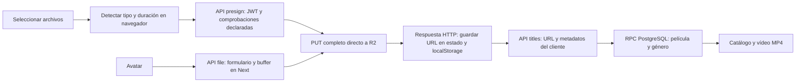
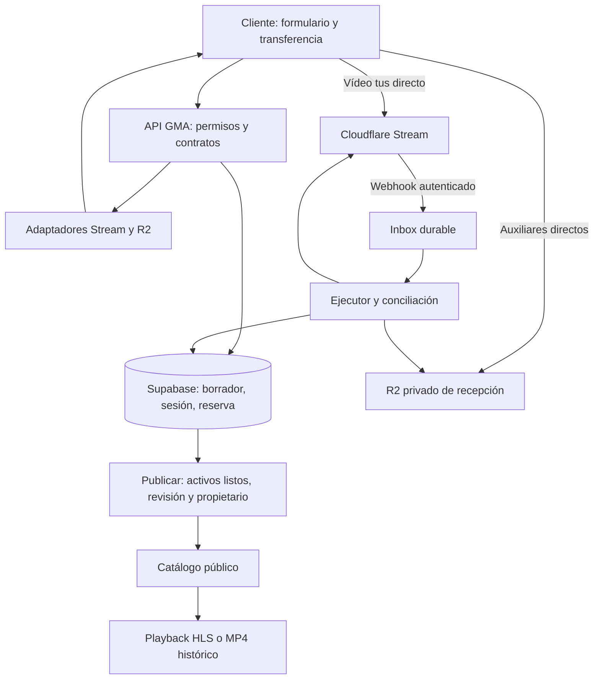

> Documento histórico de la implementación anterior. La arquitectura principal se ha redirigido a R2-first; consultar [ARQUITECTURA-R2-FIRST.md](ARQUITECTURA-R2-FIRST.md) y [PRUEBAS-R2-FIRST.md](PRUEBAS-R2-FIRST.md). Las decisiones que hacían obligatorio Stream están sustituidas.

# Investigación del motor de subidas de GMA Filmo

**Fecha:** 5 de octubre de 2026. **Base local:** `25b706e83cd3e20393b67ebe7c40bb331c08383e`, rama `mejora/temas-secundarios`. El diagnóstico anterior partía de `41494c6`; se han vuelto a inspeccionar los archivos actuales.

**Alcance:** investigación del código, contraste con documentación primaria y consulta de configuración de Vercel en lectura. Este informe no acredita una subida real ni modifica el motor, Supabase, R2 o el despliegue.

## 1. Resultado y decisión propuesta

El motor necesita reconstruir su control de sesiones, permisos, cuotas, archivos y publicación. Cambiar únicamente la librería que envía el vídeo dejaría los principales defectos activos.

**Recomendación condicionada:** núcleo propio GMA en Supabase/PostgreSQL; vídeo directo navegador → Cloudflare Stream mediante tus; auxiliares en un bucket R2 privado; publicación mediante identificadores de medios verificados. Conservar el reproductor y los MP4 históricos durante la transición.

La condición de producto es aceptar la salida documentada de Stream: H.264 adaptativo de 360p a 1080p. Su FAQ indica conversión de HDR a SDR, mezcla de más de dos canales a estéreo y ausencia de descarga del archivo fuente exacto. Si son esenciales 4K, HDR, sonido multicanal o conservación del máster, debe cambiarse esa parte de la decisión. [Producto Stream](https://developers.cloudflare.com/stream/), [FAQ](https://developers.cloudflare.com/stream/faq/).

**Estado del diagnóstico:** auditoría documental terminada; diagnóstico operativo y capacidad real pendientes. Los límites del código son políticas declaradas, no resultados de capacidad certificada. SUB-01 sigue abierto hasta reproducir el fallo y ejecutar el piloto.

### Referencia aportada

Se ha conservado [el documento adjunto](referencias/Prompt-implementacion-motor-subidas-GMA-Filmo.md) como referencia. Su texto pide implementar, pero la petición de este turno es investigar; sus órdenes no se han ejecutado. SHA-256 del original: `65cc986e2c4c12617b782f05e6382a21fa0dfe8590ae623779f08d783f9ece33`.

El documento menciona otros dos informes que no estaban adjuntos y no se localizaron con esos nombres en Descargas. No se les atribuyen conclusiones comprobadas.

## 2. Recorrido actual y garantías existentes

La subida principal ya evita transportar el vídeo por Vercel. La ruta de avatares sí recibe el archivo completo en el servidor. No se encontraron sesiones persistentes, reservas de cuota, multipart/tus, verificación final con el proveedor, eventos de procesamiento ni conciliación.

**Conservar estas garantías del código:**

- `lib/api/auth.ts:3`: Supabase valida el token con `auth.getUser`.
- `app/api/titles/[slug]/route.ts:15`: eliminación comprueba el propietario.
- `supabase/migrations/20260712_publish_creator_pelicula_rpc.sql:16`: inserción de película y colección dentro de una transacción; líneas 10–11 y 38–39 fijan `search_path` y restringen ejecución a `service_role`.
- `app/api/titles/route.ts:55`: género narrativo validado y colección resuelta en servidor.

Estas son garantías de la implementación disponible. Su despliegue efectivo y los privilegios SQL reales siguen pendientes de inspección administrativa.

## 3. Problemas correlacionados con el código

Prioridad **P1**: imprescindible para un flujo fiable. **P2**: recuperación, consistencia o integración que debe acompañar la reconstrucción. Son hallazgos estáticos; no se han ejercitado abusos contra producción.

| ID | Prioridad | Ubicación actual | Comportamiento y corrección necesaria |
| --- | --- | --- | --- |
| SUB-A01 | P1 | `app/api/upload/presign/route.ts:18,37`; `studio-upload-orbital.tsx:449,470,552,586` | Acepta `sessionUsed` del navegador y lo incrementa al acabar. Dos archivos de 4 GiB pueden solicitar firma con cero consumido y superar 6 GiB. Reservar en SQL antes de autorizar cada transferencia. |
| SUB-A02 | P1 | `presign/route.ts:48–54` | Solo suma tamaños declarados en las filas de películas del usuario, sin filtrar estado; ignora auxiliares, borradores locales y objetos sin fila. Descarta error SQL y trata ausencia de datos como cero. Ledger central, conciliación y rechazo ante error de cuota. |
| SUB-A03 | P1 | `app/api/upload/file/route.ts:16–43` | Permite todos los tipos de activo de `UPLOAD_CAPS`, sin cuota de usuario/sesión y con archivo completo en memoria. Migrar sus dos consumidores de avatar a transferencia directa y cerrar el bypass. |
| SUB-A04 | P1 | `app/api/titles/route.ts:31–50,86–100` | Publica URL, tamaño y duración del cliente sin confirmar recepción, propietario ni disponibilidad. Publicar IDs internos de activos autorizados y verificados. |
| SUB-A05 | P1 | `lib/api/auth.ts:3`; `app/(platform)/(protected)/mi-estudio/layout.tsx:12` | La pantalla exige perfil creador; las APIs solo JWT. Aplicar permiso de negocio en cada operación, con excepción explícita para avatar de onboarding. |
| SUB-A06 | P1 | `studio-upload-orbital.tsx:603–619`; `studio-upload-view.tsx:148,175–178` | Quitar archivo de la cola no elimina `mainFile`/`assetUrls` en el padre; puede seguir publicándose. Desvinculación durable y callbacks de eliminación coherentes. |
| SUB-A07 | P1 | `studio-upload-view.tsx:22,115–137` | Borrador global `gma_studio_upload_draft` compartido entre cuentas. Persistir borrador por propietario/revisión; caché local ligada al usuario. |
| SUB-A08 | P1 | `studio-upload-view.tsx:168–179`; `types/database.ts:149` | Tráiler, extras, intro y segundo póster no se envían al publicar; subtítulos sin relación por idioma. Relaciones de activos por rol, orden, idioma y versión. |
| SUB-A09 | P1 | `supabase/migrations/20260526_rls_hardening.sql:7`; `lib/supabase/queries.ts:241,262,427` | SELECT público de películas y consultas sin filtro de estado. No introducir borradores privados en esa tabla sin cambiar políticas y consultas. Preferir tablas privadas separadas. |
| SUB-A10 | P2 | `studio-upload-orbital.tsx:425–496`; `presign/route.ts:63,72` | PUT completo y firma de una hora; reintentar crea otra clave y repite bytes. Sesión estable, offset/partes del proveedor, pausa/reanudación y renovación. |
| SUB-A11 | P2 | `studio-upload-orbital.tsx:590–600,472–473` | Intercambiar filas cambia el tipo mostrado, pero la firma y callback conservan el original. Identidad de activo estable; bloquear o versionar cambios durante transferencia. |
| SUB-A12 | P2 | `studio-upload-orbital.tsx:509–552,634,919` | Varios principales posibles; último en terminar sustituye el principal aunque la UI muestra otro. Cardinalidad y sustitución explícitas. |
| SUB-A13 | P2 | `app/api/titles/[slug]/route.ts:28`; `studio-upload-view.tsx:139`; `studio-profile-view.tsx:131` | Borrar título/borrador/avatar no limpia R2. Se reduce cuota aparente al borrar SQL. Retirada, trabajo durable de eliminación y liberación confirmada. |
| SUB-A14 | P2 | `app/api/titles/route.ts:79`; RPC `:16` | Reintento de publicación puede duplicar título; sin clave idempotente ni revisión. Unicidad SQL, clave/hash de solicitud y resultado estable. |
| SUB-A15 | P2 | `presign/route.ts:18–24,62`; `file/route.ts:17` | Entrada sin esquema completo, enteros/valores finitos, límites de campos y gestión uniforme de errores. Validar contratos y limitar solicitudes por usuario globalmente. |
| SUB-A16 | P2 | `studio-edit-modal.tsx:102–108` | Muestra «Cambios guardados» sin escribir. Integrar edición durable con revisión; no contabilizarlo como edición funcional. |
| SUB-A17 | P1 | `app/api/subtitle-proxy/route.ts:22–36` | Allowlist depende de nombres de variables distintos al productor R2; sin ellos acepta cualquier URL y lee toda la respuesta, siguiendo redirecciones. Resolver activo interno, exigir origen permitido y acotar descarga/redirecciones. |
| SUB-A18 | P2 | `components/features/player/player-screen.tsx:437,447,728`; `app/api/sprites/[slug]/route.ts:3` | Reproductor MP4 sin adaptador HLS; miniaturas y sprites dependen de MP4/R2. Unión de fuentes y adaptador HLS conservando controles, seek, subtítulos y progreso. |
| SUB-A19 | P2 | `next.config.mjs:19–27` | `media-src` menciona Stream, pero `connect-src` no admite sus hosts de tus/HLS ni fetch de segmentos. Ajustar hosts reales del proveedor y verificar CSP/CORS en navegador. |
| SUB-A20 | P1 | `README.md:60–62,91–103`; `20260526_restore_peliculas.sql:7` | README aconseja ejecutar todas las migraciones y dice que son seguras; una contiene TRUNCATE con CASCADE. Obtener esquema efectivo y usar nuevas migraciones aditivas. No montar staging ejecutando ciegamente el historial. |

Los nombres abreviados `studio-*.tsx` están en `components/features/studio/`. No se ha supuesto que el esquema base completo exista en el repositorio: no aparece su creación integral.

## 4. Límites: producto, proveedor y capacidad

### Reglas escritas en GMA

Fuente: `lib/r2/client.ts:16–29`. La interfaz los llama GB/MB, pero las constantes son binarias.

| Activo / ámbito | Política actual |
| --- | --- |
| Principal | 4 GiB = 4.294.967.296 bytes |
| Tráiler y cada extra | 1 GiB |
| Intro | 500 MiB |
| Cada póster, horizontal o vertical | 10 MiB |
| Subtítulo / avatar | 5 MiB |
| «Sesión» | 6 GiB; hoy solo contador en navegador |
| Usuario gratuito | 10 GiB; hoy suma declarada en filas de películas del usuario, sin filtro de estado |
| Firma PUT | 3.600 segundos |

Hay que definir «sesión» como una entidad durable, por ejemplo un borrador y sus versiones de activos; actualmente recargar reinicia el contador. Con Stream, separar cuota comercial de bytes de entrada, bytes reales R2 y minutos de almacenamiento/entrega Stream.

### Restricciones oficiales relevantes

| Servicio | Restricción verificada y alcance |
| --- | --- |
| R2 | Tabla: PUT de una parte 5 GiB y objeto multipart 4,995 TiB; sus notas precisan 5 GiB menos 5 MiB por petición y 5 TiB menos 5 GiB por objeto. Hasta 10.000 partes. Los 4 GiB GMA caben por tamaño, pero eso no prueba recuperación ni rendimiento. [Límites R2](https://developers.cloudflare.com/r2/platform/limits/) |
| R2 multipart | Partes de al menos 5 MiB salvo la última; ETag multipart no es SHA-256 del archivo completo. Verificar partes paginadas y compatibilidad concreta de checksum/SDK. [Subidas](https://developers.cloudflare.com/r2/objects/upload-objects/), [API S3](https://developers.cloudflare.com/r2/api/s3/api/) |
| R2 limpieza | Multipart incompleto caduca por defecto a los siete días; comprobar regla efectiva del bucket. No sustituye cancelación/conciliación GMA. [Lifecycle](https://developers.cloudflare.com/r2/buckets/object-lifecycles/) |
| R2 navegador | Firma válida requiere además CORS: origen, método y cabeceras. Expiración puede presentarse como error CORS al no exponer cuerpo. [CORS](https://developers.cloudflare.com/r2/buckets/cors/) |
| R2 publicación | `r2.dev` está destinado a desarrollo y tiene limitación variable de peticiones/ancho de banda. El código usa ese origen por defecto. Usar dominio propio para entrega productiva o proveedor de vídeo. [Buckets públicos](https://developers.cloudflare.com/r2/buckets/public-buckets/) |
| Vercel Functions | Cuerpo de petición/respuesta máximo 4,5 MB. La ruta de avatar admite 5 MiB, más formulario, por encima de ese máximo. Con Fluid, Hobby: hasta 300 s y 2 GB de memoria. El vídeo directo no atraviesa este cuerpo. [Límites Vercel](https://vercel.com/docs/functions/limitations) |
| Stream | Más de 200 MB exige tus. Chunks entre 5 MiB y 200 MiB, múltiplos de 256 KiB; ajustar defaults del cliente. [Tus Stream](https://developers.cloudflare.com/stream/uploading-videos/resumable-uploads/) |
| Stream cuenta | Máximo predeterminado 30 GB por vídeo y 120 vídeos queued/encoding por cuenta. No equivale a transferencias simultáneas del navegador ni cambia los 4 GiB comerciales. [FAQ Stream](https://developers.cloudflare.com/stream/faq/) |
| Stream duración | Direct Upload acepta `maxDurationSeconds` entre 1 y 36.000 segundos; es máximo técnico, no límite comercial propuesto. GMA debe fijar una política más concreta. [API Direct Upload](https://developers.cloudflare.com/api/resources/stream/subresources/direct_upload/methods/create/) |
| Stream disponibilidad | `readyToStream` puede ser cierto con solo una calidad lista. Exigir también estado ready y porcentaje completo convertido a número e igual a 100. [Webhooks](https://developers.cloudflare.com/stream/manage-video-library/using-webhooks/) |
| Playback privado | Token del endpoint por defecto una hora; `exp` máximo 24 h. Para largometrajes/pausas, renovar conservando estado o emitir vigencia adecuada. Firmas locales con claves para escala. [Seguridad Stream](https://developers.cloudflare.com/stream/viewing-videos/securing-your-stream/) |

Una subida de 4 GiB a 5 Mbit/s tarda aproximadamente 1 h 55 min sin sobrecargas. La firma de una hora afecta especialmente a reintentos posteriores; no implica que el proveedor corte automáticamente un PUT que ya comenzó. Tus y multipart permiten recuperar progreso, según vigencia del recurso.

## 5. Configuración externa comprobada y pendiente

Consulta GET a Vercel, sin escribir ni mostrar valores de variables: equipo `bluv-s-projects`, plan **Hobby activo**, proyecto `gma-filmo`, Next.js, Node **24.x**, Fluid activado, región predeterminada `iad1`. Esto es configuración del proyecto/equipo, no una medición de capacidad ni una inspección del entorno de cada despliegue.

Se conserva un [inventario de nombres de variables, sin secretos](evidencias/vercel-config-sin-secretos.json).

| Configuración registrada en Vercel | Production | Preview |
| --- | --- | --- |
| `NEXT_PUBLIC_SUPABASE_URL`, `NEXT_PUBLIC_SUPABASE_ANON_KEY` | Sí | Sí |
| `SUPABASE_URL`, `SUPABASE_SERVICE_ROLE_KEY` | Sí | Sí |
| `CLOUDFLARE_ACCOUNT_ID`, `CLOUDFLARE_R2_BUCKET` | Sí | Sí |
| `R2_ACCESS_KEY_ID`, `R2_SECRET_ACCESS_KEY` | Sí | No |
| `NEXT_PUBLIC_APP_URL` | Sí | No |
| `NEXT_PUBLIC_R2_PUBLIC_URL` | No; el código tiene fallback | No |
| `R2_PUBLIC_DOMAIN`, `NEXT_PUBLIC_R2_DOMAIN` | No | No |
| Token Stream, secreto webhook y clave de playback | No se encontraron variables Stream | No se encontraron variables Stream |

Son nombres/presencia declarada; no prueban vigencia o permisos. Las variables listadas están clasificadas como sensibles. El `.env.local` actual solo contiene un token OIDC de Vercel. La copia antigua `production.env` en Temporal contiene valores redactados: no aporta credenciales utilizables para consultar R2/Supabase.

**Consecuencias:** preview no dispone de credenciales R2; no sirve como staging operativo de subidas. Comparte nombres de configuración Supabase con producción: debe comprobarse si apuntan al mismo proyecto y crear aislamiento antes de ejecutar pruebas con escrituras. El proxy de subtítulos tiene la condición de allowlist ausente en la configuración consultada; debe corregirse prioritariamente. No se probó explotación ni se consultaron destinos internos.

**Pendientes externos concretos:**

- [ ] Esquema SQL desplegado, migraciones aplicadas, restricciones, RLS y privilegios efectivos de RPC.
- [ ] Bucket real, CORS, permisos S3, lifecycle, inventario de objetos, multipart abierto y capacidad/coste de cuenta R2.
- [ ] Stream contratado, minutos disponibles, token de permiso mínimo, webhook y clave de reproducción.
- [ ] Entorno de prueba separado con datos y activos propios; comprobar que preview no escribe en producción.
- [ ] Registros del intento que falla y recorrido real autenticado: archivo pequeño → publicar → catálogo → reproducir.

### Ejecutor de trabajos

Vercel Hobby permite cron una vez al día con precisión por hora; no sostiene una conciliación cada pocos minutos. La propuesta necesita elegir un ejecutor: Supabase Cron/pg_cron + pg_net hacia una función autenticada, o un scheduler/worker externo, o un plan Vercel compatible. Supabase documenta esta posibilidad, pero no se comprobó que las extensiones estén habilitadas aquí. No activar cron durante esta investigación. [Cron Vercel](https://vercel.com/docs/cron-jobs/usage-and-pricing), [Programar funciones Supabase](https://supabase.com/docs/guides/functions/schedule-functions).

## 6. Alternativas y coste

Valoraciones de esfuerzo y encaje: inferencias de arquitectura, no benchmarks.

| Alternativa | Ventaja | Trabajo y límites | Cuándo elegirla |
| --- | --- | --- | --- |
| R2 multipart + MP4 validado | Conserva original y se aproxima al stack actual | GMA opera validación/limpieza; no añade calidades adaptativas ni corrige códecs incompatibles | Catálogo curado con MP4 normalizados y presupuesto mínimo |
| Stream + tus, R2 auxiliares | Ingesta reanudable y reproducción adaptativa gestionada | Núcleo GMA sigue siendo necesario; aceptar calidad/salida Stream | Recomendación inicial tras piloto de calidad y coste |
| R2 privado → importación Stream | Una subida doméstica y máster conservado | Dos ciclos de vida; URL temporal debe permanecer accesible para importación/reintentos | Máster exacto requerido; coste adicional aceptado. [Importación](https://developers.cloudflare.com/stream/uploading-videos/upload-via-link/) |
| R2 + pipeline FFmpeg | Control de variantes HLS y originales | Cola, cómputo, disco temporal, codecs, capacidad y operación a cargo de GMA | Requisitos especiales o ahorro total demostrado. [HLS FFmpeg](https://ffmpeg.org/ffmpeg-formats.html#hls) |
| Mux Direct Uploads | Alternativa gestionada con 4K configurable y niveles de calidad | Protocolo de subida y precios propios; comparar muestras reales. Su máster de salida no acredita el original bit a bit | 4K/calidad justifica comparar proveedores. [Mux 4K](https://www.mux.com/docs/guides/stream-videos-in-4k), [Subidas](https://www.mux.com/docs/guides/upload-files-directly), [Máster](https://www.mux.com/docs/guides/download-for-offline-editing) |

**Cálculo orientativo, USD sin impuestos ni otros servicios:** Stream cobra bloques de capacidad de 1.000 minutos a $5/mes y $1 por 1.000 minutos entregados. Cincuenta cortos de 20 minutos llenan un bloque: $5/mes; 1.000 vistas completas de 20 minutos equivalen aproximadamente a $20 de entrega. Buffers/precargas cuentan; las reservas de duración ocupan capacidad durante subidas pendientes. No asumir que todas las reservas caben. [Precio Stream](https://developers.cloudflare.com/stream/pricing/).

R2 Standard: $0,015/GB-mes; operaciones A $4,50/millón y B $0,36/millón; salida directa gratuita. Franquicia mensual de cuenta: 10 GB-mes, 1 millón A y 10 millones B. Cien GB-mes estables resultarían aproximadamente $1,35 de almacenamiento tras franquicia, antes de operaciones/otros servicios. Esa franquicia no pertenece a cada creador; los 10 GiB de GMA tampoco son 10 GB. [Precio R2](https://developers.cloudflare.com/r2/pricing/).

## 7. Arquitectura propuesta

### Entidades y responsabilidades

| Entidad propuesta | Datos y reglas esenciales |
| --- | --- |
| `upload_drafts` | Propietario, metadatos, revisión, estado. Privado hasta publicación. |
| `upload_sessions` | Borrador/rol, proveedor, referencia externa, longitud esperada, reserva, caducidad, clave/hash de solicitud, revisión/lease. URLs temporales no son identidad. |
| `media_assets` | ID interno, propietario, proveedor/ref única, estados, duración verificada, bytes con semántica explícita, validación, acceso y retención. |
| `draft_media` / `title_media` | Principal, tráiler, intro, extras ordenados, póster horizontal/vertical, subtítulos por idioma y versión; cardinalidades en SQL. |
| `quota_accounts` / `quota_ledger` | Uso y reservas comerciales; contabilidad R2/Stream separada. Movimientos únicos por operación/activo. |
| `webhook_inbox` / `upload_outbox` | Evento autenticado, deduplicación, trabajo, intentos, próximo intento, claim/lease, error y resolución. |

RLS por propietario, índices/uniqueness y RPC con privilegios acotados. La `service_role` elude RLS: cada operación que la usa debe comprobar permisos explícitamente. Los permisos de una página no sustituyen los de la API. [RLS Supabase](https://supabase.com/docs/guides/database/postgres/row-level-security).

Separar tres máquinas de estado: transferencia (`provisioning/uploading/paused/uploaded/cancelling/cancelled/expired/failed`), activo (`received/validating/processing/ready/rejected/deleting/deleted`) y título (`draft/published/unpublished`). Cambiar con estado/revisión esperados; impedir que un evento atrasado reactive un recurso cancelado.

### Reserva e idempotencia: secuencia precisa

1. Validar JWT, permiso creador, propietario del borrador, rol, enteros y revisión.
2. Transacción SQL: bloquear cuentas relevantes, buscar clave idempotente y comparar hash; rechazar misma clave con otra solicitud. Comprobar `usado + reservado + solicitado ≤ límite`, también sesión/duración/concurrencia/presupuesto global.
3. Persistir sesión, reserva y trabajo de provisión antes de contactar proveedor. No mantener transacción SQL abierta durante red.
4. Provisionar con correlación interna; guardar UID/clave y responder. Si se pierde respuesta externa, marcar resultado incierto y conciliar antes de crear otro recurso.
5. Verificar recepción y procesar. Consumir reserva una vez, con métricas de semántica conocida; ajustar minutos a duración final.
6. Cancelar/retirar mediante trabajo durable. Liberar cuando proveedor confirme eliminación, aborto o caducidad sin recurso facturable. Un timeout no equivale a borrado.

Ejemplo: con 6 GiB de sesión, la primera reserva de 4 GiB deja 2 GiB disponibles; la segunda solicitud concurrente de 4 GiB se rechaza aunque la primera no haya enviado bytes. Un reintento de la misma operación devuelve la misma sesión/reserva.

La exclusión entre pestañas mediante lease SQL no revoca URLs ya emitidas. Una cancelación y una transferencia tardía pueden competir: hay que confirmar invalidación/eliminación externa y reconciliar resultados. Las firmas PUT R2 son reutilizables hasta caducar; no asumir cancelación por cambiar estado SQL. [Firmas R2](https://developers.cloudflare.com/r2/api/s3/presigned-urls/).

**Conciliador:** seleccionar por antigüedad/estado la provisión incierta, recepción sin confirmar, procesamiento sin evento o estancado, reservas vencidas, cancelaciones/borrados pendientes, candidatos huérfanos y divergencias de cuota. Claim durable, reintentos limitados y escalado de fallos persistentes para revisión. Una reserva vencida necesita confirmar el resultado externo; un objeto sin relación aparente necesita comprobar todas sus referencias antes de borrarse.

### Recepción, identidad y calidad

- **Stream:** backend fija `Upload-Length` sin longitud diferida y política `maxDurationSeconds`; conserva UID de `stream-media-id`. Confirmar offset/longitud y estado externo. No inventar parámetro `maxSizeBytes` en Direct Upload. La API Video solo describe `size` como tamaño del medio, sin acreditar tamaño fuente exacto ni hash. Registrar `expected_input_bytes`, recepción tus y `provider_reported_size` por separado. El límite contra cliente manipulado exige piloto. [Direct Creator Upload](https://developers.cloudflare.com/stream/uploading-videos/direct-creator-uploads/), [API creación tus](https://developers.cloudflare.com/api/resources/stream/methods/create/), [API Video GET](https://developers.cloudflare.com/api/resources/stream/methods/get/).
- **Reselección:** SHA-256 incremental completo en Worker permite reconocer el mismo archivo del cliente honesto; el fingerprint de nombre/tamaño/fecha no basta. Ese hash local no demuestra un digest recibido por Stream. Recargar requiere reseleccionar normalmente; cerrar navegador detiene la transferencia. El protocolo tus distingue offset de identidad/autorización. [Protocolo tus](https://tus.io/protocols/resumable-upload/1-0-x).
- **Auxiliares:** HEAD/tamaño/propiedad más decodificación de imagen y límites de dimensiones; parseo real de subtítulos con idioma y límites. MIME/extensión son indicios, no validación de contenido. Guardar salida normalizada bajo clave definitiva sin permiso de escritura del cliente: una firma PUT aún válida podría sobrescribir la clave de recepción después de validarla. [Validación de archivos OWASP](https://cheatsheetseries.owasp.org/cheatsheets/File_Upload_Cheat_Sheet.html).
- **Entrega de auxiliares:** ingesta y originales permanecen privados. Pósteres/avatares normalizados publicados requieren una ruta de entrega autorizada/cacheable o copia pública controlada bajo otra clave. Subtítulos se resuelven según acceso al título. No reutilizar una URL privada caducada como URL permanente del catálogo ni cambiar a privado el bucket histórico sin migrar su entrega.
- **Procesamiento Stream:** estreno solo con `readyToStream === true`, `status.state === 'ready'` y `Number(status.pctComplete) === 100`. Verificar firma del webhook sobre cuerpo original/timestamp, persistir antes de procesar y deduplicar con datos disponibles; no inventar `event_id`. Hay una sola suscripción webhook por cuenta: preview/piloto no debe sobrescribir producción. [Webhooks](https://developers.cloudflare.com/stream/manage-video-library/using-webhooks/).

### Cliente y reproducción

Usar `@uppy/core` + `@uppy/tus` con la interfaz actual, o tus-js-client si simplifica la integración. Arranque propuesto: un vídeo simultáneo por cliente, chunk de 5–10 MiB medido en móvil, PATCH secuencial por archivo. No usar defaults de chunk infinito o 20 archivos concurrentes. No asumir extensiones checksum/termination/concatenation: comprobar capacidades reales. [Uppy tus](https://uppy.io/docs/tus/).

Golden Retriever no garantiza recuperar películas grandes después de crash/reinicio; no duplicar varios GiB en IndexedDB. Uppy 6 cambió su integración S3; `signRequest` firma también completado desde cliente. Si se añade archivo maestro R2, diseñar un adaptador que reserve el completado validado al backend. Compatibilidad declarada con React 18 no sustituye un spike/build del proyecto. [Golden Retriever](https://uppy.io/docs/golden-retriever/), [Uppy 6](https://uppy.io/blog/uppy-6.0/), [Uppy S3](https://uppy.io/docs/aws-s3/).

Reproductor: HLS nativo donde exista, adaptador mantenido como hls.js en el resto; conservar HTMLVideoElement, progreso, subtítulos, seek y pantalla completa. Separar fuente MP4 histórica de UID Stream, renovar tokens sin perder posición y obtener miniaturas mediante el proveedor adecuado. Evitar precargar películas completas innecesariamente. [Player propio Stream](https://developers.cloudflare.com/stream/viewing-videos/using-own-player/web/).

## 8. Contratos a implementar después

Todos los controles usan sesión/activo propietario y revisión; respuestas con código estable, mensaje recuperable y correlation ID, sin secretos ni URLs firmadas en logs.

| Operación propuesta | Contrato y garantía |
| --- | --- |
| Crear/editar borrador | ID privado, propietario, metadatos y revisión esperada; conflicto si cambió |
| `POST /api/uploads` | Borrador, rol, longitud esperada, identidad y clave idempotente; reserva y provisión durable |
| `GET /api/uploads/:id` | Estado autorizado y progreso externo conciliado |
| `POST /api/uploads/:id/resume` | Recuperación de sesión vigente; autorización temporal renovada cuando proceda |
| `POST /api/uploads/:id/cancel` | Intención durable; no prometer limpieza completada antes de confirmarla |
| `POST /api/uploads/:id/complete` | Verifica recepción; no publica automáticamente |
| `POST /api/webhooks/stream` | Firma/cuerpo original, inbox, deduplicación; procesamiento posterior |
| `POST /api/titles/:id/publish` | IDs listos, propietario, revisión, política de duración y publicación idempotente atómica |
| Editar/sustituir/retirar título | Versión nueva lista antes de cambiar referencia; retirada SQL y limpieza durable separadas |
| Playback del título | Resuelve acceso público/privado y fuente; tokens temporales si corresponde |
| Ejecutor de outbox/conciliación | Claim SQL, trabajo acotado, backoff con jitter, retry y recuperación de leases |

Clasificar corto/película mediante duración verificada: corto <40 minutos, película ≥40. Asociar todos los auxiliares aceptados. Preservar atomicidad de la RPC actual al ampliarla para revisión, referencias e idempotencia.

## 9. Plan verificable de implementación

Cada casilla se cerrará con commit y evidencia. El orden no implica ejecución en este turno.

- [x] **SUB-R01:** auditoría actual, fuentes primarias, contraste del documento y metadatos de Vercel — este informe.
- [ ] **SUB-R02:** reproducir fallo con archivo pequeño y cuenta de prueba; traza red/registro por fase, sin anotar tokens.
- [ ] **SUB-R03:** inventario efectivo SQL/RLS/R2, staging aislado y decisiones de calidad, originales, duración/cuotas y presupuesto.
- [ ] **SUB-R04:** contratos/modelo, migraciones aditivas, reservas, idempotencia y autorización; probar invariantes en PostgreSQL real.
- [ ] **SUB-R05:** Stream+tus y R2 auxiliares con bandera desactivada; migrar también ambos avatares y aislamiento de borradores.
- [ ] **SUB-R06:** autenticación de eventos, executor, incertidumbre, cancelación, limpieza y conciliación.
- [ ] **SUB-R07:** publicación/edición real por IDs y versiones, player HLS/MP4, miniaturas/subtítulos y CSP/CORS.
- [ ] **SUB-R08:** piloto de capacidad/recuperación/calidad/coste; activar gradualmente después de cumplir criterios.
- [ ] **SUB-R09:** cerrar rutas heredadas de bypass y migrar referencias idempotentemente; retirar lo antiguo tras validar compatibilidad.

Rollback: bandera detiene nuevas sesiones del motor; catálogo/MP4 existentes permanecen disponibles. Conservar jobs para sesiones ya iniciadas y no liberar reservas ni borrar activos indiscriminadamente al desactivar. Las migraciones aditivas no deben revertirse destruyendo datos.

## 10. Matriz de pruebas y medición de capacidad

Estas pruebas son **pendientes**, no resultados obtenidos. Las pruebas responsive actuales interceptan subidas con un 503 (`tests/responsive/responsive.spec.ts:28`); comprueban presentación, no el motor. No se ha ejecutado carga, SQL ni transferencias reales durante la investigación.

| Caso | Evidencia exigida |
| --- | --- |
| Caps exactos ±1 byte y tipos inválidos | Rechazo consistente antes de transferir; enteros finitos y cuota sin cambio |
| Subidas concurrentes/pestañas | Cero exceso de cuota; dos reservas de 4 GiB no caben en sesión 6 GiB |
| Mismo idempotency key / payload distinto | Resultado único estable / conflicto; cero doble reserva o título |
| Cortar red durante subida de >200 MB | Recuperación desde offset; sin repetir archivo entero ni perder asociaciones |
| Recargar y reseleccionar mismo/otro archivo | Recupera el mismo; otro contenido de igual nombre/tamaño no mezcla bytes |
| Sesión de auth y URL caducadas | Renovación autorizada o explicación/recurso nuevo; sin sesión ajena |
| Longitud tus manipulada y exceso de bytes | Stream mantiene longitud fijada; verificar 4 GiB sin atribuirlo a un parámetro inexistente |
| Respuesta de provisión perdida | Estado incierto conciliado; un recurso/reserva, no duplicados |
| Cancelar/complete/delete en carrera | Recurso final ausente o vinculado correctamente; cuota liberada una sola vez |
| PUT auxiliar reutilizado tras validar | No puede modificar el activo definitivo listo/publicado |
| Webhook falso/duplicado/atrasado | Falso rechazado; duplicados sin efectos dobles; atrasado no resucita recurso |
| Ready con pctComplete parcial | No publica hasta 100 y verificación actual |
| SQL falla / proveedor diverge | No cuota cero ficticia; trabajos persistentes recuperan consistencia |
| Usuario diferente / lector sin perfil creador | No publica, modifica ni consulta activos privados ajenos; avatar onboarding permitido según contrato |
| Vídeo corrupto, imagen enorme, subtítulo inválido | Rechazo/normalización, memoria acotada, limpieza y mensaje recuperable |
| Tráiler/intro/extras/dos pósteres/subtítulos idiomas | Todas las relaciones sobreviven recarga/publicación y se consumen donde corresponda |
| Sustitución de título publicado | Versión anterior sigue hasta que nueva esté lista; conmutación atómica |
| Largometraje >1 h / pausa y red móvil cambiante | HLS/token se renuevan; seek, posición y subtítulos conservados |
| Safari/Chrome/Firefox y dispositivos reales | Reproducción, controles, portrait/landscape, fullscreen y subtítulos |
| Catálogo histórico y migración repetida | MP4/YouTube/creadores siguen; ningún borrador expuesto o dato truncado |

### Protocolo de capacidad propuesto

1. Entorno aislado, una cuenta de creador de prueba y activos sintéticos válidos o autorizados. Registrar duración/bytes/hash, navegadores, plan, región y configuración del transporte.
2. Escalar 50 MiB → 250 MiB → 1 GiB → 4 GiB. Los archivos deben ser decodificables para Stream; un bloque aleatorio no prueba vídeo. Rechazos de cap+1 pueden ejercitarse con metadata sin enviar el exceso.
3. Empezar con una transferencia; ampliar de forma controlada a varios usuarios y al límite global acordado. Separar transferencias activas de cola de codificación y sesiones reservadas.
4. Redes estables y cortes/latencia/red lenta; medir throughput, bytes repetidos, latencia API, tiempo de procesamiento, memoria cliente, reservas, huérfanos y reproducción inicial/rebuffering.
5. Criterios propuestos: 100 solicitudes concurrentes de reserva sin exceso; cero duplicados y acceso ajeno; recuperación comprobada tras cada fallo; ninguna publicación sin activo listo. Para piloto: estado recuperable ≤5 s y limpieza confirmada ≤15 min con ejecutor operativo. Son objetivos propuestos, no SLA del proveedor.
6. Capacidad aprobada solo para el tamaño/concurrencia/dispositivos medidos. Presupuesto finito de minutos almacenados/entregados, GB R2 y peticiones antes del piloto; limpieza confirmada al terminar. No extrapolar a usuarios ilimitados ni usar la franquicia como capacidad por creador.
7. Pruebas unitarias de transiciones con proveedores simulados + concurrencia/constraints/RLS sobre PostgreSQL real + piloto externo separado. Un mock no prueba CORS, cuotas contratadas o comportamiento real de tus.

Muestras de calidad: movimiento, grano, sombras, aspect ratios distintos, audio y subtítulos; comparar fuente con resultado en móvil/escritorio. No se ha comprobado esa calidad todavía.

## 11. Decisiones pendientes del propietario

| Decisión | Propuesta inicial para discutir antes de activar |
| --- | --- |
| Calidad pública | 1080p/SDR/estéreo solo si satisface la promesa de la plataforma; comparar Mux si 4K esencial |
| Original exacto | Opcional; si obligatorio, R2 privado multipart → importación, con retención y cuota propias |
| Duración máxima | Política finita por tipo; no convertir 10 h técnicas en autorización general |
| Cuotas | Mantener 4/6/10 GiB como límites comerciales iniciales, aclarar sesión durable y añadir presupuesto de minutos Stream |
| Concurrencia | Un vídeo simultáneo por cliente al inicio; techo global limitado por presupuesto/reservas, luego medir |
| Caducidad/retención | Definir borradores, recursos rechazados, másteres y reemplazos; jobs y reglas externas coordinadas |
| Publicación/acceso | Catálogo invitado sigue público; borradores/activos pendientes privados; firma de reproducción según política |
| Coste/ejecutor | Presupuesto de piloto y servicio que ejecute jobs cada pocos minutos; Hobby cron diario no cumple ese objetivo |

## 12. Qué corregir en el prompt antes de ejecutarlo

El documento aportado es una buena base de alcance, pero necesita estos añadidos concretos:

1. Base actual `25b706e`, fallo de edición que no guarda, eliminación/reordenación de cola y avatares de onboarding.
2. Decisión explícita 1080p/SDR/estéreo, máster y presupuesto de entrega.
3. Definición durable de «sesión» y semántica separada de bytes fuente/tus/proveedor/minutos.
4. SHA local como identidad de reselección; no afirmar digest de original comprobado por Stream.
5. `pctComplete` numérico 100, webhook único por cuenta y separación de entornos.
6. Defaults tus/Uppy acotados y compatibilidad real de Uppy 6/S3; backend controla completado cuando se active multipart.
7. Protección de la clave R2 definitiva frente a reutilizar firma PUT de recepción.
8. Ejecutor adecuado al Hobby real; entorno aislado y esquema SQL inventariado antes de migraciones.
9. Configuración obligatoria del proxy de subtítulos y hosts reales en CSP/CORS.
10. Gates de piloto, calidad y capacidad con evidencia; no marcar el motor correcto por pasar build o pruebas de interfaz.

**Próximo paso concreto:** SUB-R02 y SUB-R03, seguido del núcleo SQL/contratos. La investigación no identifica por sí sola cuál fue la causa exacta del intento fallido del usuario; hace falta su traza real y una reproducción controlada.
